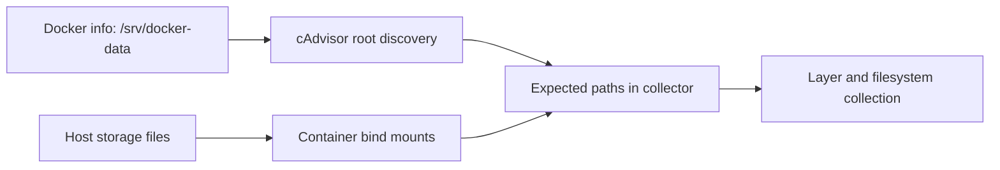

# Keep cAdvisor Filesystem Metrics with a Custom Docker Data Root

Author: [nawazdhandala](https://www.github.com/nawazdhandala)

Tags: Docker, Linux, Prometheus, Monitoring, Troubleshooting

Description: Preserve Docker's actual storage paths inside cAdvisor, distinguish API discovery from filesystem access, and verify metrics after a data-root change.

Docker stores its state under `/srv/docker-data`, but cAdvisor still mounts `/var/lib/docker`. Container names and CPU metrics appear, while filesystem usage is missing or errors mention unreadable layer metadata. This is a plausible split: Docker's API can describe a container even when cAdvisor cannot read the corresponding host storage paths.

The repair is to align the exporter with the daemon's real path and storage implementation. Do not move Docker data or create replacement directories merely to satisfy the monitor.

This guide uses cAdvisor 0.55.1 source and a classic Docker storage-driver layout for its concrete path example. A containerd-backed image store needs separate inspection, as explained below.

## Ask the running daemon for its root

Use the Docker context for the host being monitored:

```bash
docker context show
docker info --format 'Root={{.DockerRootDir}} Driver={{.Driver}}'
```

The [Docker info command](https://docs.docker.com/reference/cli/docker/system/info/) reports the effective root and storage driver. A configuration file might be stale, overridden, or belong to another daemon, so use the running engine's answer as your starting point.

Docker's [daemon configuration documentation](https://docs.docker.com/engine/daemon/#daemon-data-directory) describes `data-root`. This article assumes that directory is already configured correctly for Docker. Changing it is a storage migration task with its own backup and downtime requirements; it is not a monitoring workaround.

Next, choose one running application container and inspect its storage information:

```bash
docker container inspect app-container --format '{{json .GraphDriver}}'
```

Replace `app-container` with a known workload. The output can include driver-specific paths, such as writable-layer locations. Compare those paths with the reported root, but do not assume every driver returns the same fields. See [Docker inspect](https://docs.docker.com/reference/cli/docker/container/inspect/) for formatted output.

## Know what cAdvisor learns automatically

In cAdvisor 0.55.1, the [Docker factory](https://github.com/google/cadvisor/blob/v0.55.1/container/docker/factory.go) obtains the root from Docker status. `--docker_root` is marked deprecated and used as a fallback if that lookup does not produce a root. The lookup is cached with `sync.Once`.

Consequently, adding `--docker_root=/srv/docker-data` is not the primary repair when Docker already reports that directory. Fix the filesystem view and API access first. After a real daemon-root change, recreate or restart the collector through its normal lifecycle so cached runtime information is refreshed.

This does not mean every cAdvisor path is obtained dynamically. The [Docker handler](https://github.com/google/cadvisor/blob/v0.55.1/container/docker/handler.go) combines the discovered root with driver-specific metadata paths. When operating outside the host namespace, it prefixes the storage root with `/rootfs`. Those details explain why a mount with the right files at the wrong destination can still fail.



## Preserve the absolute path in the container

For an existing containerized cAdvisor deployment, the relevant Compose fragment is:

```yaml
services:
  cadvisor:
    image: ghcr.io/google/cadvisor:0.55.1@sha256:e02855207ec07bb45ee41f720645945251f093f24c28f8c29cf718490f784922
    volumes:
      - type: bind
        source: /
        target: /rootfs
        read_only: true
      - type: bind
        source: /srv/docker-data
        target: /srv/docker-data
        read_only: true
        bind:
          create_host_path: false
```

Replace both `/srv/docker-data` values with the actual root. Merge these mounts into your working deployment; retain the required runtime socket, cgroup/system mounts, reviewed permissions, and network settings. This is not a complete installation manifest.

The `/rootfs` view makes the example root available as `/rootfs/srv/docker-data`, while the explicit mount preserves `/srv/docker-data` directly. Do not rename the custom host root to `/var/lib/docker` inside the collector while expecting all paths returned by Docker to change with it.

The [Compose bind-mount options](https://docs.docker.com/reference/compose-file/services/#volumes) describe `create_host_path: false`. This prevents the custom source mount from silently creating an empty directory when the host path is wrong. Check your installed Compose version supports the field.

Validate the resolved project before applying it:

```bash
docker compose config
```

Review every source and destination, including mounts that overlap or mask other paths. The [config command](https://docs.docker.com/reference/cli/docker/compose/config/) validates and renders configuration; it cannot establish that cAdvisor's storage scans will succeed.

## Investigate nested mounts and separate stores

A data directory can be a separate filesystem mounted beneath the host root. Inspect the real mount layout and any later mount changes rather than assuming the container sees everything the host sees. Docker documents bind mounts and propagation in its [bind-mount guide](https://docs.docker.com/engine/storage/bind-mounts/).

The containerd image store adds another boundary. Docker's documentation explains that its image and snapshot data can reside separately from Docker's `data-root`; changing that setting does not move all containerd storage. Consult the [containerd image-store documentation](https://docs.docker.com/engine/storage/containerd/) and inspect your engine's actual configuration.

For such a host, neither adding the classic Docker-root mount nor copying an overlay2 path recipe establishes support for snapshot accounting. Check the pinned cAdvisor version's containerd integration, required socket/path visibility, and emitted metrics. Keep unsupported coverage explicit rather than presenting a successful CPU scrape as proof of storage support.

## Verify the specific filesystem measurements

After updating the collector, inspect recent logs and one application's raw samples. Distinguish these outcomes:

| Evidence | Interpretation to investigate |
|---|---|
| Runtime inspection fails | Socket, context, permissions, or daemon compatibility |
| Layer metadata cannot be read | Incorrect path, missing mount, access restriction, or layout mismatch |
| Filesystem device cannot be determined | Mount/device resolution and storage-driver handling |
| CPU works but filesystem family is absent | Metric selection or unsupported storage collection path |

In the [cAdvisor filesystem collector](https://github.com/google/cadvisor/blob/v0.55.1/container/docker/fs.go), usage collection follows storage-driver-specific branches and matches the backing device to filesystem information. A correct directory mount does not create a missing driver implementation.

Check that the desired disk metric group is enabled and allow time for filesystem scanning. Usage and capacity have different meanings: reported capacity can belong to the backing filesystem, while writable-layer usage is container-specific. Bind-mounted application data is another accounting boundary and should be monitored through an appropriate source.

For acceptance, compare the same known container before and after the mount correction. Record its identity, resolved paths, driver, logs, and the precise filesystem families present. Test after a collector restart as well, so success is not dependent on stale discovery state.

The examples were schema-checked and their path assumptions reviewed against versioned source. No Docker data migration, live collector deployment, or filesystem scan was performed. Keep the previous monitoring configuration available and make storage changes only through the daemon's supported operational procedure.
