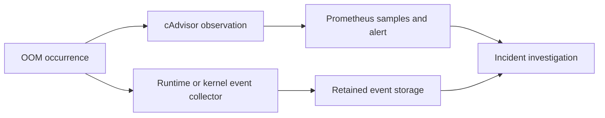

# Alert on cAdvisor OOM Events Across Restarts Without Hiding Gaps

Author: [nawazdhandala](https://www.github.com/nawazdhandala)

Tags: Docker, Prometheus, Monitoring, Alerting

Description: Build reset-aware cAdvisor OOM alerts, test short-lived containers and missing samples, and retain runtime events when a metrics scrape cannot preserve the evidence.

A container runs out of memory, disappears, and is replaced before the next scrape. The service recovers, yet the OOM alert never fires. Increasing a query's time window cannot recover the missing observation: Prometheus never received the counter change.

Out-of-memory monitoring needs two complementary paths. Metrics can alert on observed changes and show resource trends. A retained event stream preserves evidence that may outlive the failed container. This guide provides a concrete cAdvisor alert and explains where that alert must be supplemented.

The examples reference cAdvisor 0.55.1 and Prometheus 3.7.3. The alert is evaluated with synthetic fixtures; no memory-exhaustion experiment was run on a live host.

## Understand what the counter represents

`container_oom_events_total` counts OOM events observed for a container. OOM means out of memory. Do not silently relabel it as an authoritative count of every process killed by the kernel. In the examined manager code, the OOM event's container and the killed process's victim container are represented separately; the counter update uses the event container lookup. [cAdvisor manager implementation](https://github.com/google/cadvisor/blob/v0.55.1/manager/manager.go).

The Prometheus exporter exposes this counter when the OOM metric group is included. Successful CPU or memory scraping does not establish that OOM detection is working. The manager logs a warning if it cannot configure an OOM source, and that condition needs investigation even if the scrape endpoint remains healthy. [Exporter implementation](https://github.com/google/cadvisor/blob/v0.55.1/metrics/prometheus.go).

Check the exact deployed version, enabled groups, startup logs, and host access required by its collector. Validate coverage on the kernel and runtime you operate instead of assuming every standalone and kubelet deployment has equivalent permissions or behavior.

## Preserve container identity through the calculation

Start with one scrape job and preserve its host and container labels:

```promql
increase(container_oom_events_total{job="cadvisor"}[10m]) > 0
```

`increase` handles observed counter resets and extrapolates over the requested window. The result can be fractional, so use a positive-change condition rather than expecting an exact integer count. It requires sufficient samples of the same series to calculate an increase. [Prometheus increase behavior](https://prometheus.io/docs/prometheus/latest/querying/functions/#increase).

A replacement container with a new `id` is a different series, not merely a counter reset. Keep that identity while calculating changes. If you later group by application, aggregate the per-series increases rather than adding counters before applying reset handling.

Use one canonical exporter for each accounting boundary. A parent cgroup event and a child victim record are not automatically independent incidents, and scraping the same source twice can duplicate notifications. Correlate the evidence before producing a fleet-wide event count.

## Use an alert that does not wait away the evidence

Save this as `cadvisor-oom.rules.yml`, then reference it from the existing Prometheus `rule_files` configuration:

```yaml
groups:
  - name: cadvisor-oom
    interval: 30s
    rules:
      - alert: ContainerOOMEventObserved
        expr: increase(container_oom_events_total{job="cadvisor"}[10m]) > 0
        keep_firing_for: 5m
        labels:
          severity: warning
        annotations:
          summary: "cAdvisor observed an OOM event"
          description: "Inspect the event and victim details for this container identity."
```

There is deliberately no long `for` duration. Such a delay requires the expression to remain active before firing and can be inappropriate for a brief event signal. `keep_firing_for` keeps an already firing alert active for the specified time after its condition stops being met. It cannot create an alert for an unseen event. [Prometheus alert rule semantics](https://prometheus.io/docs/prometheus/latest/configuration/alerting_rules/).

With Prometheus 3.7.3's matching tool available, check the file:

```bash
promtool check rules cadvisor-oom.rules.yml
```

A successful check confirms rule syntax, not notification delivery. Test the receiver route separately. Alertmanager grouping and initial notification delays influence whether a short alert reaches someone; review `group_wait`, grouping labels, and resolved-message behavior for the chosen receiver. [Alertmanager routing configuration](https://prometheus.io/docs/alerting/latest/configuration/).

## Know which restart cases the query can detect

Consider these distinct timelines:

| Scraped observations | Expected interpretation |
| --- | --- |
| Same ID: 0, 0, 1, 1 | Positive increase can trigger the alert |
| Same ID: 4, 0, 1 | Reset followed by an observed increase can trigger it |
| New ID first observed at 1, then stays at 1 | No observed rise from a baseline; increase can remain zero |
| Container disappears before any event sample | Metrics cannot recover the missing event |
| Old series has a captured rise, then disappears | Historical samples can remain useful within the query window |

A larger window extends the period in which captured samples can contribute. It does not make collection lossless. A shorter scrape interval can reduce some gaps but adds overhead and still cannot guarantee observing an extremely short-lived container.

Avoid turning missing series into zero with a blanket fallback. Zero means an observed value; absence can mean failed discovery, disabled collection, an inaccessible source, or a removed container. Maintain scrape-health and collection-coverage checks alongside the event alert.

## Retain runtime evidence outside the container

For Docker, a bounded read-only query can retrieve recent OOM events from the correct daemon:

```bash
docker events --since 10m --until 0s \
  --filter type=container --filter event=oom \
  --format '{{json .}}'
```

This requests the recent interval ending now and emits JSON records rather than waiting indefinitely for future events. Docker documents a limited event history, including a maximum of 256 returned historical events. The command is an investigation aid, not a durable audit archive. [Docker events options and retention](https://docs.docker.com/reference/cli/docker/system/events/).

For continuous retention, forward runtime or kernel events to storage independent of the application container. Record the source host, original timestamp, container ID, workload identity when available, and event type. Define replay and deduplication behavior so reconnecting a collector neither silently drops records nor creates duplicate incidents.



In Kubernetes, kube-state-metrics also exposes last-termination information and restart counters. Those describe API state, not an immutable event ledger: later terminations and deleted Pods can replace or remove the evidence. Check the installed version's metric status and labels before building a separate correlation rule. [Pod metric reference](https://github.com/kubernetes/kube-state-metrics/blob/main/docs/metrics/workload/pod-metrics.md).

## Test gaps as deliberately as successful alerts

Use fixtures for a normal increment, reset, constant counter, single sample, and a newly observed nonzero counter. Verify that the first two cases alert and that the others do not magically produce evidence. Also test how long an already firing alert persists after its condition disappears.

In an approved disposable staging environment, test collection and delivery with a small isolated memory-constrained workload. Confirm the event reaches retained storage and the notification arrives with enough identity to find that record. Include collector restart and container replacement scenarios without stressing production nodes.

A reliable design is explicit about both what was observed and what could have been missed. Keep cAdvisor's reset-aware alert for fast detection, and use independently retained events when evidence must survive the failed container.
