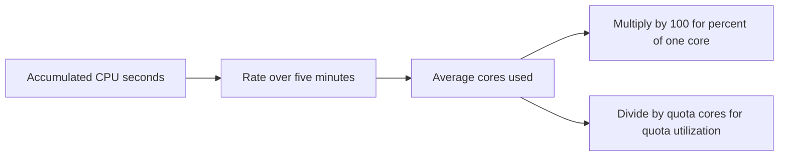

# Calculate Container CPU Cores, Percent, and Throttling with cAdvisor

Author: [nawazdhandala](https://www.github.com/nawazdhandala)

Tags: Docker, Prometheus, Monitoring

Description: Turn cAdvisor CPU counters into useful core usage, quota utilization, and throttling measurements with explicit denominators and tested PromQL examples.

A dashboard showing container CPU at 150% is not necessarily broken. It may mean the container used an average of one and a half CPU cores. Another dashboard might show the same workload at 75% because it divides usage by a two-core quota. Both numbers can be correct, but their labels must explain what they mean.

Start with CPU time, choose a denominator deliberately, and keep throttling separate from utilization. This guide uses the metric implementation in cAdvisor 0.55.1 and checks the example expressions with Prometheus 3.7.3. The checks use synthetic series, not a running container benchmark.

## Establish which container you are measuring

The examples assume a standalone cAdvisor scrape job named `cadvisor`, one target per host, and a known container cgroup ID. A cgroup is the Linux resource-accounting group to which the runtime assigns the container. Replace `node-a:8080` and `/docker/EXAMPLE` with the exact `instance` and `id` labels from your metrics.

Do not paste a Docker-style ID into a Kubernetes query without inspecting the actual labels. Also avoid summing the root cgroup, parent groups, and their child containers together: they can describe overlapping CPU consumption. Select one canonical scrape source if both kubelet and standalone cAdvisor are present.

Before calculating anything, inspect the raw usage series and confirm whether its `cpu` label contains `total` or individual CPU names. In the pinned exporter, usage can be emitted as a total or as per-CPU samples depending on available statistics. [cAdvisor 0.55.1 CPU metric implementation](https://github.com/google/cadvisor/blob/v0.55.1/metrics/prometheus.go).

## Convert accumulated CPU time into cores

`container_cpu_usage_seconds_total` is a counter: it accumulates CPU seconds. Its raw value tells you little about current demand. Calculate its per-second rate over a window:

```promql
sum by (job, instance, id) (
  rate(container_cpu_usage_seconds_total{
    job="cadvisor", instance="node-a:8080", id="/docker/EXAMPLE"
  }[5m])
)
```

The result is average CPU seconds consumed per wall-clock second, conventionally displayed as cores. A value of `0.25` means a quarter of one core on average; `1.5` means one and a half cores. It does not mean the application was permanently assigned those physical cores.

The sum combines per-CPU samples when present and also works with one total sample. It assumes the source does not expose both representations for the same measurement. Keep enough identity labels to distinguish containers and hosts; include a cluster label if your query spans clusters with reused target names.

Use `rate` before aggregation so Prometheus can account for each counter's resets independently. A five-minute window smooths short bursts and needs enough successful scrapes to produce a useful estimate. It cannot recover work that was never observed between scrapes. [Prometheus rate semantics](https://prometheus.io/docs/prometheus/latest/querying/functions/#rate).



## Name the percentage before choosing the formula

For percent of one core, multiply the first expression by 100. The earlier `1.5` result becomes 150%. Do not cap this panel at 100 or describe it as percent of the whole host.

Percent of host capacity needs a separate, trustworthy host CPU-count denominator. Percent of a CPU quota instead needs the container's quota divided by its scheduling period. CPU shares or weights express relative scheduling priority; they are not a core-count limit.

For cgroup v2, `cpu.max` expresses a runtime budget and period, or `max` for no such limit. Quotas interact with the cgroup hierarchy, so a leaf container's configured quota need not describe every restriction imposed by its ancestors. [Linux CPU controller documentation](https://docs.kernel.org/admin-guide/cgroup-v2.html#cpu).

For this single-container example, calculate configured quota cores as follows:

```promql
(container_spec_cpu_quota{
  job="cadvisor", instance="node-a:8080", id="/docker/EXAMPLE"
} > 0)
/
(container_spec_cpu_period{
  job="cadvisor", instance="node-a:8080", id="/docker/EXAMPLE"
} > 0)
```

A quota of 200000 and period of 100000 yields two cores. The comparison filters invalid or unlimited representations; it deliberately does not use `bool`, which would replace the values with zero or one. Missing quota data should remain missing, not become an invented unlimited or zero-capacity value. [Prometheus comparison operators](https://prometheus.io/docs/prometheus/latest/querying/operators/#comparison-binary-operators).

To calculate percent of that quota, join the usage result to this denominator:

```promql
100 * sum by (job, instance, id) (
  rate(container_cpu_usage_seconds_total{
    job="cadvisor", instance="node-a:8080", id="/docker/EXAMPLE"
  }[5m])
)
/ on (job, instance, id)
(
  (container_spec_cpu_quota{
    job="cadvisor", instance="node-a:8080", id="/docker/EXAMPLE"
  } > 0)
  /
  (container_spec_cpu_period{
    job="cadvisor", instance="node-a:8080", id="/docker/EXAMPLE"
  } > 0)
)
```

There must be one denominator per matching container identity. If Prometheus reports multiple matches, investigate duplicate scrape sources or incomplete identity labels rather than masking the problem with an arbitrary aggregation. At 1.5 cores and a two-core quota, the expected answer is 75%. Label the panel “CPU usage as percent of configured quota.”

## Measure throttling as its own signal

Throttling means the scheduler withheld CPU execution because a bandwidth budget was exhausted. The share of enforcement periods with throttling is:

```promql
100 * rate(container_cpu_cfs_throttled_periods_total{
  job="cadvisor", instance="node-a:8080", id="/docker/EXAMPLE"
}[5m])
/
(rate(container_cpu_cfs_periods_total{
  job="cadvisor", instance="node-a:8080", id="/docker/EXAMPLE"
}[5m]) > 0)
```

If 20 out of 100 observed periods were throttled, this reports 20%. It does not mean 20% of CPU capacity was consumed or 20% of requests were delayed. The denominator filter avoids division by a zero period rate.

`container_cpu_cfs_throttled_seconds_total` measures throttled duration instead. Its rate is a different quantity from the fraction of periods, and should not be presented as a universal percentage of application downtime. Inspect it alongside request latency and queue depth. The pinned exporter gates these CFS metrics on quota information; absent metrics are not proof of zero throttling. [Exported CPU metric definitions](https://github.com/google/cadvisor/blob/v0.55.1/docs/storage/prometheus.md).

## Validate the dashboard before using it for alerts

Use a small set of known inputs to establish the panel's units:

| Input | Expected interpretation |
| --- | --- |
| 90 CPU seconds per minute | 1.5 average cores |
| Same usage, two-core quota | 75% of configured quota |
| Same usage, percent of one core | 150% |
| 20 throttled periods out of 100 | 20% of enforcement periods throttled |
| Missing or nonpositive quota | No quota-utilization result |

Prometheus supports expression fixtures through `promtool test rules`, including expected result labels and values. Test counters with a reset, per-CPU inputs, missing quotas, and zero enforcement-period rates. [Official rule-testing format](https://prometheus.io/docs/prometheus/latest/configuration/unit_testing_rules/).

In staging, compare these panels during a controlled workload and after it becomes idle. If usage looks doubled, check duplicate targets and overlapping cgroups first. If a ratio disappears, inspect the raw denominator and label match. If average utilization looks modest while throttling rises, investigate short bursts and parent limits before changing resource allocations.

Choose alerts only after relating these measurements to service performance. A readable dashboard keeps cores, quota utilization, and throttled periods in separate panels, with the window and denominator visible in their descriptions.
