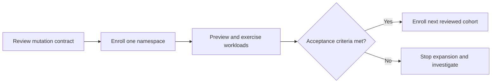

# Canary a Mutating Webhook with Opt-In Namespaces

Author: [nawazdhandala](https://www.github.com/nawazdhandala)

Tags: Kubernetes, Testing, Reliability

Description: Roll out a webhook through explicit namespace enrollment, compare expected mutations with actual results, and define promotion and exit criteria before expanding.

A canary is useful only if it can reveal the failures that would matter during a wider rollout. Successfully creating one test object proves very little if production uses different controllers, update paths, or workload configurations.

For a new mutating webhook, namespace enrollment gives you a manageable rollout unit. You can expose one application team, observe its real workflow, and keep the rest of the cluster outside the new behavior until the evidence supports expansion.

This guide uses **Kubernetes v1.35.0** and assumes an already deployed, reachable webhook with valid TLS and reviewed mutation logic. It focuses on deciding when to expand scope. The examples do not install the server or replace an existing enforcement policy.

## Define the expected change before enrolling anything

Write down the mutation contract in terms of observable fields. For example, an opt-in diagnostic injector might add a named volume and a named environment variable to newly created Pods. List which existing user values it preserves, which conflicts it rejects, and which container types it intentionally ignores.

Also define the negative contract. A namespace outside enrollment should receive no call from this entry. A protected infrastructure namespace should remain excluded even if accidentally labelled. Unrelated fields in admitted objects should not change because of this webhook.

Choose a canary namespace with a representative workload owner and a known recovery procedure. Use a second, non-enrolled namespace as a control. The difference between them should be the enrollment decision, not a completely different application or API path.

## Make enrollment explicit and protect recovery namespaces

This fragment belongs inside one entry in an existing `MutatingWebhookConfiguration`. It targets new Pods only:

```yaml
rules:
  - operations: ["CREATE"]
    apiGroups: [""]
    apiVersions: ["v1"]
    resources: ["pods"]
    scope: Namespaced
namespaceSelector:
  matchLabels:
    platform.example.com/injector: enabled
  matchExpressions:
    - key: kubernetes.io/metadata.name
      operator: NotIn
      values:
        - kube-system
        - kube-public
        - kube-node-lease
        - platform-system
```

Replace the enrollment key's domain with your organization's domain. Replace `platform-system` with the webhook's own namespace and review other infrastructure exclusions required by your cluster. Preserve the existing entry's service, CA bundle, timeout, failure policy, and truthful side-effect declaration.

The selector evaluates Namespace labels for these namespaced Pod requests. A label on the Pod itself does not enroll its namespace. The [namespace selector documentation](https://kubernetes.io/docs/reference/access-authn-authz/extensible-admission-controllers/#matching-requests-namespaceselector) describes the matching boundary.

Kubernetes automatically adds the immutable `kubernetes.io/metadata.name` label to namespaces, making it useful for explicit name exclusions. See [automatic namespace labelling](https://kubernetes.io/docs/concepts/overview/working-with-objects/namespaces/#automatic-labelling). The list above is illustrative, not a universal inventory of system namespaces.

For an existing webhook rollout, avoid unintentionally narrowing established coverage. If you run old and candidate entries simultaneously, design disjoint selectors and check that a request cannot receive both mutations unexpectedly. A canary should not quietly replace a policy that production already depends on.

## Enroll through the namespace owner

Inspect the intended namespace before changing it with [kubectl get](https://kubernetes.io/docs/reference/kubectl/generated/kubectl_get/):

```bash
kubectl get namespace team-canary --show-labels
```

Replace `team-canary` with the approved application namespace. Confirm its current labels and who manages them. If GitOps owns the Namespace manifest, make the enrollment change through that source of truth.

For a directly managed test namespace, add the label deliberately:

```bash
kubectl label namespace team-canary platform.example.com/injector=enabled
```

The command does not use `--overwrite`; an existing conflicting value should prompt investigation instead of being silently replaced. Label updates and removal syntax are documented by [kubectl label](https://kubernetes.io/docs/reference/kubectl/generated/kubectl_label/).

Whoever can change enrollment labels can affect the scope of this mechanism. That is acceptable for a controlled rollout, but it is not sufficient for mandatory enforcement if workload owners can remove the label. Decide who may edit namespace metadata before treating enrollment as a security boundary.



## Preview the actual Pod shape

Use a valid Pod manifest derived from the canary application, including its relevant annotations, security settings, volumes, and existing environment variables. Use an approved image and a unique name. Save it as `canary-pod.yaml` with `metadata.namespace: team-canary`.

First request a server-side preview:

```bash
kubectl create --dry-run=server -f canary-pod.yaml -o json > admitted-preview.json
```

This requires a webhook that supports dry runs and authorization for the create operation. Inspect the output only after the command succeeds. The file can exist even when redirection captured no successful response. The [kubectl create reference](https://kubernetes.io/docs/reference/kubectl/generated/kubectl_create/) explains the server-side mode.

Compare the expected owned fields with the response. Do not treat every difference from the submitted file as your webhook's work: API defaulting and other mutators can also change the result. Use the webhook's audit annotations or safe request records to attribute its mutation.

Repeat in the non-enrolled control namespace using the same meaningful Pod configuration and a different name. Confirm that this webhook is excluded there, rather than merely returning an empty patch. Successful creation alone cannot distinguish those outcomes.

## Exercise the workflow that creates production Pods

A dry-run Pod does not test a running application. In staging, run an approved workload lifecycle through its normal controller and deployment process. Observe newly created Pods, container startup, health checks, and the application behavior that depends on the injected configuration.

For a Deployment, the webhook above matches the controller's Pod CREATE requests, not the Deployment object itself. Testing only the Deployment manifest's admission can miss the relevant call entirely. Kubernetes describes the relationship between controllers and [Pod templates](https://kubernetes.io/docs/concepts/workloads/pods/#pod-templates).

Include representative paths such as a rolling update, a Job creating a Pod, a workload with an existing conflicting value, and a Pod already carrying the desired injected fields. Keep tests within the operations you actually register. A CREATE-only injector does not promise to revisit every later Pod UPDATE.

Before promotion, require evidence for these outcomes:

| Check | Acceptance evidence |
|---|---|
| Intended mutation | Exact owned fields appear without duplicates |
| Compatibility | Existing configuration and application behavior remain correct |
| Exclusion | Control and protected namespaces remain outside this entry |
| Availability | Representative bursts and controlled staging failures behave as intended |
| Recovery | Namespace owner can stop enrollment through the approved path |

Choose latency and error thresholds from your workload requirements before the test. A fixed waiting period without representative activity is weak evidence: an idle namespace may simply never exercise the webhook.

## Expand in cohorts and keep an exit path

Enroll the next reviewed application cohort by adding the same label to its namespaces. Keep the implementation version and admission settings fixed while comparing results, so a scope change is not mixed with a code or failure-policy change.

Continue inventorying namespaces that are enrolled and those that remain excluded. Avoid replacing the selector with an empty one as a shortcut to broad adoption; that discards the explicit enrollment boundary and can include infrastructure you have not assessed.

To stop new matching requests in a directly managed canary namespace, remove the enrollment label:

```bash
kubectl label namespace team-canary platform.example.com/injector-
```

Confirm the resulting label state and test a fresh request after the change is observed. Do not assume an in-flight request is cancelled. Removing the label does not reverse mutations already stored on objects or restart existing Pods. Repairing affected workloads requires its own reviewed rollout or reconciliation plan.

The YAML and shell syntax were checked locally, along with positive enrollment and protected-name exclusion cases. No namespace was labelled and no canary workload was deployed. A successful rollout should leave more than a completed checklist: retain the observed object changes, relevant request evidence, workload results, and the reason each cohort was promoted.
