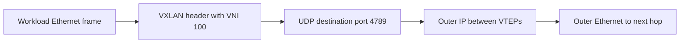

# Decode VXLAN Captures: Inner MACs, Outer VTEPs, VNI, and UDP

Author: [nawazdhandala](https://www.github.com/nawazdhandala)

Tags: VXLAN, Networking, Troubleshooting

Description: Read VXLAN captures layer by layer, distinguish workload addresses from tunnel endpoints, and filter a known VNI without mistaking outer traffic for delivery.

A VXLAN capture contains two conversations. The underlay carries UDP between tunnel endpoints. Inside that UDP packet, the tenant network carries an Ethernet frame between workloads. Mixing these layers can send an investigation in the wrong direction: an outer destination MAC may belong to a router, while the workload's destination MAC is buried inside the tunnel.

This walkthrough uses a small, explicit topology and synthetic captures to explain the fields. The decoding and filters were exercised locally with tcpdump 4.99.1, Apple version 161. Command references use the upstream **tcpdump 4.99.5** manual and **libpcap 1.10.5** filter documentation. No live VXLAN traffic was captured for the article.

## Write down the expected identities

A VTEP is a VXLAN tunnel endpoint. A VNI is the 24-bit VXLAN network identifier that distinguishes a tenant segment. For this example, expect:

| Layer | Source | Destination or identifier |
| --- | --- | --- |
| Workload IPv4 | `10.20.0.11` | `10.20.0.12` |
| Inner Ethernet | `02:00:00:00:00:11` | `02:00:00:00:00:12` |
| Outer IPv4 | `192.0.2.10` | `192.0.2.20` |
| Outer UDP | Example source port `53000` | Destination port `4789` |
| VXLAN | Valid VNI flag set | VNI `100` |

The UDP source port need not equal the destination port. VXLAN recommends deriving the source port from inner packet information to help distribute traffic across underlay paths. Port 4789 is the assigned destination port, but implementations can be configured differently. Confirm the actual tunnel configuration. [VXLAN encapsulation fields](https://www.rfc-editor.org/rfc/rfc7348.html).



Read a packet from the outside inward, reversing the diagram's construction order. On a routed underlay, outer Ethernet addresses can change at each hop. Inner addresses belong to the encapsulated frame; they are not the next-hop addresses of the physical link.

## Choose the capture point deliberately

Capture on the physical or logical underlay interface to observe encapsulation. Capture on the workload-facing interface to observe the tenant frame before encapsulation or after decapsulation. Label each file with its host, interface, direction being investigated, and time window.

On Linux, inspect the tunnel before choosing the filter:

```bash
ip -d link show dev vxlan100
```

Replace the device name. Check the VNI, local address, remote or group configuration, and destination port. The Linux VXLAN documentation explains the device display and warns that its historical default destination port differs from the assigned port for compatibility. [Linux VXLAN documentation](https://docs.kernel.org/networking/vxlan.html).

Avoid starting with a capture on every interface. Duplicate observations and different link-layer formats make a first comparison harder. Begin with one known underlay interface and one controlled test flow, then add observation points to answer a specific missing step.

## Capture a bounded staging sample

Use an approved staging host and substitute its interface and VTEP addresses:

```bash
sudo tcpdump -nn -s 0 -i UNDERLAY_INTERFACE -c 50 \
  -w /APPROVED_CAPTURE_DIRECTORY/vxlan-underlay.pcap \
  'udp dst port 4789 and host 192.0.2.10 and host 192.0.2.20'
```

The directory must already exist with suitable permissions for the capture process; use a new filename and restricted access. Packet files may contain application payloads. `-s 0` requests the default large snapshot length, `-w` saves packet bytes, and `-c` stops after the matching packet count. Stop with Ctrl-C if the count is not reached. A count is not a deadline. [tcpdump capture options](https://raw.githubusercontent.com/the-tcpdump-group/tcpdump/tcpdump-4.99.5/tcpdump.1.in).

The filter selects the two outer endpoints in either direction and the configured destination port. For this example, the capture point exposes ordinary, untagged Ethernet/IP. VLAN tags or a different link type can change filtering assumptions. Later IP fragments may not contain a UDP header, so this port filter is not a complete fragmentation investigation. Broaden the approved capture to the endpoint pair when investigating missing fragments. [Filter semantics](https://raw.githubusercontent.com/the-tcpdump-group/libpcap/libpcap-1.10.5/pcap-filter.manmisc.in).

## Decode the file without sending traffic

Read the saved file with numeric addresses, Ethernet headers, and additional protocol detail:

```bash
tcpdump -nn -e -vv -r /APPROVED_CAPTURE_DIRECTORY/vxlan-underlay.pcap
```

Reading a saved file does not require capture privileges. Numeric output prevents address and service-name lookups from obscuring the values. [tcpdump reading and display options](https://raw.githubusercontent.com/the-tcpdump-group/tcpdump/tcpdump-4.99.5/tcpdump.1.in).

These are excerpts from the locally decoded synthetic packet, with the long header detail omitted:

```text
02:00:00:00:00:10 > 02:00:00:00:00:01, ethertype IPv4
192.0.2.10.53000 > 192.0.2.20.4789: [no cksum] VXLAN, flags [I] (0x08), vni 100
02:00:00:00:00:11 > 02:00:00:00:00:12, ethertype IPv4
10.20.0.11 > 10.20.0.12: ICMP echo request, id 4660, seq 1
```

The first MAC pair is outer Ethernet. In this fixture the destination ending in `01` represents a next hop, not workload B. The next line names the tunnel endpoints and UDP ports. The VXLAN header follows, then the inner Ethernet pair, then the workload IP packet.

`[I]` means the VNI-valid flag is set; it is not proof that the receiving VTEP accepts VNI 100. The upstream decoder reads the VNI and then decodes the encapsulated Ethernet frame. [Pinned VXLAN decoder](https://raw.githubusercontent.com/the-tcpdump-group/tcpdump/tcpdump-4.99.5/print-vxlan.c).

The fixture deliberately uses a zero outer UDP checksum for IPv4, displayed as `[no cksum]`. Do not extrapolate that choice to every transport or diagnose it as a failed checksum calculation. RFC 7348 discusses the outer UDP checksum separately. [VXLAN UDP header](https://www.rfc-editor.org/rfc/rfc7348.html).

## Filter the layer you actually mean

An ordinary `host 10.20.0.11` filter on this encapsulated capture does not automatically search the inner packet. Local testing confirmed that it matched neither of two synthetic VXLAN packets carrying that workload address. The outer endpoint filter matched both.

For an IPv4, unfragmented, standard VXLAN packet with UDP destination port 4789, this offline filter selects VNI 100:

```bash
tcpdump -nn -e -vv -r /APPROVED_CAPTURE_DIRECTORY/vxlan-underlay.pcap \
  'udp dst port 4789 and (udp[8] & 0x08 != 0) and (udp[12:4] & 0xffffff00 = 0x00006400)'
```

UDP's header occupies eight bytes. At `udp[8]`, the expression checks the VXLAN I flag. At `udp[12:4]`, it reads the three VNI bytes plus the following reserved byte; the mask excludes that reserved byte. Hexadecimal `64` is decimal 100. The filter matched the VNI-100 fixture and rejected the otherwise equivalent VNI-200 fixture. [Packet arithmetic syntax](https://raw.githubusercontent.com/the-tcpdump-group/libpcap/libpcap-1.10.5/pcap-filter.manmisc.in).

This is a scoped diagnostic expression, not a general VXLAN validator. It does not validate every reserved bit, IPv6 extension chains, fragmentation, or arbitrary encapsulation variants. Preserve the original capture so a narrow filter cannot erase contradictory evidence.

## Correlate receipt with actual delivery

Find the same controlled request at the sending VTEP, receiving VTEP, and destination workload interface. Use inner addresses, protocol, and identifiers together; for this ICMP fixture, identifier 4660 and sequence 1 help distinguish the request. Timestamps assist correlation but do not replace synchronized clocks or packet identities.

A packet at the remote underlay proves observation at that capture point. It does not prove successful decapsulation, VNI membership, bridge forwarding, or application receipt. If it disappears after that point, investigate those next stages instead of changing the outer route without evidence.

Finally, account for capture drops, truncated snapshots, and hardware offloads. Linux documents VXLAN-related segmentation and receive parsing offloads; local capture representation may differ from wire traffic. Corroborate surprising lengths or checksum indications at another observation point. [Linux VXLAN offloads](https://docs.kernel.org/networking/vxlan.html).

Keep the result precise: which packet was observed, at which layer and interface, with which identities. That evidence turns a large packet dump into a short, testable explanation of where forwarding stops.
