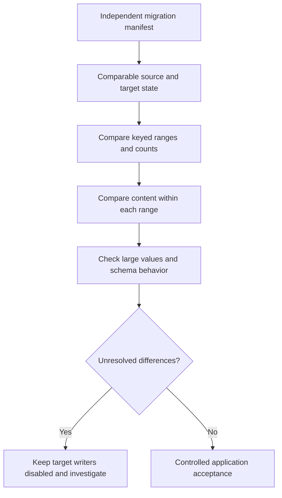

# CDC Is Caught Up but Rows Are Missing: Validate the Data

Author: [nawazdhandala](https://www.github.com/nawazdhandala)

Tags: PostgreSQL, Data Migration, AWS

Description: Validate migration coverage, keyed counts, chunk checksums, large values, and schema behavior before treating low CDC lag as a successful cutover.

Change data capture, or CDC, transfers ongoing database changes to another system. A task with little reported lag can still have an incomplete initial load, an excluded table, or values truncated by its configuration.

Progress and correctness answer different questions. Progress tells you how far a configured pipeline has advanced. Correctness asks whether the intended target data and behavior match the migration contract.

This guide uses AWS Database Migration Service, or DMS, for task inspection and PostgreSQL 17 for diagnostic SQL. It also identifies separate limitations of PostgreSQL native logical replication. Do not assume those two replication systems have identical schema or data-type support.

## Establish what should have moved

Create a manifest of expected tables, primary keys, selected columns, row filters, transformations, and excluded objects. Derive it from the application inventory and approved migration design, not only from the task's current table list. An excluded table may never appear as a task error.

Record the DMS engine version, endpoints, table mappings, task settings, and schema migration revision. Check how the initial load and ongoing changes were coordinated. Restarting CDC from a newer position does not repair rows that were absent from the initial copy.

| Evidence | What it helps establish | What it cannot establish alone |
|---|---|---|
| Low replication lag | Pipeline progress under its configured scope | Complete table coverage |
| Equal row counts | Equal cardinality within a comparable range | Equal values or equal keys |
| Matching chunk digests | Likely equality under the chosen encoding | Full coverage, absence of hash collisions, or correct schema |
| Tool validation passed | Covered rows met the validator's rules | Correct excluded or partially validated content |
| Application checks passed | Selected business behavior works | Every row and object migrated |

Use these layers together. None is a substitute for knowing the intended scope.

## Inspect table-level validation, not just the task headline

With AWS CLI 2.38.1, retrieve statistics for the exact DMS task:

```bash
aws dms describe-table-statistics \
  --profile migration-readonly --region us-east-1 \
  --replication-task-arn arn:aws:dms:us-east-1:123456789012:task:REPLACE_WITH_TASK_ID \
  --output json --no-cli-pager
```

Replace the profile, Region, account, and task identifier. Preserve automatic pagination and compare the returned table set with your independent manifest. The statistics record's update time is not the time of the last business-data update. [DMS table statistics reference](https://docs.aws.amazon.com/cli/latest/reference/dms/describe-table-statistics.html).

Review full-load status and validation states, including pending, mismatched, suspended, and unavailable validation. DMS validation has key requirements and consumes additional source, target, and network resources. A table without usable validation is unresolved; it is not implicitly correct. [DMS validation behavior and limitations](https://docs.aws.amazon.com/dms/latest/userguide/CHAP_Validating.html).

Preserve mismatch evidence before changing the task. Automatically reloading a table can erase useful clues or disrupt an otherwise recoverable migration.

## Compare the same logical point in time

Two perfectly accurate count queries can disagree if the source is still changing while the target catches up. A timestamp written in your notebook does not create a shared database snapshot.

For a final cutover check, use an approved write pause: stop all source writers, let active transactions finish, establish the final source checkpoint, and verify that the target has applied the required changes. Keep target application writers disabled during comparison. The checkpoint mechanism must match the replication product; a marker row alone may not prove that parallel apply has finished every table.

For continuous validation, use the tool's supported consistency handling or recheck mismatches against a controlled boundary. Do not classify every transient difference as permanent loss, but do not waive it without a later reconciled result.



## Use bounded keyed checks instead of one giant checksum

For PostgreSQL-to-PostgreSQL diagnostics, compare small primary-key ranges. The example assumes matching PostgreSQL 17 schemas with a unique integer `order_id`, integer `customer_id`, numeric `total_amount`, and text `status`. Replace the table, columns, and range with a reviewed case. Use equivalent settings and data representation on both systems.

```sql
SELECT count(*) AS row_count,
       md5(COALESCE(
           string_agg(
               md5(jsonb_build_array(
                   order_id, customer_id, total_amount::text, status
               )::text),
               '' ORDER BY order_id
           ),
           ''
       )) AS chunk_digest
FROM public.orders
WHERE order_id >= 1000 AND order_id < 2000;
```

Run it separately on source and target after establishing comparable state. JSON arrays preserve field boundaries and distinguish null from an empty string. Ordering by a unique key gives the aggregation a stable order. Fixed-size row digests keep the aggregated input bounded for this small integer range. [JSON construction](https://www.postgresql.org/docs/17/functions-json.html), [ordered aggregates](https://www.postgresql.org/docs/17/functions-aggregate.html), [MD5 function](https://www.postgresql.org/docs/17/functions-string.html).

This MD5 digest is a diagnostic shortcut, not a security proof. Matching digests can collide, and equality covers only the listed columns and range. Numeric formatting or intended transformations may require a different canonical encoding. Do not reuse this expression as a universal cross-engine checksum.

Create a range manifest that covers the union of source and target keys, including empty and sparse ranges. Otherwise, an extra target range can escape inspection. When counts or digests differ, compare keys and then individual column values within that range. A missing row plus an unexpected extra row can leave the overall count unchanged.

Bound query time and concurrency so validation does not overwhelm the databases. Avoid aggregating an entire large table into one string.

## Check large values and their actual representation

DMS limited LOB mode truncates large-object values that exceed the configured maximum and emits a warning. A fast task can therefore be progressing exactly as configured while losing the suffix of a document. Review the endpoint's data-type mapping and LOB settings, not just the generic column label. [DMS LOB modes](https://docs.aws.amazon.com/dms/latest/userguide/CHAP_Tasks.LOBSupport.html).

For a PostgreSQL text column, a bounded size check can help identify the affected population:

```sql
SELECT count(*) AS rows_in_range,
       count(document_text) AS nonnull_documents,
       max(octet_length(document_text)) AS largest_document_bytes
FROM public.documents
WHERE document_id >= 1000 AND document_id < 2000;
```

This assumes an integer key and a text column. `octet_length` measures bytes, not characters. Equal maximum lengths do not prove equal content: compare the actual values or suitable full-value digests for affected records. [String length functions](https://www.postgresql.org/docs/17/functions-string.html).

Distinguish ordinary text or binary columns from PostgreSQL's separate large-object facility referenced by object identifiers. Native PostgreSQL logical replication does not replicate those large objects. It also does not replicate sequence state or schema-changing DDL commands. DDL means data definition language, such as creating or altering a table. Those limitations require separate migration work when using native logical replication. [PostgreSQL 17 logical replication restrictions](https://www.postgresql.org/docs/17/logical-replication-restrictions.html).

## Validate behavior before enabling target writers

Compare column types, nullability, defaults, constraints, indexes, extensions, and the approved schema revision. Verify sequence or identity behavior through the migration plan before accepting new writes. Avoid blindly setting every sequence to a table maximum; schemas and ownership rules differ.

Run controlled application checks on the target with external effects disabled or redirected. Include updates and deletes, not only reads, and check important relationships such as order totals and tenant ownership.

Keep a final evidence record with the compared checkpoint, covered tables and ranges, unresolved differences, validator exclusions, and application results. Enable normal target writers only after the accepted conditions are met and the source-writing boundary is enforced.

A “caught up” signal remains useful. It becomes a cutover signal only when coverage, content, large values, and schema behavior have also been accounted for.
