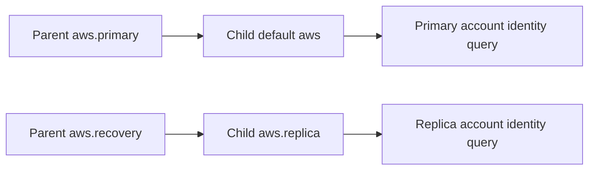

# Pass Assumed-Role AWS Providers into Terraform Modules from CDKTF

Author: [nawazdhandala](https://www.github.com/nawazdhandala)

Tags: CDKTF, Terraform, AWS, TypeScript

Description: Map CDKTF AWS provider aliases to a Terraform module's expected provider names, verify generated mappings, and separate role authentication from module wiring.

Your parent stack defines an AWS provider that assumes a role in another account, but a child Terraform module still uses the wrong account or reports a missing provider configuration. The role configuration and the module connection are separate pieces. Defining the provider does not automatically connect every child module to it.

A provider alias names one configured instance of a provider. A module has its own provider names, and the caller maps those names to parent configurations. The names on each side can differ. Getting that direction right is the central step in this tutorial.

The example uses CDKTF CLI/core 0.21.0, AWS binding 21.22.1, AWS provider 6.25.0, constructs 10.8.1, TypeScript 5.8.3, and Terraform 1.11.4. CDKTF is deprecated; this is maintenance guidance for existing applications. See the [official notice](https://developer.hashicorp.com/terraform/cdktf).

## Start with the module's provider contract

A reusable Terraform module should declare the providers it requires. Additional configurations are declared with `configuration_aliases`. Aliased configurations are not automatically inherited from the parent; they must be passed explicitly. See [providers within modules](https://developer.hashicorp.com/terraform/language/modules/develop/providers).

Our child expects the default `aws` configuration plus `aws.replica`. The parent calls its two configurations `aws.primary` and `aws.recovery`:



The word `replica` describes the child's role for that connection. It does not force the parent alias to have the same name, choose an AWS region, or assume a role by itself.

For an existing external module, inspect its exact pinned version before editing the caller. Determine whether it expects only a default provider, one or more aliases, or legacy provider blocks inside the module. A variable named `role_arn` is not a substitute for a provider mapping unless that module explicitly implements a different contract.

## Define a minimal child module

Create `modules/account-check/main.tf` in a disposable TypeScript CDKTF project:

```hcl
terraform {
  required_providers {
    aws = {
      source = "hashicorp/aws"
      version = "= 6.25.0"
      configuration_aliases = [aws.replica]
    }
  }
}

data "aws_caller_identity" "primary" {}
data "aws_caller_identity" "replica" {
  provider = aws.replica
}
output "primary_account" {
  value = data.aws_caller_identity.primary.account_id
}
output "replica_account" {
  value = data.aws_caller_identity.replica.account_id
}
```

This is an ordinary Terraform module outside the CDKTF language implementation. A local source makes the example inspectable; the same mapping principle applies to a versioned registry module or pinned Git source.

The child has no `provider "aws"` configuration block. It receives the configured connections from its caller. Its two data sources ask for the effective account identity through those connections. They do not create AWS resources. The [caller identity data source](https://github.com/hashicorp/terraform-provider-aws/blob/v6.25.0/website/docs/d/caller_identity.html.markdown) returns the account, user, and ARN for the provider's authenticated caller.

## Connect parent providers using the exact CDKTF API

Use this complete `main.ts`:

```typescript
import { App, TerraformHclModule, TerraformOutput, TerraformStack } from "cdktf";
import { AwsProvider } from "@cdktf/provider-aws/lib/provider";

const app = new App();
const stack = new TerraformStack(app, "module-accounts");
const primary = new AwsProvider(stack, "primary-provider", {
  alias: "primary",
  region: "us-east-1",
  allowedAccountIds: ["111111111111"],
  assumeRole: [{ roleArn: "arn:aws:iam::111111111111:role/TerraformRead" }],
});
const recovery = new AwsProvider(stack, "recovery-provider", {
  alias: "recovery",
  region: "us-west-2",
  allowedAccountIds: ["222222222222"],
  assumeRole: [{ roleArn: "arn:aws:iam::222222222222:role/TerraformRead" }],
});
const accounts = new TerraformHclModule(stack, "accounts", {
  source: "./modules/account-check",
  providers: [
    primary,
    { provider: recovery, moduleAlias: "replica" },
  ],
});
new TerraformOutput(stack, "primary_account", {
  value: accounts.getString("primary_account"),
});
new TerraformOutput(stack, "replica_account", {
  value: accounts.getString("replica_account"),
});
app.synth();
```

The account numbers, role names, and regions are example settings. Replace them with approved targets before any AWS plan. An ARN is Amazon's resource identifier; these role ARNs name the roles the provider should assume. No access keys belong in this source.

The `assumeRole` value is an array in this pinned binding. The AWS provider obtains starting credentials through its supported authentication chain, then assumes the configured role. Cross-account access requires both authorization for the caller and a matching trust policy on the target role. See the [AWS provider configuration](https://github.com/hashicorp/terraform-provider-aws/blob/v6.25.0/website/docs/index.html.markdown) and [AWS role-assumption permissions](https://docs.aws.amazon.com/IAM/latest/UserGuide/id_roles_use_permissions-to-switch.html).

The subtle part is the module's `providers` array. Passing `primary` directly maps the child's default `aws` to the parent's `aws.primary`. The object with `moduleAlias: "replica"` maps the child's `aws.replica` to `aws.recovery`.

In CDKTF 0.21.0, `moduleAlias` takes the alias suffix, not the full `aws.replica` name. CDKTF prepends the provider type. Supplying `aws.replica` would incorrectly generate `aws.aws.replica`. The [versioned module implementation](https://github.com/hashicorp/terraform-cdk/blob/v0.21.0/packages/cdktf/lib/terraform-module.ts) shows that conversion explicitly.

## Include the local module in synthesis setup

For this disposable project, use:

```json
{
  "language": "typescript",
  "app": "npx ts-node main.ts",
  "sendCrashReports": "false",
  "terraformModules": [
    { "name": "account-check", "source": "./modules/account-check" }
  ]
}
```

Run with the pinned CLI and dependencies available:

```bash
npx cdktf get
npx tsc --noEmit
npx cdktf synth
```

The declaration and generation step let this CLI prepare the local module for synthesis. The example uses `TerraformHclModule` directly, while generated module classes provide another supported way to call modules. See [CDKTF modules](https://developer.hashicorp.com/terraform/cdktf/concepts/modules).

CDKTF packages the local module as an asset under the stack output. Keep those assets when moving generated configuration to CI. Merely copying the top-level `cdk.tf.json` can leave its module source unavailable.

## Verify the mapping before checking credentials

Inspect `module.accounts.providers` in `cdktf.out/stacks/module-accounts/cdk.tf.json`. It should contain this mapping:

```json
{
  "aws": "aws.primary",
  "aws.replica": "aws.recovery"
}
```

The left side is the child's name; the right side is the parent's configuration reference. Also verify that each parent configuration contains the expected role ARN, account allowlist, and region. The account allowlist checks the resulting account; it does not grant access or replace a trust policy.

In the disposable fixture, initialize dependencies without connecting a state backend, then validate:

```bash
terraform -chdir=cdktf.out/stacks/module-accounts init -backend=false -input=false
terraform -chdir=cdktf.out/stacks/module-accounts validate
```

These checks can catch missing child aliases and invalid provider references before a credentialed plan. They do not prove that AWS will allow role assumption. Refer to [Terraform validate](https://developer.hashicorp.com/terraform/cli/commands/validate) for that boundary.

When you are ready for a real identity check, initialize the intended backend through your normal workflow and run a reviewed plan using approved starting credentials. Confirm both returned account IDs match their intended roles. No apply is necessary merely to read the identity data sources, although provider initialization and reads contact AWS.

## Keep provider selection separate from other configuration

| Symptom | Check |
|---|---|
| Missing required provider configuration | Child `configuration_aliases` and caller mapping |
| Invalid reference containing `aws.aws` | Full provider name mistakenly used as `moduleAlias` |
| Both identity queries return one account | Both child slots mapped to the same parent connection |
| AssumeRole access denied | Starting identity, target trust, and applicable policies |
| Backend access denied | Backend authentication, which is separate from module providers |

For a third-party registry module, pin the module's `version` as well as the provider requirements. For a Git source, use a reviewed immutable commit reference. Module source selection has its own rules in the [module block reference](https://developer.hashicorp.com/terraform/language/modules/syntax).

Finally, do not remove a provider configuration while state still contains resources that require it for refresh or destruction. Review provider changes against existing state, especially when changing accounts. Correct synthesis establishes the wiring; a credentialed identity check establishes where that wiring leads before any resource-changing deployment.
