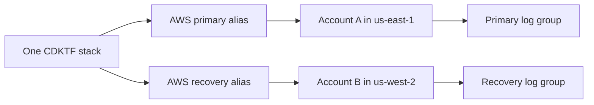

# Use AWS Provider Aliases Across Accounts and Regions in CDKTF

Author: [nawazdhandala](https://www.github.com/nawazdhandala)

Tags: CDKTF, Terraform, AWS, Troubleshooting

Description: Configure explicit AWS provider aliases in CDKTF, inspect account and region routing, and avoid implicit defaults when targeting multiple environments.

Two AWS providers can have different TypeScript variable names and still collide in the Terraform configuration. The name passed to a CDKTF constructor identifies a construct in your application. It does not automatically give the provider a Terraform alias.

For a stack spanning accounts or regions, assign each provider an alias and pass the intended provider object to every relevant resource and data source. Then inspect the synthesized configuration before making AWS calls. This catches routing mistakes while they are still ordinary code changes.

This guide maintains an existing CDKTF application. HashiCorp deprecated CDKTF on December 10, 2025; the example therefore pins a specific archived toolchain rather than presenting it as a new supported platform. [CDKTF status](https://developer.hashicorp.com/terraform/cdktf).

## Keep three names separate

Consider a provider constructed with ID `primary-provider` and alias `primary`:

| Name | Purpose | Example |
| --- | --- | --- |
| CDKTF construct ID | Distinguishes objects within the parent construct | `primary-provider` |
| Terraform provider alias | Names an alternate configuration of the AWS provider | `aws.primary` |
| AWS role ARN | Identifies the role Terraform intends to assume | `arn:aws:iam::111111111111:role/TerraformDeploy` |

An ARN is an Amazon Resource Name. The alias does not create an IAM role, grant permissions, or select an account on its own. Its provider configuration supplies the region and authentication settings.

Terraform resources normally use the default provider for their type. An explicit provider reference selects an alternate configuration. If every configuration is aliased, Terraform still has an implied empty default for anything that omits that reference. It may fail for missing settings or pick up settings from the environment. Treat omission as something to inspect, not as a reliable safety barrier. [Terraform provider configurations](https://developer.hashicorp.com/terraform/language/block/provider).



The two arrows represent explicit provider selection. Sharing a stack does not make authentication or regional settings interchangeable.

## Prepare an exact, reviewable example

Use a disposable TypeScript project with CDKTF CLI/core `0.21.0`. This example uses `@cdktf/provider-aws` package `21.22.1`, which describes Terraform AWS provider `6.25.0` and requires CDKTF `^0.21.0` and Constructs `^10.4.2`. The package version and Terraform plugin version are different numbers. [Published package metadata](https://registry.npmjs.org/@cdktf/provider-aws/21.22.1).

In an existing compatible test project, install the exact binding package:

```bash
npm install --save-exact @cdktf/provider-aws@21.22.1
```

Review the manifest and lock-file changes. The application command in `cdktf.json` should run the example's `main.ts`, such as `npx ts-node main.ts`. Keep the project's compiler versions pinned too. The local checks used Constructs `10.8.1`, TypeScript `5.8.3`, ts-node `10.9.2`, and Node `24.1.0`.

The following complete application declares two log groups. Account numbers and the role name are placeholders: replace them with approved targets before planning against AWS. Both roles must already exist. The executing identity needs permission to assume them, and each target role's trust policy must permit that identity. AWS describes both sides of cross-account authorization in its [role permission guidance](https://docs.aws.amazon.com/IAM/latest/UserGuide/id_roles_use_permissions-to-switch.html).

```typescript
import { Construct } from "constructs";
import { App, TerraformStack, TerraformOutput } from "cdktf";
import { AwsProvider } from "@cdktf/provider-aws/lib/provider";
import { DataAwsCallerIdentity } from "@cdktf/provider-aws/lib/data-aws-caller-identity";
import { CloudwatchLogGroup } from "@cdktf/provider-aws/lib/cloudwatch-log-group";

class RegionalStack extends TerraformStack {
  constructor(scope: Construct, id: string) {
    super(scope, id);
    const targets = [
      { alias: "primary", account: "111111111111", region: "us-east-1" },
      { alias: "recovery", account: "222222222222", region: "us-west-2" },
    ];
    for (const target of targets) {
      const provider = new AwsProvider(this, `${target.alias}-provider`, {
        alias: target.alias,
        region: target.region,
        allowedAccountIds: [target.account],
        assumeRole: [{
          roleArn: `arn:aws:iam::${target.account}:role/TerraformDeploy`,
          sessionName: "cdktf-alias-review",
        }],
      });
      const caller = new DataAwsCallerIdentity(this, `${target.alias}-caller`, {
        provider,
      });
      new CloudwatchLogGroup(this, `${target.alias}-logs`, {
        provider,
        name: "/example/alias-lab",
        retentionInDays: 7,
      });
      new TerraformOutput(this, `${target.alias}_account`, {
        value: caller.accountId,
      });
    }
  }
}

const app = new App();
new RegionalStack(app, "regions");
app.synth();
```

The loop constructs two explicit configurations from known synthesis-time values. `assumeRole` is an array in this binding version; `allowedAccountIds` provides an account check. The exact TypeScript properties are defined in the [tagged binding source](https://github.com/cdktf/cdktf-provider-aws/blob/v21.22.1/src/provider/index.ts).

Credentials are supplied through the runner's approved AWS authentication mechanism, rather than embedded in source. The account allowlist is a guard against targeting the wrong account; it does not confer authorization. The provider's authentication behavior and account checks are documented in the [AWS provider 6.25.0 reference](https://github.com/hashicorp/terraform-provider-aws/blob/v6.25.0/website/docs/index.html.markdown).

## Inspect routing before requesting a plan

Run synthesis using the pinned CLI, then inspect the generated stack:

```bash
cdktf synth
```

In `cdktf.out/stacks/regions/cdk.tf.json`, expect two entries under `provider.aws`: one with alias `primary`, the other with alias `recovery`. Each log group and caller-identity data source should contain a provider reference selecting the corresponding alias.

This read-only Node command prints those references without making AWS requests:

```bash
node <<'JS'
const fs = require("node:fs");
const config = JSON.parse(fs.readFileSync(
  "cdktf.out/stacks/regions/cdk.tf.json", "utf8"
));
console.log("Providers:", config.provider.aws.map(p => ({
  alias: p.alias, region: p.region, accounts: p.allowed_account_ids
})));
for (const section of ["resource", "data"]) {
  for (const [type, entries] of Object.entries(config[section] || {})) {
    for (const [name, entry] of Object.entries(entries)) {
      console.log(section, type, name, entry.provider || "IMPLICIT DEFAULT");
    }
  }
}
JS
```

The expected routing is `aws.primary` for the primary objects and `aws.recovery` for the recovery objects. Inspect these associations even when compilation succeeds: a valid provider object can still be the wrong provider object. The exact example passed TypeScript compilation and CDKTF synthesis locally; all four generated resource/data references matched their intended aliases. No AWS plan or apply was executed.

## Verify identity when AWS access is available

The caller-identity data source reports the effective account and caller identity for its provider connection. It is included twice so a reviewed plan can show the account reached through each alias. An AWS CLI identity check using unrelated credentials does not prove that these configured assume-role chains work. [Caller identity data-source reference](https://github.com/hashicorp/terraform-provider-aws/blob/v6.25.0/website/docs/d/caller_identity.html.markdown).

For two regions in the same account, use the same intended account and role with different region settings. For two accounts in the same region, keep the region and change the role/account pair. Neither arrangement needs two unrelated copies of the AWS provider package.

Before deployment, confirm the plan's account outputs, the intended regions, and the proposed resources together. The example creates log groups if applied; it is not merely an identity probe. Use a separate data-only configuration if identity inspection is all you intend to perform.

## Avoid configuration drift as the stack grows

Pass provider objects into reusable constructs rather than having each construct silently create its own default AWS provider. A nested construct can otherwise hide the very configuration your review is trying to make explicit.

Terraform modules have an additional provider-mapping boundary. An aliased configuration is not automatically inherited as every child module's intended provider. Map it explicitly according to the module's declared interface. Keep that mapping separate from the TypeScript construct ID. [Providers within modules](https://developer.hashicorp.com/terraform/language/modules/develop/providers).

Finally, retain provider configurations needed by resources already in state. Removing an alias while resources still depend on it can prevent Terraform from managing those objects. Review alias changes as state-related changes, not cosmetic renaming. A useful completion check is a reviewed provider map: every object has an intended account, region, and explicit route to the configuration that supplies them.
