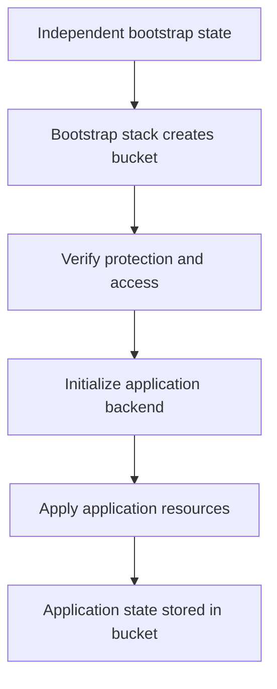

# Bootstrap a CDKTF Remote-State Bucket Without a Dependency Cycle

Author: [nawazdhandala](https://www.github.com/nawazdhandala)

Tags: CDKTF, Terraform, AWS, Amazon S3

Description: Create an S3 state bucket from a separate bootstrap stack, retain its management state, and configure application backends only after storage and access are ready.

Your CDKTF stack contains an S3 bucket resource and an S3 backend pointing at that bucket. On the first deployment, Terraform says the bucket does not exist. Adding a resource dependency does not solve this ordering problem: Terraform needs the backend before it can apply the resources that would create the bucket.

The restriction is about initial creation. An existing bucket can store state that describes the bucket itself, but that arrangement couples recovery and deletion to the same storage. A separate bootstrap stack makes the ownership and recovery path easier to understand.

This tutorial targets existing CDKTF applications. HashiCorp deprecated CDKTF on December 10, 2025; see the [official notice](https://developer.hashicorp.com/terraform/cdktf). Examples use CLI/core 0.21.0, constructs 10.8.1, TypeScript 5.8.3, ts-node 10.9.2, and AWS binding 21.22.1, which targets Terraform AWS provider 6.25.0. The application backend example targets Terraform 1.11.4.

## Separate storage creation from storage consumption

A backend decides where Terraform reads and writes state. It is initialized before resource operations. It cannot use a resource result as though the bucket had already been created. See the [backend configuration rules](https://developer.hashicorp.com/terraform/language/backend).



Keep the bootstrap state outside the bucket it creates. An existing organizational backend is preferable when available. A protected local file can support an initial controlled bootstrap, provided it has an owner, restricted access, and an independently retained backup. An ephemeral CI workspace that disappears after the job does not meet that requirement.

The application stack should receive a known bucket name as configuration after bootstrap. A CDKTF resource token or cross-stack output cannot make the backend wait for a provider operation during the same initial deployment.

## Build a small, explicit bootstrap stack

Use a separate TypeScript CDKTF project whose `cdktf.json` runs `npx ts-node main.ts`. Install the pinned versions above and configure AWS authentication through your approved credential mechanism. Replace account `111111111111` and the bucket-name placeholder before planning. The bucket name must be available under S3 naming rules.

Put this in `main.ts`:

```typescript
import { resolve } from "node:path";
import { App, LocalBackend, TerraformStack } from "cdktf";
import { AwsProvider } from "@cdktf/provider-aws/lib/provider";
import { S3Bucket } from "@cdktf/provider-aws/lib/s3-bucket";
import { S3BucketVersioningA } from "@cdktf/provider-aws/lib/s3-bucket-versioning";
import { S3BucketPublicAccessBlock } from "@cdktf/provider-aws/lib/s3-bucket-public-access-block";
import { S3BucketServerSideEncryptionConfigurationA } from "@cdktf/provider-aws/lib/s3-bucket-server-side-encryption-configuration";

const app = new App();
const stack = new TerraformStack(app, "state-bootstrap");
new LocalBackend(stack, { path: resolve("bootstrap.tfstate") });
new AwsProvider(stack, "aws", {
  region: "us-east-1",
  allowedAccountIds: ["111111111111"],
});
const bucket = new S3Bucket(stack, "state", {
  bucket: "replace-with-your-unique-state-bucket-name",
  forceDestroy: false,
  lifecycle: { preventDestroy: true },
});
new S3BucketVersioningA(stack, "versioning", {
  bucket: bucket.id,
  versioningConfiguration: { status: "Enabled" },
});
new S3BucketPublicAccessBlock(stack, "public-access", {
  bucket: bucket.id,
  blockPublicAcls: true,
  blockPublicPolicy: true,
  ignorePublicAcls: true,
  restrictPublicBuckets: true,
});
new S3BucketServerSideEncryptionConfigurationA(stack, "encryption", {
  bucket: bucket.id,
  rule: [{ applyServerSideEncryptionByDefault: { sseAlgorithm: "AES256" } }],
});
app.synth();
```

The bucket's management record goes to `bootstrap.tfstate` in the project directory. That file is operational data: exclude it from source control and retain it securely after deployment. The account allowlist is a check against accidentally using the wrong account; it does not grant permissions.

The example explicitly disables forced bucket deletion and adds Terraform's `preventDestroy`. These are useful guards, not an immutable backup policy. Removing the resource configuration also removes that lifecycle rule's protection, and privileged users can act outside Terraform. See the [bucket resource](https://github.com/hashicorp/terraform-provider-aws/blob/v6.25.0/website/docs/r/s3_bucket.html.markdown) and [lifecycle rules](https://developer.hashicorp.com/terraform/language/meta-arguments/lifecycle).

Versioning preserves previous object versions. The public-access block enables all four bucket-level controls. Encryption uses S3-managed keys through `AES256`; it is not a customer-managed KMS key configuration. Review your organization's retention, transport-security, access-policy, and key requirements before adopting this as a production baseline. The exact schemas are documented for [versioning](https://github.com/hashicorp/terraform-provider-aws/blob/v6.25.0/website/docs/r/s3_bucket_versioning.html.markdown), [public access](https://github.com/hashicorp/terraform-provider-aws/blob/v6.25.0/website/docs/r/s3_bucket_public_access_block.html.markdown), and [encryption](https://github.com/hashicorp/terraform-provider-aws/blob/v6.25.0/website/docs/r/s3_bucket_server_side_encryption_configuration.html.markdown).

## Review and deploy bootstrap independently

From the bootstrap project root:

```bash
npx tsc --noEmit
npx cdktf synth
npx cdktf diff state-bootstrap
```

The first two commands check and generate configuration. The diff requires AWS credentials and permission to inspect the intended account; review its proposed bucket and three supporting resources. In the generated `cdk.tf.json`, verify that `terraform.backend` is local and does not refer to the new bucket.

The [CDKTF CLI reference](https://developer.hashicorp.com/terraform/cdktf/cli-reference/commands) documents diff and deploy. After approving the plan through your normal process, deploy only this stack:

```bash
npx cdktf deploy state-bootstrap
```

This command creates AWS resources and can incur charges. Keep the normal interactive approval. Do not combine initial bootstrap and application deployment into an indiscriminate all-stacks command.

Before the first state write, confirm that the bucket exists in the intended account and region, versioning is enabled, public-access controls are present, and the intended writer can use its assigned state key. AWS recommends waiting 15 minutes after first enabling versioning before object writes; the [versioned provider documentation](https://github.com/hashicorp/terraform-provider-aws/blob/v6.25.0/website/docs/r/s3_bucket_versioning.html.markdown) calls out that delay. Retain the bootstrap state and its recovery instructions before moving on.

## Configure the application backend with known values

The following is a standalone synthesis example for a separate application project. It intentionally contains no application resources. Add your existing resources only after preserving their current state and reviewing whether a migration is required.

```typescript
import { App, S3Backend, TerraformStack } from "cdktf";
const app = new App({ outdir: "application.out" });
const stack = new TerraformStack(app, "application");
new S3Backend(stack, {
  bucket: "replace-with-your-unique-state-bucket-name",
  key: "applications/example/terraform.tfstate",
  region: "us-east-1",
  encrypt: true,
  allowedAccountIds: ["111111111111"],
});
stack.addOverride("terraform.backend.s3.use_lockfile", true);
app.synth();
```

Replace the bucket name and account ID with the verified bootstrap values. The key is an example application-specific location; allocate a distinct key per independently managed state.

CDKTF 0.21.0's [`S3Backend` interface](https://github.com/hashicorp/terraform-cdk/blob/v0.21.0/packages/cdktf/lib/backends/s3-backend.ts) does not expose `useLockfile`. The explicit override writes Terraform's `use_lockfile` setting into the synthesized backend. Inspect that output rather than adding a nonexistent TypeScript property. Terraform 1.11.4 supports the S3 lockfile mechanism described in the [backend reference](https://developer.hashicorp.com/terraform/language/backend/s3).

Backend authentication is separate from AWS provider configuration. Grant the application runner only the bucket listing and state-object access it needs, plus the documented lock-object permissions. With lockfiles enabled, the lock object's access includes creation and deletion; granting only state read/write is insufficient. Additional KMS permissions are needed if your design chooses KMS encryption. This example does not supply an IAM policy because the permitted principals and key paths belong to your environment's access design.

## Treat an existing application's transition as a migration

For a brand-new application with no state, initialization can start directly against the prepared backend. An already deployed application needs its existing state transferred deliberately. Back up the source, pause competing writers, and review Terraform's [backend initialization and migration behavior](https://developer.hashicorp.com/terraform/cli/commands/init).

Changing a backend definition or using reconfiguration alone is not proof that state moved. Confirm the destination contains the expected tracked resources and that the next plan does not propose recreating them. Resume writers only after the new location and locking behavior have been verified.

Leave the bootstrap stack's state in its independent location, or migrate it to another established organizational backend through a separately reviewed operation. Application teardown should never implicitly destroy the shared state bucket. Successful bootstrap means both the application storage and the record of how that storage is managed remain recoverable.
