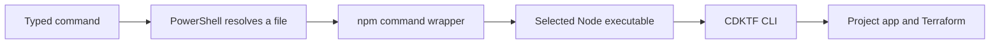

# Fix CDKTF on Windows: Node, npm, PATH, and PowerShell

Author: [nawazdhandala](https://www.github.com/nawazdhandala)

Tags: CDKTF, Terraform, Microsoft Windows, PowerShell, Node.js

Description: Diagnose a CDKTF CLI that installs but will not launch on Windows by checking command resolution, npm's prefix, Node selection, and PowerShell script policy.

An npm installation can succeed while typing `cdktf` still fails. Installation places files somewhere; command discovery decides which file runs; Node executes the CLI; and PowerShell may apply a policy to a script wrapper. A failure at one layer does not establish a failure at every layer.

Work through those boundaries in order. This guide uses CDKTF CLI 0.21.0 as the concrete package version and PowerShell syntax reviewed against the 7.5 documentation. Windows commands below are source-reviewed examples, not claims of execution on Windows. CDKTF is deprecated; see the [official project notice](https://developer.hashicorp.com/terraform/cdktf).

## Identify the first failing layer



The last stage matters: a working `cdktf --version` does not prove that Python, ts-node, Terraform, or project dependencies are installed. First get the CLI itself to start, then investigate synthesis or deployment separately.

| Error or observation | Likely boundary |
|---|---|
| Command not recognized | Discovery, PATH, or missing wrapper |
| A `.ps1` file cannot be loaded | PowerShell script policy or wrapper trust |
| Node is not recognized | Node installation or PATH |
| Wrong CLI version starts | Another installation or command takes precedence |
| CLI starts but synth fails | Project app command, dependencies, or Terraform |

Keep the exact error and the path it names. Repeated administrator installations can create additional copies without fixing the shell that launches the wrong one.

## Inspect command resolution in the failing terminal

Run these read-only PowerShell commands in the same terminal where CDKTF fails:

```powershell
Get-Command node.exe,npm.cmd,cdktf -All -ErrorAction SilentlyContinue |
  Select-Object Name,CommandType,Source,Definition
where.exe node
where.exe npm
where.exe cdktf
```

`Get-Command -All` exposes multiple candidates, including functions and aliases. `where.exe` searches filesystem locations using Windows' executable search rules. Use the `.exe` suffix deliberately: plain `where` can mean something else in PowerShell. Refer to [Get-Command](https://learn.microsoft.com/en-us/powershell/module/microsoft.powershell.core/get-command?view=powershell-7.5) and [Windows where](https://learn.microsoft.com/en-us/windows-server/administration/windows-commands/where).

A missing result is useful evidence. Multiple results are also useful: compare the installation directories before choosing which one should be authoritative. PowerShell's [command precedence rules](https://learn.microsoft.com/en-us/powershell/module/microsoft.powershell.core/about/about_command_precedence?view=powershell-7.5) explain why an alias or function can hide an external command.

Once Node and npm are discoverable, inspect them directly:

```powershell
node.exe --version
node.exe -p "process.execPath"
node.exe -p "process.arch"
npm.cmd --version
npm.cmd prefix -g
npm.cmd ls -g cdktf-cli --depth=0
```

Node's [`process.execPath`](https://nodejs.org/docs/latest-v24.x/api/process.html#processexecpath) reports the actual executable. Compare it with the intended Node installation, especially if you use a version manager. Record architecture too when diagnosing native dependency problems; a successful install is not evidence that every runtime component matches.

The npm commands show the active global prefix and whether that installation contains `cdktf-cli`. They query the npm you just resolved, which may differ from the npm used in an earlier shell. See [npm prefix](https://docs.npmjs.com/cli/v11/commands/npm-prefix/) and [npm ls](https://docs.npmjs.com/cli/v11/commands/npm-ls/).

## Test the wrapper at its actual location

On Windows, npm puts global command wrappers directly in its global prefix, rather than in a Unix-style `bin` subdirectory. Do not assume a fixed user-profile location. npm documents the layout in its [folder reference](https://docs.npmjs.com/cli/v11/configuring-npm/folders/).

If the global package is installed, resolve and test its `.cmd` wrapper:

```powershell
$npmPrefix = npm.cmd prefix -g
if ($LASTEXITCODE -ne 0) { throw "Cannot determine npm prefix" }
$npmPrefix = $npmPrefix.Trim()
$cdktfCmd = Join-Path $npmPrefix "cdktf.cmd"
if (-not (Test-Path -LiteralPath $cdktfCmd)) {
  throw "No cdktf.cmd in the active npm prefix"
}
& $cdktfCmd --version
```

The call operator `&` runs the path stored in the variable, including paths containing spaces. If this succeeds but an unqualified command fails, focus on discovery or wrapper selection rather than reinstalling the package.

CDKTF's [package declaration](https://github.com/hashicorp/terraform-cdk/blob/v0.21.0/packages/cdktf-cli/package.json) exposes the `cdktf` command from `bundle/bin/cdktf`. npm's [cmd-shim implementation](https://github.com/npm/cmd-shim) creates Windows launch wrappers. These wrappers ultimately need a working Node runtime; they are not standalone native CDKTF executables.

## Repair a missing PATH entry without replacing PATH

After verifying the prefix and wrapper, test a change limited to the current PowerShell process:

```powershell
$env:Path = "$npmPrefix;$env:Path"
cdktf.cmd --version
```

This prepends the verified npm prefix while preserving existing entries. It uses `$npmPrefix` from the previous snippet. Closing this terminal discards this particular change. Microsoft documents process-scoped environment changes and inheritance in [environment variables](https://learn.microsoft.com/en-us/powershell/module/microsoft.powershell.core/about/about_environment_variables?view=powershell-7.5).

If the test fixes discovery, add the appropriate prefix through your approved user-environment configuration process. Then open a fresh terminal. An editor launched before an environment change can retain the old environment, so restart its terminal host when necessary. Avoid replacing the entire persistent PATH with one directory or accumulating prefixes from every past Node installation.

## Handle a PowerShell wrapper-policy error precisely

If the error names `cdktf.ps1` or `npm.ps1`, inspect the current policy and the selected command:

```powershell
Get-ExecutionPolicy -List
Get-Command cdktf -All
```

The policy scopes can differ, and organization-controlled Group Policy can take precedence over local settings. The [execution-policy reference](https://learn.microsoft.com/en-us/powershell/module/microsoft.powershell.core/about/about_execution_policies?view=powershell-7.5) explains those rules.

For an approved npm tool, explicitly invoking its verified `.cmd` wrapper can distinguish a PowerShell-script issue from a package/runtime issue without changing execution policy. It does not establish that every organizational application-control requirement has been met. If your organization mandates signed launchers or managed tool installation, use that supported distribution path.

Do not prescribe unrestricted machine-wide execution policy as a generic CDKTF fix. A policy error, an absent command, and an outdated Node runtime are different diagnoses.

## Prefer a known project CLI when comparing versions

If the project already installs the CLI locally, from its root run:

```powershell
.\node_modules\.bin\cdktf.cmd --version
```

That makes the intended installation explicit. For a controlled version comparison where package retrieval is permitted, npm can run a specified package:

```powershell
npm.cmd exec --package=cdktf-cli@0.21.0 -- cdktf --version
```

This can download the package into npm's cache and prompt for confirmation when it is absent. It is not a promise of offline execution. The separator `--` distinguishes the command arguments from npm's options; see [npm exec](https://docs.npmjs.com/cli/v11/commands/npm-exec/).

After the expected CLI version launches, check the project's CDKTF library version and actual app command before trying synthesis. Keep the Node runtime consistent across the terminal, editor, and CI environment. A useful repair record names the resolved command path, Node executable, npm prefix, and CLI version, so the next fresh shell can reproduce the result.
