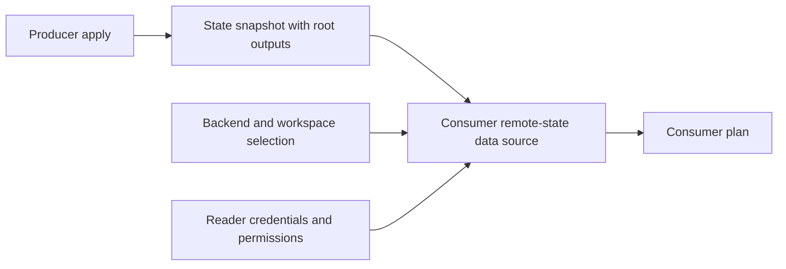

# Fix Missing Remote State in CDKTF Cross-Stack References

Author: [nawazdhandala](https://www.github.com/nawazdhandala)

Tags: CDKTF, Terraform, Troubleshooting

Description: Diagnose CDKTF cross-stack state failures by checking producer apply order, the exact backend and workspace, output names, and reader permissions.

A CDKTF consumer stack can synthesize correctly and then fail with “Unable to find remote state.” The producer's TypeScript object exists, its output expression is valid, and the application compiles. None of those facts proves that the producer has written a state snapshot where the consumer expects to read it.

Treat the reference as a small data-transfer contract: one stack publishes an output into state, and another reads a particular snapshot. Check publication, location, and access separately. Repeatedly deploying the consumer cannot repair a missing producer snapshot or a mismatched state key.

The examples target CDKTF CLI/core `0.21.0` and Terraform `1.11.4`. CDKTF was deprecated on December 10, 2025, so this is maintenance guidance for existing applications. [Official CDKTF notice](https://developer.hashicorp.com/terraform/cdktf).

## Identify the reader and writer

CDKTF supports references between stacks and can generate the output and remote-state plumbing needed to connect them. Each stack still has its own Terraform configuration and state. Inspect the synthesized artifacts rather than assuming that passing a TypeScript property makes two stacks share one state file. [CDKTF stacks and cross-stack references](https://developer.hashicorp.com/terraform/cdktf/concepts/stacks).



A backend stores state. The consumer's own backend stores the consumer's state; its `terraform_remote_state` data source reads the producer's state. Those are different connections, even when both use the same storage service.

The remote-state data source exposes root-level outputs from a snapshot. It does not run the producer, apply pending output changes, or recursively expose every child-module output. [Remote-state data-source documentation](https://developer.hashicorp.com/terraform/language/state/remote-state-data).

## Reproduce the ordering failure without cloud resources

This complete `main.ts` uses explicit local-state wiring to make the two locations visible. Use a fresh disposable TypeScript CDKTF project, with `npx ts-node main.ts` as its application command. The tested compiler environment was TypeScript `5.8.3`, ts-node `10.9.2`, Constructs `10.8.1`, and Node `24.1.0`.

```typescript
import { resolve } from "node:path";
import { App, TerraformStack, LocalBackend, TerraformOutput,
  DataTerraformRemoteStateLocal } from "cdktf";

const app = new App();
const producer = new TerraformStack(app, "producer");
const producerPath = resolve("producer.tfstate");
new LocalBackend(producer, { path: producerPath });
new TerraformOutput(producer, "network_label", { value: "lab-network" });

const consumer = new TerraformStack(app, "consumer");
new LocalBackend(consumer, { path: resolve("consumer.tfstate") });
const upstream = new DataTerraformRemoteStateLocal(consumer, "upstream", {
  path: producerPath,
});
new TerraformOutput(consumer, "received_label", {
  value: upstream.getString("network_label"),
});
consumer.addDependency(producer);
app.synth();
```

Both paths resolve from the project directory when synthesis runs. This intentionally makes the lab machine-specific; it is not a pattern for sharing local state across CI workers. The local backend and reader APIs are defined in [CDKTF's tagged source](https://github.com/hashicorp/terraform-cdk/blob/v0.21.0/packages/cdktf/lib/backends/local-backend.ts).

`addDependency` records an ordering relationship for CDKTF. Directly invoking Terraform in just the consumer directory bypasses CDKTF's orchestration. That distinction lets this lab demonstrate the failure deliberately. [Stack dependency implementation](https://github.com/hashicorp/terraform-cdk/blob/v0.21.0/packages/cdktf/lib/terraform-stack.ts).

With the pinned tools on your path, run:

```bash
cdktf synth
terraform -chdir=cdktf.out/stacks/producer init -input=false
terraform -chdir=cdktf.out/stacks/consumer init -input=false
terraform -chdir=cdktf.out/stacks/consumer plan -input=false
```

In a fresh directory, the final command should fail because `producer.tfstate` does not yet exist. Now publish the producer's output, only in this resource-free lab:

```bash
terraform -chdir=cdktf.out/stacks/producer apply
terraform -chdir=cdktf.out/stacks/consumer plan -input=false
```

Review the producer plan before confirming it. It should contain only the `network_label` output and zero managed resources. Applying saves that output to local state; the consumer plan can then show `received_label = "lab-network"`. This sequence was reproduced locally. No cloud resources were created and the consumer was not applied. [Terraform apply behavior](https://developer.hashicorp.com/terraform/cli/commands/apply).

## Check publication before changing locations

For a real incident, identify the exact producer stack and the last successful apply in the intended environment. A successful synth or plan is insufficient. A code change adding an output also needs to reach the producer's persisted state before another stack can read it.

In an already initialized producer directory, inspect the intended non-sensitive output and workspace:

```bash
terraform -chdir=cdktf.out/stacks/producer workspace show
terraform -chdir=cdktf.out/stacks/producer output -raw network_label
```

Replace the directory and output name with the verified producer values. The lab returns `default` and `lab-network`. `output -raw` prints the value directly, including sensitive values when requested; choose an appropriate output rather than dumping all state into an incident log. [Workspace show](https://developer.hashicorp.com/terraform/cli/commands/workspace/show), [Terraform output](https://developer.hashicorp.com/terraform/cli/commands/output).

If the expected output is absent, compare the root output declarations with the applied revision. An internal child-module output needs a root output that forwards it. If CDKTF generated the output name automatically, use that generated name instead of guessing from the TypeScript property name.

## Compare the complete state address

Open the producer's backend declaration and the consumer's `data.terraform_remote_state` declaration in their generated JSON. Record this comparison privately, excluding credentials:

| Field | Producer side | Consumer reader side |
| --- | --- | --- |
| Backend type | Where the producer writes | Reader's `backend` |
| Storage location | File path, bucket/key, or workspace identity | Reader's `config` |
| Workspace | Workspace used during producer apply | Reader's selected workspace |
| Output | Applied root output name | Referenced output attribute |
| Execution identity | Identity allowed to publish | Identity allowed to read |

A matching bucket name alone is not enough. For S3, the default workspace uses the configured key directly. Other workspaces use `<workspace_key_prefix>/<workspace_name>/<key>`; the default prefix is `env:`. A producer in workspace `staging` can therefore write somewhere different from a reader using `default`, even when both configurations show the same base key. [S3 backend workspace paths](https://developer.hashicorp.com/terraform/language/backend/s3).

The remote-state reader has its own optional `workspace` setting. Do not assume that selecting a workspace for the consumer automatically selects the producer's workspace. Also distinguish Terraform CLI workspaces from the workspace names and organization settings used by a hosted backend.

## Separate access failures from missing state

The reader needs access to the actual state location. Configuring an AWS resource provider's assume-role settings does not automatically configure an S3 backend or remote-state reader to use that role. Review the backend's own authentication settings and the credentials available to the process doing the read. [CDKTF remote backends](https://developer.hashicorp.com/terraform/cdktf/concepts/remote-backends).

For S3, investigate the exact object path, bucket policy, reader identity, and encryption-key permissions where applicable. An access-denied diagnostic calls for an authorization investigation, not creation of a replacement empty state file. Similarly, changing the key just to make an error disappear can connect the consumer to the wrong environment.

Remote-state access can expose the complete snapshot even though the expression only selects outputs. If the consumer should not have that access, publish the required value through a narrower configuration interface instead. Terraform documents this access distinction and alternatives in its [remote-state guidance](https://developer.hashicorp.com/terraform/language/state/remote-state-data).

Finish the repair by confirming the producer's applied output, the reader's exact location, and a successful consumer plan. Do not overwrite, migrate, or fabricate state as a diagnostic shortcut. The evidence should show why the consumer now reads the intended producer snapshot, not merely that the error stopped appearing.
