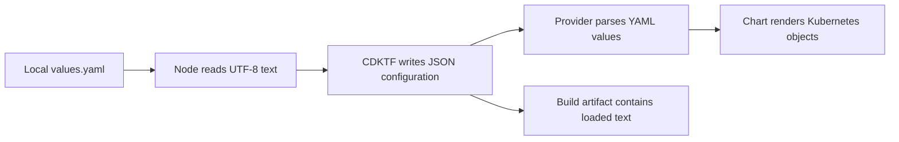

# Load Local Helm Values in CDKTF Without Losing Multiline Strings

Author: [nawazdhandala](https://www.github.com/nawazdhandala)

Tags: CDKTF, Terraform, Helm, TypeScript

Description: Load local Helm YAML as raw text, verify multiline values through synthesis and rendering, and keep secret material out of generated CDKTF configuration.

A values file can look correct in your editor yet reach Helm as a filename, a doubly encoded string, or text with its line breaks removed. These mistakes happen at different stages. First establish what CDKTF sends to Terraform, then inspect what the chart renders.

This tutorial uses a tiny local chart containing one ConfigMap, a Kubernetes object for non-secret configuration. It gives you a reproducible example without needing a cluster. The same loading pattern applies to an existing chart, but its supported value names must come from that chart's documentation.

CDKTF means Cloud Development Kit for Terraform. HashiCorp deprecated it on December 10, 2025; this is maintenance guidance for existing projects. The example uses CDKTF CLI/core 0.21.0, constructs 10.8.1, TypeScript 5.8.3, ts-node 10.9.2, and the prebuilt Helm binding 12.1.2, which targets Terraform Helm provider 3.1.1. These are explicit example versions, not a recommendation to start a new CDKTF project. See the [CDKTF notice](https://developer.hashicorp.com/terraform/cdktf) and [versioned binding](https://github.com/cdktf/cdktf-provider-helm/tree/v12.1.2).

## Follow the value through three representations

The provider's `values` argument accepts a list of raw YAML strings. It does not accept a list of paths to YAML files. See the [Helm 3.1.1 release schema](https://github.com/hashicorp/terraform-provider-helm/blob/v3.1.1/docs/resources/release.md).



A JSON string displays line breaks as `\n`. That escaping is expected: parsing the JSON reconstructs the line breaks. Replacing those characters manually can corrupt perfectly valid generated configuration. Conversely, seeing readable YAML in the original file does not prove the template uses it correctly.

## Make a small chart you can inspect

Use a disposable TypeScript CDKTF project configured to run `npx ts-node main.ts`, with the versions above installed. Keep `main.ts`, `values.yaml`, and a `chart` directory beside one another. Create `chart/templates` before adding these files.

Put this in `chart/Chart.yaml`:

```yaml
apiVersion: v2
name: multiline-demo
version: 0.1.0
type: application
```

Then create `chart/templates/configmap.yaml`:

```yaml
apiVersion: v1
kind: ConfigMap
metadata:
  name: {{ .Release.Name }}
data:
  message: {{ .Values.message | quote }}
```

This is a Helm template, so an ordinary YAML parser cannot validate it before rendering. The `quote` function produces a quoted string containing the supplied message. The chart deliberately has no workload, image dependency, credential, or installation hook.

Create `values.yaml`:

```yaml
message: |
  First line: ready
  Second line: keep this newline
```

The vertical bar makes a literal block: these two lines remain separate, including a final newline. A folded block using `>` can turn line breaks into spaces; `|-` removes the final newline. Choose based on the application consuming the text, especially for scripts or certificate material. See [Helm's YAML techniques](https://helm.sh/docs/chart_template_guide/yaml_techniques/).

## Read the file once, without re-encoding it

Use this complete `main.ts`:

```typescript
import { readFileSync } from "node:fs";
import { resolve } from "node:path";
import { App, TerraformStack } from "cdktf";
import { HelmProvider } from "@cdktf/provider-helm/lib/provider";
import { Release } from "@cdktf/provider-helm/lib/release";

const app = new App();
const stack = new TerraformStack(app, "helm-values");
new HelmProvider(stack, "helm", {
  kubernetes: { configPath: "/REPLACE/WITH/approved-kubeconfig" },
});
new Release(stack, "example", {
  name: "multiline-demo",
  chart: resolve(__dirname, "chart"),
  namespace: "default",
  values: [readFileSync(resolve(__dirname, "values.yaml"), "utf8")],
});
app.synth();
```

The kubeconfig path is an explicit placeholder. Replace it with an approved configuration before any cluster operation. Synthesis and the local rendering below do not use that credential or contact Kubernetes.

`readFileSync` with `utf8` returns text rather than a byte buffer. Resolving from `__dirname` makes the input relative to this source file when run with ts-node, instead of whichever directory launched the command. If you later compile into a different directory, copy the supporting files there or deliberately change the path strategy. The [Node file API](https://nodejs.org/docs/latest-v24.x/api/fs.html#fsreadfilesyncpath-options) documents the return behavior.

Do not wrap this text in `JSON.stringify`, split it into lines, or replace newlines with spaces. CDKTF handles the JSON serialization. Also notice the chart path is absolute in this simple lab: moving only `cdktf.out` to another machine will not transport that chart. Package or stage the chart at an available path in a real deployment workflow.

## Check the generated text and rendered object separately

From the project root, with the pinned tools installed, run:

```bash
npx tsc --noEmit
npx cdktf synth
helm lint chart -f values.yaml
helm template multiline-demo chart -f values.yaml > rendered.yaml
```

The first two commands check TypeScript and generate Terraform configuration. The latter two use Helm locally; this example was checked with Helm 3.17.3. Successful [linting](https://helm.sh/docs/helm/helm_lint/) and [template rendering](https://helm.sh/docs/helm/helm_template/) are not a Kubernetes API compatibility test or proof that a release can install.

Use this read-only check to compare the synthesized string without printing its contents:

```javascript
// Save as check-values.cjs; run with: node check-values.cjs
const assert = require("node:assert/strict");
const fs = require("node:fs");
const config = JSON.parse(fs.readFileSync(
  "cdktf.out/stacks/helm-values/cdk.tf.json", "utf8"));
const releases = Object.values(config.resource.helm_release);
assert.equal(releases.length, 1);
assert.deepEqual(releases[0].values,
  [fs.readFileSync("values.yaml", "utf8")]);
console.log("Loaded YAML matches the source file");
```

For this intentionally non-secret fixture, inspect `rendered.yaml`. Its `message` should be a quoted string with two escaped newlines, representing the two original lines and their terminating newline. The comparison isolates loading problems; rendering isolates chart problems. If the string matches but the object is wrong, investigate the chart's template and expected value type before changing your file reader.

## Keep secrets outside this loading path

Reading a password from an ignored local file still embeds it in generated configuration. Ignoring the source file in Git does not protect CI artifacts, debugging output, or Terraform state. Ordinary sensitive values remain stored in state and saved plans even when Terraform hides them in normal displays. See [Terraform sensitive-data handling](https://developer.hashicorp.com/terraform/language/manage-sensitive-data).

| Input choice | What to review |
|---|---|
| Non-secret YAML read during synthesis | Generated configuration contains its text |
| Provider `setSensitive` | Redaction is not removal from state |
| Chart reference to a separately managed Secret | Confirm the chart supports the reference and never receives the secret value |
| Write-only provider argument | Verify exact version support and the entire secret delivery path |

Provider 3.1.1 documents `set_wo` and a revision field for write-only updates. That is a different mechanism from `set_sensitive`; it does not retroactively remove literals already embedded by your program. This tutorial does not exercise that feature. Do not claim a secret-free workflow merely because a terminal output is masked.

Terraform's `file` function, exposed through CDKTF's function bindings, defers reading to Terraform rather than Node. It requires a file available at evaluation time; it is neither a secret store nor an automatic file-transfer mechanism. Review [CDKTF functions](https://developer.hashicorp.com/terraform/cdktf/concepts/functions) and [Terraform file](https://developer.hashicorp.com/terraform/language/functions/file) before choosing that alternative.

For an existing application chart, first look for a documented reference to an existing Kubernetes Secret. Keep only that reference and ordinary settings in committed values. Verify which component creates the Secret, who can read it, and how rotation reaches the application. The loading fix is complete when the intended text survives synthesis and rendering; secret handling needs its own explicit design.
