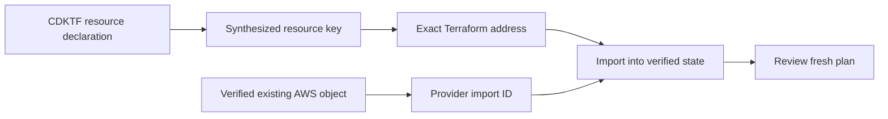

# Import Existing Resources at the Correct CDKTF Terraform Address

Author: [nawazdhandala](https://www.github.com/nawazdhandala)

Tags: CDKTF, Terraform, AWS, Troubleshooting

Description: Find the exact synthesized CDKTF resource address before importing an existing object, verify its provider and state destination, then review the resulting plan.

An existing AWS log group is named `/example/existing-app`. Your CDKTF code calls its construct `application`. Neither string necessarily identifies the Terraform address where the object should be imported.

Import connects an existing remote object to an address in Terraform state. If the address does not match the configuration CDKTF generates, the next plan can describe an unwanted create or an object that no longer has configuration. The reliable starting point is the synthesized resource map, followed by verification of the backend, workspace, and provider that will perform the import.

This guide uses CDKTF CLI/core `0.21.0` and Terraform CLI syntax verified with `1.11.4`. HashiCorp deprecated CDKTF on December 10, 2025, so the workflow is intended for maintaining existing applications. [CDKTF status](https://developer.hashicorp.com/terraform/cdktf).

## Separate the address from the import ID

Terraform's command takes two distinct arguments:

```text
terraform import ADDRESS ID
```

`ADDRESS` identifies the resource in your Terraform configuration and state. `ID` is the provider-specific identifier of the existing object. Terraform requires each managed remote object to be associated with one resource address; importing an already managed object under another address can create conflicting ownership. [Terraform import reference](https://developer.hashicorp.com/terraform/cli/commands/import).

For the example in this article:

| Item | Meaning |
| --- | --- |
| `application` | CDKTF construct ID within its parent |
| Generated `aws_cloudwatch_log_group.<logical-name>` | Terraform resource address |
| `/example/existing-app` | AWS log group name and import ID |
| Account and region | Context in which that name identifies the intended object |

A nested CDKTF construct is not automatically a Terraform child module. Read the emitted configuration to determine the actual address rather than inventing a `module.logging` prefix.



## Declare the intended object before importing

Use a disposable review project or a branch of the actual application. This example uses `@cdktf/provider-aws` `21.22.1`, whose published metadata targets Terraform AWS provider `6.25.0`. The tested TypeScript environment used Constructs `10.8.1`, TypeScript `5.8.3`, ts-node `10.9.2`, and Node `24.1.0`. [Exact binding metadata](https://registry.npmjs.org/@cdktf/provider-aws/21.22.1).

The complete `main.ts` below intentionally places the resource under a nested construct. Replace the account, region, name, and retention with the verified existing object's settings before using it for an actual import. The account number is a placeholder, not a credential.

```typescript
import { Construct } from "constructs";
import { App, TerraformStack } from "cdktf";
import { AwsProvider } from "@cdktf/provider-aws/lib/provider";
import { CloudwatchLogGroup } from "@cdktf/provider-aws/lib/cloudwatch-log-group";

const app = new App();
const stack = new TerraformStack(app, "adoption");
const provider = new AwsProvider(stack, "aws", {
  region: "us-east-1",
  allowedAccountIds: ["111111111111"],
});
const logging = new Construct(stack, "logging");
new CloudwatchLogGroup(logging, "application", {
  provider,
  name: "/example/existing-app",
  retentionInDays: 30,
});
app.synth();
```

The provider is passed explicitly to the resource. The sample retention is not a claim about your object: copying it unchanged could propose a retention change after import. Match encryption, tags, class, and other relevant settings too. The AWS provider documentation specifies that log groups are imported using their name, and identifies which configuration arguments can change or replace them. [AWS provider 6.25.0 log group reference](https://github.com/hashicorp/terraform-provider-aws/blob/v6.25.0/website/docs/r/cloudwatch_log_group.html.markdown).

## Read the generated address, including nesting effects

With the pinned CLI on your path and `npx ts-node main.ts` configured as the application command, run:

```bash
cdktf synth
```

Then run this Node inspection from the project directory:

```bash
node <<'JS'
const fs = require("node:fs");
const config = JSON.parse(fs.readFileSync(
  "cdktf.out/stacks/adoption/cdk.tf.json", "utf8"
));
for (const [type, entries] of Object.entries(config.resource || {})) {
  for (const [logicalName, resource] of Object.entries(entries)) {
    console.log(JSON.stringify({
      address: `${type}.${logicalName}`,
      name: resource.name,
      provider: resource.provider || "implicit default"
    }));
  }
}
JS
```

This prints resource addresses from the generated root configuration. It makes no AWS calls and does not touch state. Copy the address of the entry whose name and provider match the intended object. Do not rebuild the logical name from memory or copy a hash from another project.

The exact application compiled and synthesized locally. Its nested resource received a generated logical name rather than simply `application`. That is why the inspection command is part of the workflow, even when the source looks straightforward. CDKTF describes resources as constructs translated into Terraform configuration in its [resource documentation](https://developer.hashicorp.com/terraform/cdktf/concepts/resources).

This script intentionally lists root resource declarations only. A resource inside a real Terraform module needs its module address. A resource using `count` or `for_each` also needs the relevant instance index or key, such as `[0]` or `["blue"]`. Quote a complete address when passing it to the shell. [Terraform resource addressing](https://developer.hashicorp.com/terraform/cli/state/resource-addressing).

## Confirm the state destination and current ownership

Before changing state, use the approved initialized working directory for this stack. Verify its backend and selected workspace against the deployment configuration. The directory name alone does not prove that it points to the correct remote state.

```bash
stack_dir='cdktf.out/stacks/adoption'
terraform -chdir="$stack_dir" workspace show
terraform -chdir="$stack_dir" state list
```

Review the listed addresses for an existing binding, and check the team's other state ownership records if this object may already be managed elsewhere. `state list` only describes the selected state; an empty result is not proof that no other stack owns the object. [Terraform state list](https://developer.hashicorp.com/terraform/cli/commands/state/list).

Keep the reviewed source and synthesized artifact stable through this operation. Changing construct parents or IDs between discovering the address and importing changes the question you are answering. Avoid editing `cdk.tf.json` to hide a mismatch: the next synth would replace that manual edit.

## Import once, then inspect the plan

After verifying the object, provider identity, state destination, and exact address, use the source-verified command below. It changes state and reads AWS through the configured provider. This step was not executed against AWS for this article.

```bash
address='REPLACE_WITH_ADDRESS_FROM_SYNTHESIZED_JSON'
terraform -chdir="$stack_dir" import -input=false -lock-timeout=2m \
  "$address" '/example/existing-app'
```

Replace both placeholders as appropriate for your approved object. Retain locking and provide the same required input values and authentication used by the stack. The command-line import operation does not write matching TypeScript for you; the resource declaration must remain in the application.

After a successful import, inspect the bound object and request a fresh plan:

```bash
terraform -chdir="$stack_dir" state show "$address"
terraform -chdir="$stack_dir" plan -input=false -lock-timeout=2m
```

`state show` displays a single resource's attributes, which may contain sensitive information. Review it in an appropriate environment. [Terraform state show](https://developer.hashicorp.com/terraform/cli/commands/state/show).

Do not treat an import success message as permission to apply the next plan. Verify that the intended address is present, that Terraform is not proposing a duplicate create, and that any configuration differences are understood. If the address is wrong, pause and review a deliberate state correction with the state owner; do not import the same object again under another guessed name.

A completed adoption has three matching pieces: the existing object's identity, the generated resource address, and a reviewed plan for that address. Preserving those three facts makes later refactoring a separate, reviewable change.
