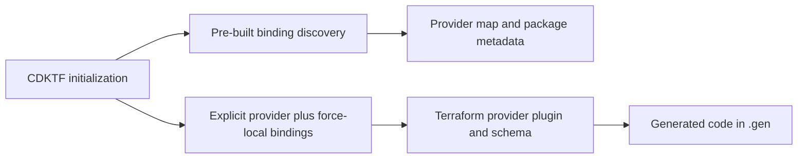

# Recover CDKTF Init with Locally Generated Provider Bindings

Author: [nawazdhandala](https://www.github.com/nawazdhandala)

Tags: CDKTF, Terraform, TypeScript, Troubleshooting

Description: Bypass CDKTF pre-built provider discovery with version-pinned local bindings, while preserving existing projects and separating metadata failures from downloads.

CDKTF initialization can fail with “Unable to request pre-built provider information” before your application has any infrastructure to deploy. The error concerns discovery of packaged provider bindings, not proof that your cloud credentials or Terraform state are wrong.

There is a supported switch in CDKTF 0.21.0 for generating bindings locally. The important detail is that it differs from `--local`, which chooses local state storage. Using the wrong flag leaves the failing discovery path in place.

This is a maintenance workflow for existing CDKTF users. HashiCorp [deprecated CDKTF on December 10, 2025](https://developer.hashicorp.com/terraform/cdktf) and no longer maintains it. The pinned example below demonstrates recovery behavior; it is not a recommendation to start a new long-lived platform on an unsupported tool.

## Identify the failing layer

A Terraform provider is a plugin that implements resources and data sources. A CDKTF provider binding is programming-language code generated from that provider's schema. Pre-built bindings package that generated code for installation through a language package manager.

In the [0.21.0 discovery implementation](https://github.com/hashicorp/terraform-cdk/blob/v0.21.0/packages/@cdktf/cli-core/src/lib/dependencies/prebuilt-providers.ts), CDKTF requests a provider map from `https://www.cdk.tf/.well-known/prebuilt-providers.json`. The same component also performs package-metadata requests. Its network-error message does not establish which network layer failed; inspect the surrounding log and destination before choosing a repair.

A proxy, DNS failure, TLS trust problem, or unavailable metadata endpoint can interrupt this stage. Do not disable certificate verification as a workaround. Local binding generation bypasses pre-built binding discovery, but still needs the provider schema and the dependencies used to generate and run the application.



The second path removes a particular dependency from discovery. It does not turn initialization into an offline operation.

## Preserve a partially created project

Before retrying, inspect the working directory. Initialization may already have created `package.json`, `cdktf.json`, source files, or dependency files before failing. Preserve those files and any edits. Do not repeatedly initialize over an existing application or delete state to repair a provider-metadata request.

If the directory is a disposable failed scaffold, create a separate empty recovery directory for comparison. If it contains an established project, use the existing-project procedure below. Keep its backend configuration unchanged: a binding-generation problem does not justify moving remote state to local storage.

Record the CLI version and the intended provider version. These are separate version numbers. A binding package version is also not automatically the same as its underlying Terraform provider version.

## Initialize a controlled TypeScript example

The example uses CDKTF CLI/core 0.21.0, Terraform 1.11.4, and `hashicorp/random` 3.6.3. The Random provider avoids cloud credentials for this generation exercise. Install Terraform and Node.js through your approved toolchain first; the [tagged TypeScript template](https://github.com/hashicorp/terraform-cdk/blob/v0.21.0/packages/@cdktf/cli-core/templates/typescript/package.json) requires Node.js 20.9 or newer. The validation environment used Node.js 24.1.0 on macOS arm64.

Run this from a new, empty directory. `npx` may download the pinned CLI package, and initialization installs language dependencies:

```bash
npx --yes cdktf-cli@0.21.0 init \
  --template=typescript \
  --local \
  --cdktf-version=0.21.0 \
  --project-name=local-bindings-lab \
  --project-description='Local binding recovery validation' \
  --from-terraform-project=no \
  --enable-crash-reporting=false \
  --providers='hashicorp/random@=3.6.3' \
  --providers-force-local
```

The [tagged init command](https://github.com/hashicorp/terraform-cdk/blob/v0.21.0/packages/cdktf-cli/src/bin/cmds/init.ts) defines these options. Two arguments work together: `--providers` supplies the provider without the interactive catalog chooser, and `--providers-force-local` chooses local generation. Supplying only the latter can still leave interactive provider discovery relevant.

`--local` is appropriate here because this is an isolated lab. It controls state storage, as explained in the [project setup documentation](https://developer.hashicorp.com/terraform/cdktf/create-and-deploy/project-setup). It does not mean “install dependencies from disk.”

After successful initialization, inspect `cdktf.json`. Its provider list should contain:

```json
{
  "terraformProviders": ["hashicorp/random@=3.6.3"]
}
```

This is a relevant excerpt, not a replacement for the full file. Preserve its language, application command, project information, and other settings. Generated bindings should appear below `.gen/providers/random` in this template.

## Keep the language toolchain reproducible

A pinned CDKTF CLI does not freeze every dependency installed by its template. In an existing project, retain the reviewed lockfile and compatible compiler versions. In the isolated example, use these explicit TypeScript runtime/compiler pins before synthesis:

```bash
npm install --save-dev --save-exact \
  typescript@5.8.3 ts-node@10.9.2 @types/node@22.14.0
```

These are the versions used for this article's synthesis check, not a general upgrade prescription. The [ts-node installation guidance](https://typestrong.org/ts-node/docs/installation/) explains local compiler resolution. A compiler-loading failure after binding generation is a different layer from the original metadata failure; preserve the new error instead of assuming the workaround failed.

Review the resulting dependency lockfile. Do not use an automatic broad dependency upgrade to diagnose this specific problem.

## Use local imports and synthesize a small stack

In the disposable lab, replace its empty `main.ts` with:

```typescript
import { Construct } from "constructs";
import { App, TerraformStack } from "cdktf";
import { RandomProvider } from "./.gen/providers/random/provider";
import { Pet } from "./.gen/providers/random/pet";

class RecoveryStack extends TerraformStack {
  constructor(scope: Construct, id: string) {
    super(scope, id);
    new RandomProvider(this, "random", {});
    new Pet(this, "example", { length: 2 });
  }
}

const app = new App();
new RecoveryStack(app, "recovery");
app.synth();
```

The imports deliberately reference generated local code. They do not use an `@cdktf/provider-random` pre-built package. The provider and resource constructors correspond to the generated 3.6.3 schema bindings.

Now synthesize:

```bash
npx --yes cdktf-cli@0.21.0 synth
```

Inspect `cdktf.out/stacks/recovery/cdk.tf.json` for the Random provider requirement and the `random_pet` resource with length two. Synthesis produces Terraform configuration; it does not create the resource. The [CLI reference](https://developer.hashicorp.com/terraform/cdktf/cli-reference/commands) documents generation and synthesis operations.

## Recover an existing project without reinitializing it

For an existing compatible 0.21.0 project, review its provider declarations and imports first. The provider-add command uses a different flag spelling:

```bash
npx --yes cdktf-cli@0.21.0 provider add \
  'hashicorp/random@=3.6.3' --force-local
npx --yes cdktf-cli@0.21.0 get
```

The [tagged provider-add command](https://github.com/hashicorp/terraform-cdk/blob/v0.21.0/packages/cdktf-cli/src/bin/cmds/provider-add.ts) defines `--force-local`. Review the resulting configuration diff, update affected imports intentionally, and synthesize the existing stacks. Avoid mixing generated and pre-built bindings for the same provider without understanding the code changes.

If generation now fails while installing the Terraform plugin, investigate that destination separately. Restricted environments may need a configured [Terraform provider mirror](https://developer.hashicorp.com/terraform/cli/config/config-file#provider-installation), along with approved language-package access. “Local bindings” describes where code is generated, not where every input originates.

Finish by verifying generated files, compatible imports, and synthesized provider requirements. Keep deployment as a separate reviewed action. Recovering initialization should give you reproducible configuration and clear evidence of the dependency that failed, without changing infrastructure or relocating state.
