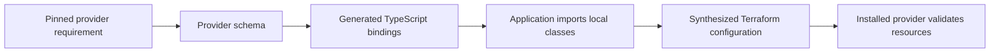

# Fix Missing CDKTF Resources by Regenerating Provider Bindings

Author: [nawazdhandala](https://www.github.com/nawazdhandala)

Tags: CDKTF, Terraform, TypeScript

Description: Diagnose missing CDKTF resource classes by checking the installed provider schema, generating pinned local bindings, and validating the resulting Terraform configuration.

A Terraform resource appears in the documentation, but your CDKTF application cannot import its class. Installing the newest npm package is one possible response, but it skips the most useful question: which provider schema does your application actually use?

A binding is generated programming-language code that describes a Terraform provider's resources and arguments. The provider itself is a separate executable. Missing classes can therefore come from an older binding package, an incorrect import, failed generation, or a provider version that never supported that resource.

This walkthrough checks those boundaries with a small local example. It uses CDKTF CLI/core 0.21.0, constructs 10.8.1, TypeScript 5.8.3, ts-node 10.9.2, Terraform 1.11.4, and Random provider 3.6.3. CDKTF was deprecated on December 10, 2025, so treat this as maintenance guidance for existing projects. See the [official project notice](https://developer.hashicorp.com/terraform/cdktf).

## Identify which layer reports the error

A TypeScript import failure occurs before Terraform runs. An unsupported resource type reported by Terraform happens later. They require different investigations.

| Observation | First place to check |
|---|---|
| Cannot find an npm module | Installed dependencies and import path |
| Package exists but has no exported class | Package's generated API and embedded provider version |
| Local `.gen` import cannot be resolved | Generation output and project configuration |
| Terraform rejects a resource type | Selected provider executable and its schema |
| A data source exists but no resource does | Whether the provider supports creating that object |

A data source reads information; a resource manages something. Similar names do not make them interchangeable. Start with the documentation for the exact provider version and exact Terraform type, such as `random_bytes`, rather than guessing the TypeScript class name.

## Understand the two dependency paths

CDKTF supports prebuilt provider packages and locally generated bindings. A prebuilt package's npm version is not the same version number as its underlying Terraform provider. Local generation instead takes a provider requirement from `cdktf.json`. See [CDKTF provider integration](https://developer.hashicorp.com/terraform/cdktf/concepts/providers).



Regenerating `.gen` will not change an application that still imports from `@cdktf/provider-example`. Trace the actual import statements. Likewise, editing the generated class manually does not teach the provider executable a new resource type. The schema must support it first.

Before changing an established application, retain its current package lock, provider requirements, generated configuration, and relevant plan evidence. Do the experiment in a separate working directory. Provider upgrades can change behavior across existing resources even when your immediate goal is one missing class.

## Generate bindings for one exact provider version

For a disposable TypeScript project with the tool versions above already installed, use this `cdktf.json`. In an existing project, merge the provider requirement while preserving its application command and other providers.

```json
{
  "language": "typescript",
  "app": "npx ts-node main.ts",
  "sendCrashReports": "false",
  "terraformProviders": ["hashicorp/random@=3.6.3"]
}
```

The equals sign constrains generation to 3.6.3. Run from that project root, with Terraform available on PATH and access to an approved provider download source:

```bash
npx cdktf get
```

Expected output includes generated TypeScript constructs under `.gen`. This command generates language bindings; it does not create infrastructure. A download, schema extraction, or generator failure must be resolved before trying to compile imports. Refer to the [CDKTF get command](https://developer.hashicorp.com/terraform/cdktf/cli-reference/commands#get).

In this pinned example, `.gen/providers/random/bytes/index.ts` exports a class named `Bytes`. Its generated provider metadata identifies version 3.6.3. Use the generated names you actually find rather than assuming every Terraform resource prefix survives in the class name.

The [Random 3.6.3 documentation](https://github.com/hashicorp/terraform-provider-random/blob/v3.6.3/docs/resources/bytes.md) lists `random_bytes` and its required `length` argument. This resource is useful here because its schema can be checked without a cloud account. We will validate configuration only, without generating secret material through an apply.

## Compile a minimal application using those imports

Use this complete `main.ts`:

```typescript
import { App, TerraformStack } from "cdktf";
import { RandomProvider } from "./.gen/providers/random/provider";
import { Bytes } from "./.gen/providers/random/bytes";

const app = new App();
const stack = new TerraformStack(app, "schema-check");
new RandomProvider(stack, "random");
new Bytes(stack, "sample", { length: 16 });
app.synth();
```

The provider class and resource class both come from the local generated directory. Keeping that boundary consistent avoids accidentally proving that an unrelated prebuilt dependency works while the intended local binding remains unused.

Run:

```bash
npx tsc --noEmit
npx cdktf synth
```

The first command checks TypeScript without writing compiled JavaScript. Synthesis should produce `cdktf.out/stacks/schema-check/cdk.tf.json`, containing a `random_bytes` resource with length 16 and a Random provider requirement constrained to 3.6.3. If compilation succeeds but the resource is absent from the JSON, check whether your application instantiates it and whether you inspected the correct stack.

## Ask the installed provider what it supports

Now initialize only the disposable synthesized directory and export its schema:

```bash
terraform -chdir=cdktf.out/stacks/schema-check init -input=false
terraform -chdir=cdktf.out/stacks/schema-check providers schema -json > provider-schema.json
terraform -chdir=cdktf.out/stacks/schema-check validate
```

This new disposable stack uses CDKTF's local backend and has no existing state. Initialization configures that backend, installs providers, and creates a dependency lock file. Do not run this example against an unrelated production backend. Skipping backend initialization can leave `providers schema` unable to run when the generated configuration contains an explicit backend. Review [terraform init](https://developer.hashicorp.com/terraform/cli/commands/init) before adapting it to another workflow.

Inspect one precise schema entry with this read-only Node script, saved as `check-schema.cjs` and run using `node check-schema.cjs`:

```javascript
const assert = require("node:assert/strict");
const fs = require("node:fs");
const schema = JSON.parse(fs.readFileSync("provider-schema.json", "utf8"));
const provider = schema.provider_schemas["registry.terraform.io/hashicorp/random"];
assert.ok(provider, "Expected Random provider schema");
const resource = provider.resource_schemas.random_bytes;
assert.ok(resource, "Selected provider has no random_bytes resource");
assert.equal(resource.block.attributes.length.required, true);
console.log("random_bytes exists and requires length");
```

This checks the provider executable's schema, independently of TypeScript autocomplete. For another provider, replace both the fully qualified provider address and resource key after verifying them. The [schema command documentation](https://developer.hashicorp.com/terraform/cli/commands/providers/schema) defines this JSON structure.

Do not confuse a resource schema's numeric `version` field with the provider release number. Confirm the selected provider release in initialization output and `.terraform.lock.hcl`. The [dependency lock file](https://developer.hashicorp.com/terraform/language/files/dependency-lock) records provider selections and checksums; it serves a different purpose from npm's lock file.

## Choose the next fix from the evidence

If the resource exists in the schema but no corresponding class was generated, retain the exact schema, generation logs, and tool versions for a small reproduction. Check generator failures before widening version constraints. If the class exists but the compiler cannot resolve it, focus on import paths and TypeScript configuration.

If the resource is absent from the schema, regeneration cannot manufacture it. Find a documented provider release that supports it, review that release's upgrade implications, and repeat the isolated exercise with that exact version. Avoid changing every provider at once.

Finally, a successful [Terraform validate](https://developer.hashicorp.com/terraform/cli/commands/validate) establishes configuration consistency with the installed provider. It does not establish cloud permissions, API availability, or a safe production change. Review a plan against the intended environment before deployment. The useful result is a traceable chain from provider requirement to schema, generated class, application import, and synthesized resource.
