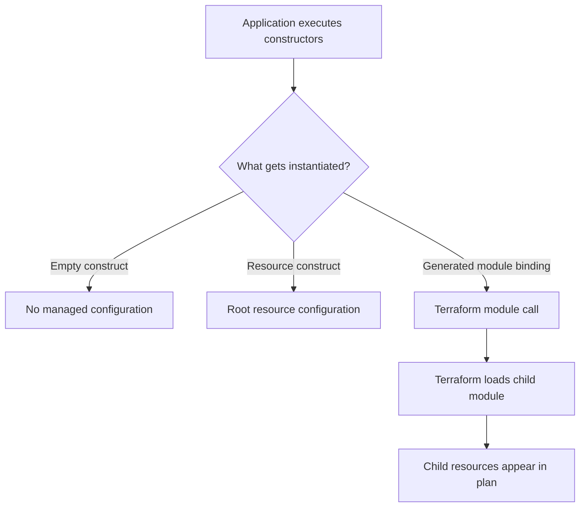

# Why a CDKTF Module Produces No Resources

Author: [nawazdhandala](https://www.github.com/nawazdhandala)

Tags: CDKTF, Terraform, TypeScript, Troubleshooting

Description: Distinguish plain constructs from generated Terraform module bindings, instantiate the right object, and inspect module blocks before concluding resources are missing.

Your application imports a class called `NetworkModule`, synthesis succeeds, and the plan contains no new resources. The class name sounds like infrastructure, but it does not explain what the application actually constructed.

In CDKTF, “module” can mean a TypeScript source module, a reusable construct, or a Terraform module called through generated bindings. Those meanings lead to different synthesized output. Diagnose the missing behavior by following the object from its constructor to the emitted Terraform configuration and then to the plan.

The executable example uses CDKTF CLI/core `0.21.0` and Terraform `1.11.4`. CDKTF was deprecated on December 10, 2025, so this is guidance for understanding and maintaining an existing application. [Official CDKTF status](https://developer.hashicorp.com/terraform/cdktf).

## Identify which kind of module you have

| What you have | What it does | Expected evidence |
| --- | --- | --- |
| TypeScript file or package | Exports code that other code can import | An import alone does not declare infrastructure |
| Class extending `Construct` | Groups behavior and child constructs | Resources only if its executed code creates them |
| Generated class extending `TerraformModule` | Represents a Terraform module call | A `module` entry after instantiation |
| Terraform module source | Contains Terraform configuration | Terraform loads and evaluates it during initialization and planning |

Constructs are building blocks for organizing resources and behavior. A custom construct can create several resources, wrap another construct, or create none. Extending `Construct` does not turn arbitrary fields into provider resources. [CDKTF construct documentation](https://developer.hashicorp.com/terraform/cdktf/concepts/constructs).



This is why searching only for a root `resource` object in `cdk.tf.json` is not a complete resource inventory. A module call can contain the resources one level below that root configuration.

## Reproduce an empty construct

In a disposable TypeScript CDKTF project, this complete `main.ts` synthesizes successfully but declares no managed resources:

```typescript
import { Construct } from "constructs";
import { App, TerraformStack } from "cdktf";

class EmptyModule extends Construct {
  constructor(scope: Construct, id: string) {
    super(scope, id);
  }
}
const app = new App();
const stack = new TerraformStack(app, "module-demo");
new EmptyModule(stack, "empty");
app.synth();
```

The constructor adds an organizational node to the construct tree. It never instantiates a provider resource or a Terraform module binding. Renaming `EmptyModule` to `ProductionNetwork` would not change that behavior.

Run synthesis and inspect the output:

```bash
cdktf synth
```

For this example, `cdktf.out/stacks/module-demo/cdk.tf.json` has no resource or module declarations. Backend and metadata entries may still exist. In the local test, generating bindings beforehand did not change that result: files under `.gen` were available, but the application had not used them.

## Create a small real Terraform module

A Terraform module is a directory of Terraform configuration. To make the distinction concrete without using a cloud account, create `modules/marker/main.tf`:

```hcl
terraform {
  required_version = ">= 1.4.0"
}
variable "label" {
  type = string
}
resource "terraform_data" "marker" {
  input = var.label
}
output "label" {
  value = terraform_data.marker.output
}
```

`terraform_data` is a built-in resource that follows Terraform's managed lifecycle without directly provisioning an external service. It needs no separately installed provider. The module's input becomes a value tracked by that resource, and the output exposes it. [Terraform data resource reference](https://developer.hashicorp.com/terraform/language/resources/terraform-data).

Add the local module to the project's `cdktf.json`:

```json
{
  "language": "typescript",
  "app": "npx ts-node main.ts",
  "sendCrashReports": "false",
  "terraformProviders": [],
  "terraformModules": [
    { "name": "marker", "source": "./modules/marker" }
  ]
}
```

This is a complete configuration for the disposable example, not a replacement for an existing application's other provider and module entries. Local modules use the object form with a name and source. [CDKTF module configuration](https://developer.hashicorp.com/terraform/cdktf/concepts/modules).

Now generate bindings with the pinned CLI:

```bash
cdktf get
```

In the tested `0.21.0` project, this created `.gen/modules/marker.ts`, exporting a `Marker` class with a required `label` input and a `labelOutput` accessor. Binding generation creates the language interface; it does not instantiate the module in your stack. [CDKTF get command](https://developer.hashicorp.com/terraform/cdktf/cli-reference/commands#get).

## Instantiate the generated binding

Replace the disposable application's `main.ts` with:

```typescript
import { App, TerraformStack, TerraformOutput } from "cdktf";
import { Marker } from "./.gen/modules/marker";

const app = new App();
const stack = new TerraformStack(app, "module-demo");
const marker = new Marker(stack, "used", { label: "module-demo" });
new TerraformOutput(stack, "label", { value: marker.labelOutput });
app.synth();
```

The important operation is `new Marker(...)`. It attaches a Terraform module call to this stack. The output accessor represents the child module's output; it is not the concrete value during synthesis.

Run synthesis again. This time, inspect the top-level `module` object in the generated JSON. It should contain `used`, its module source, and `label: "module-demo"`. The root may still have no `resource` object, because `terraform_data.marker` lives inside the Terraform module.

That distinction is normal Terraform behavior: a `module` block calls a child module whose own configuration contains resources. [Terraform module block reference](https://developer.hashicorp.com/terraform/language/block/module).

## Validate the child module and inspect its plan

For the disposable local-backend example, initialize and plan the generated stack:

```bash
terraform -chdir=cdktf.out/stacks/module-demo init -input=false
terraform -chdir=cdktf.out/stacks/module-demo validate
terraform -chdir=cdktf.out/stacks/module-demo plan -input=false
```

The expected plan includes `module.used.terraform_data.marker` with one resource to add. That outcome was verified locally after both TypeScript compilation and synthesis. No apply was run, so the test did not persist the marker resource into state.

Initialization resolves the module source and prepares its dependencies. [Terraform initialization](https://developer.hashicorp.com/terraform/cli/commands/init).

Use `cdktf synth` for this local-module example. The CLI supplies module-path context, and CDKTF packages the configured local module as an asset. Running the TypeScript entry point directly without that context failed in the test. When transferring generated output, retain the referenced asset directory as well as the JSON. Binding generation alone does not perform this synthesis step. [Tagged module-asset implementation](https://github.com/hashicorp/terraform-cdk/blob/v0.21.0/packages/cdktf/lib/terraform-module-asset.ts).

## Trace the failure at the correct layer

If your real project still produces no resources, work through the evidence in order:

1. Confirm that the application entry point instantiates the intended stack and executes `app.synth()`.
2. Confirm that the relevant constructor runs. A class definition or import does not call it, and an application-language conditional may skip it.
3. Inspect the constructor body. A plain construct needs to create resource or module children if that is its purpose.
4. Inspect the generated stack's `resource` and `module` entries, not just one of them.
5. If a module call exists, inspect the Terraform module source, its inputs, and the resulting plan. Internal `count = 0`, empty iteration inputs, or feature flags can legitimately suppress resources.
6. If the plan says no changes, check whether the resources already exist in the selected state. “No new resources” and “no resources configured” are different findings.

Do not extend `TerraformModule` merely to group resource constructs. In this release, that class represents a module call and rejects nested construct children. Use `Construct` for resource composition. [Tagged TerraformModule implementation](https://github.com/hashicorp/terraform-cdk/blob/v0.21.0/packages/cdktf/lib/terraform-module.ts).

Do not make an empty constructor appear productive by adding unrelated resources. Decide whether the abstraction should create resources directly or call a Terraform module, then test for that specific emitted configuration.

The local comparison showed the useful boundary: an instantiated empty construct emitted neither resources nor modules; an instantiated generated binding emitted one module call; Terraform then planned the child resource. Keep those three observations separate when reviewing a reusable abstraction, and the apparently empty deployment becomes a much smaller problem to diagnose.
