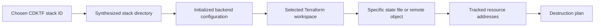

# Diagnose CDKTF Nothing to Destroy by Checking the Selected State

Author: [nawazdhandala](https://www.github.com/nawazdhandala)

Tags: CDKTF, Terraform, Infrastructure as Code

Description: Trace an empty CDKTF destruction plan through stack selection, backend configuration, workspace, and state location before attempting cleanup.

You can still see the infrastructure, but CDKTF reports nothing to destroy. That result does not establish that the infrastructure is gone. It establishes that the selected operation found no destruction work in the state and configuration it used.

Terraform state is the record connecting resource addresses in your code to managed objects. A different state file can be perfectly valid and completely unrelated to the resources you intended to remove. Before retrying a destructive command, identify that record.

This guide uses CDKTF 0.21.0 and Terraform 1.11.4 for a local demonstration. CDKTF is deprecated, so the guidance is for maintaining existing applications; see the [official CDKTF notice](https://developer.hashicorp.com/terraform/cdktf). No cloud resources need to be created or deleted to reproduce the selection problem.

## Trace the selection before changing anything

There are several separate names in a CDKTF deployment:



The stack ID identifies a CDKTF stack. A workspace selects a state within a backend that supports workspaces. An S3 key identifies an object in a bucket. None of those names automatically proves the others are correct.

CDKTF's [versioned destroy implementation](https://github.com/hashicorp/terraform-cdk/blob/v0.21.0/packages/cdktf-cli/src/bin/cmds/destroy.ts) selects stacks by their IDs. A renamed class in your source code is not necessarily a renamed stack ID, and a renamed stack ID does not automatically migrate its old state. Look at the string passed to `TerraformStack`, then follow the generated configuration.

Pause cleanup retries while investigating. Retain the last successful deployment's source revision, generated artifact, stack ID, backend inputs, and CI job identity. These are more useful than a new empty plan whose origin is unclear.

## Inspect the exact generated stack

For an already initialized working directory, set this placeholder to the verified stack directory. Do not substitute a directory merely because its name resembles the service name.

```bash
stack_dir="/REPLACE/WITH/project/cdktf.out/stacks/STACK_ID"
terraform -chdir="$stack_dir" workspace show
terraform -chdir="$stack_dir" state list
```

[Workspace show](https://developer.hashicorp.com/terraform/cli/commands/workspace/show) reports the active workspace. [State list](https://developer.hashicorp.com/terraform/cli/commands/state/list) lists tracked addresses. Record the exit status as well as the output: a missing state file can produce an error, while an existing state containing no tracked resources can yield an empty listing. Neither should silently become a successful inventory of your intended deployment.

Read the stack's `cdk.tf.json` and compare its `terraform.backend` settings with the previous deployment. Review the initialized backend information and any `-backend-config` inputs used by CI too. Treat these files as sensitive because backend configuration can contain credentials. Do not paste whole files into public issue reports.

If the backend is not initialized, establish the correct backend inputs before running initialization. An empty directory plus a guessed backend is not a recovery plan. Terraform distinguishes reconfiguration from migration; understand the prompts and implications in the [init documentation](https://developer.hashicorp.com/terraform/cli/commands/init).

## Reproduce the problem with local state

Use a new disposable TypeScript CDKTF project configured with `"app": "npx ts-node main.ts"`. The tested toolchain used CLI/core 0.21.0, constructs 10.8.1, TypeScript 5.8.3, and ts-node 10.9.2. Add this complete `main.ts`:

```typescript
import { resolve } from "node:path";
import { App, LocalBackend, TerraformResource, TerraformStack } from "cdktf";

const app = new App();
for (const name of ["original", "renamed"]) {
  const stack = new TerraformStack(app, name);
  new LocalBackend(stack, { path: resolve(`${name}.tfstate`) });
  const marker = new TerraformResource(stack, "marker", {
    terraformResourceType: "terraform_data",
  });
  marker.addOverride("input", "local-state-demonstration");
}
app.synth();
```

This intentionally makes two stacks with identical resource definitions but different local state paths. The built-in [`terraform_data` resource](https://developer.hashicorp.com/terraform/language/resources/terraform-data) records a value in state; this example has no provisioner and creates no external infrastructure. The generic resource wrapper and override keep the demonstration independent of an additional provider package.

From the disposable project root, run:

```bash
npx tsc --noEmit
npx cdktf synth
terraform -chdir=cdktf.out/stacks/original init -input=false
terraform -chdir=cdktf.out/stacks/renamed init -input=false
terraform -chdir=cdktf.out/stacks/original apply
```

Review the apply prompt: it should create only `terraform_data.marker` in the `original` stack. Approve only that local demonstration. This writes `original.tfstate`; the `renamed` stack has not been applied.

Now compare two speculative destruction plans:

```bash
terraform -chdir=cdktf.out/stacks/renamed plan -destroy -input=false
terraform -chdir=cdktf.out/stacks/original plan -destroy -input=false
```

The first has nothing to destroy. The second proposes removing the marker from the original state. Neither command applies the proposed deletion. The [plan documentation](https://developer.hashicorp.com/terraform/cli/commands/plan) explains the destruction planning mode.

In the local verification, the original plan contained one delete action and the renamed plan contained none. The original marker remained in state. The lesson is not that a stack rename always loses state: these paths were deliberately different. An explicit backend can retain the same state location across a rename. Inspect the emitted configuration instead of inferring behavior from the new name.

## Compare remote state coordinates precisely

For S3, compare bucket, key, region, endpoint overrides if used, workspace, and the identity that can access the bucket. In the default workspace, the backend uses the configured key. A non-default workspace uses `<workspace_key_prefix>/<workspace_name>/<key>`, with `env:` as the default prefix. See the [S3 backend reference](https://developer.hashicorp.com/terraform/language/backend/s3).

That means `services/api.tfstate` and `env:/staging/services/api.tfstate` are different state objects. Finding one does not prove it is the object's history you need. Compare deployment records and known resource addresses before selecting it.

| Difference found | Appropriate next investigation |
|---|---|
| New local path after a checkout move | Locate the original retained state and deployment artifact |
| Changed remote key or workspace | Identify which location contains the last successful deployment |
| Correct state, wrong provider account or region | Verify provider authentication separately from backend access |
| Resources exist but no retained state tracks them | Plan a controlled state recovery or import process |
| Correct state and resources already removed | Review refresh results and external deletion history |

Backend credentials and provider credentials serve different purposes. Access to a state bucket does not prove that the provider is targeting the account containing the resources. CDKTF's [remote backend guidance](https://developer.hashicorp.com/terraform/cdktf/concepts/remote-backends) explains how the backend is configured separately.

## Recover ownership before resuming deletion

Once you identify the owning state, preserve a backend-native version or approved backup before any migration. A `terraform state pull` export can help inspection, but it may upgrade the exported representation to the local Terraform version; it is not necessarily an untouched historical copy. Treat state exports as secret-bearing artifacts. See [state pull](https://developer.hashicorp.com/terraform/cli/commands/state/pull).

Do not create replacement resources just to populate an empty state, import objects already owned by another state, or edit state identifiers to make the command proceed. If ownership records are missing, recovery is a separate task requiring evidence about the real objects and their previous management.

After restoring the intended backend selection, verify workspace, tracked addresses, provider identity, and the full destruction plan together. A successful diagnosis ends with a plan against the correct inventory. Whether to execute that plan remains an explicit operational decision, especially when other stacks depend on those resources.
