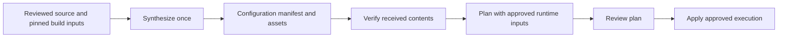

# Reuse Reviewed CDKTF Synth Output Safely in CI

Author: [nawazdhandala](https://www.github.com/nawazdhandala)

Tags: CDKTF, Terraform, CI/CD

Description: Preserve synthesized CDKTF configuration and assets across CI stages, verify artifact contents, and distinguish configuration approval from saved-plan approval.

A reviewer approves the Terraform configuration generated by CDKTF. Later, a deployment job installs dependencies again and runs synthesis with a different environment. Even if the source revision is unchanged, the configuration being deployed might differ from the artifact that was reviewed.

Treat synthesis as a build step with explicit inputs and a retained output. Pass the reviewed output to the next stage instead of silently rebuilding it. Then decide whether approval covers that configuration or a particular Terraform plan: those are different guarantees.

This guide targets CDKTF CLI/core `0.21.0` and Terraform `1.11.4`. HashiCorp deprecated CDKTF on December 10, 2025; preserving a known toolchain is especially relevant for existing projects. [CDKTF status](https://developer.hashicorp.com/terraform/cdktf).

## Define what crosses the stage boundary

`cdktf.out` contains synthesized stack configuration and a manifest used by CDKTF. Applications using assets can also produce files that Terraform configuration references. Copying one `cdk.tf.json` file can therefore leave the receiving job with a valid-looking configuration and missing payloads. [CDKTF assets](https://developer.hashicorp.com/terraform/cdktf/concepts/assets).



Retain enough context to explain the artifact:

| Record | Why it matters |
| --- | --- |
| Source revision and dependency lock | Identifies the application and libraries |
| CLI, core, compiler, Node and Terraform versions | Identifies the toolchain |
| Synthesis-time inputs | Explains configuration choices made by the application |
| Stack IDs and dependency manifest | Identifies the intended deployment units |
| Generated files and asset payloads | Supplies the actual configuration and referenced content |
| Backend/workspace and runtime input policy | Identifies where and with which values planning is allowed |

Avoid inserting credentials into this record. Record the approved source of runtime credentials and secrets rather than their values.

## Build a clean artifact, not a working-directory backup

Run synthesis in a fresh build workspace with reviewed dependency locks. Retain the complete relevant output layout and any externally referenced files that the application does not package automatically. Inspect file references, local modules, and executable hooks: a directory hash cannot make a missing external dependency portable.

Restore reviewed `.terraform.lock.hcl` files to the corresponding generated stack directories before taking the artifact snapshot, if your workflow manages those locks separately. Terraform's lock file records provider selections and checksums; the JavaScript lock file does not replace it. [Terraform dependency locking](https://developer.hashicorp.com/terraform/language/files/dependency-lock).

Do not package a deployment directory indiscriminately after initialization or apply. It can contain backend initialization data, downloaded plugins, state files, and plans. Keep the immutable configuration artifact separate from the receiving job's writable Terraform working directory. Initialization can create working files without changing the reviewed source artifact.

Also inspect backend paths. A local backend pointing to an absolute build-machine path is not automatically usable on another runner. In production, use the project's approved backend configuration and initialization process. Do not rewrite backend paths during transfer and still describe the result as the identical reviewed artifact.

## Verify file contents before execution

The following small Python program fingerprints regular files beneath `cdktf.out`. Save it as `artifact-fingerprint.py` outside that directory. It includes hidden files, rejects symbolic links, and requires the CDKTF manifest to exist. It does not run CDKTF or Terraform.

```python
import hashlib
import json
from pathlib import Path
import sys

root = Path(sys.argv[1])
if root.is_symlink() or not (root / "manifest.json").is_file():
    raise SystemExit("Expected a real CDKTF output directory with manifest.json")
files = {}
for path in sorted(root.rglob("*")):
    if path.is_symlink():
        raise SystemExit(f"Package a real file instead of a symlink: {path}")
    if path.is_file():
        digest = hashlib.sha256()
        with path.open("rb") as stream:
            for chunk in iter(lambda: stream.read(1024 * 1024), b""):
                digest.update(chunk)
        files[path.relative_to(root).as_posix()] = digest.hexdigest()
if len(sys.argv) == 3:
    expected = json.loads(Path(sys.argv[2]).read_text())
    if files != expected:
        raise SystemExit("Artifact files differ from the reviewed fingerprint")
    print("Artifact file contents match")
else:
    print(json.dumps(files, indent=2, sort_keys=True))
```

The code uses Python's documented [path handling](https://docs.python.org/3.13/library/pathlib.html) and [SHA-256 hashing](https://docs.python.org/3.13/library/hashlib.html). In the build job, write the fingerprint beside the output:

```bash
python3 artifact-fingerprint.py cdktf.out > reviewed-files.json
```

Upload both through your approved CI artifact mechanism. In the receiving job, before initialization or other modifications, verify:

```bash
python3 artifact-fingerprint.py cdktf.out reviewed-files.json
```

Success prints `Artifact file contents match`. Added, missing, or modified regular files cause a failure. The check deliberately concerns file names and bytes, not permissions or empty directories; preserve any required executable modes through the packaging mechanism too.

The fingerprint must come from the trusted reviewed build. If someone can replace both the output and its fingerprint, this comparison does not authenticate the artifact. Bind approval to the CI artifact identity and trusted build record as well as the content check.

## Reuse configuration with the supported CLI flag

CDKTF `0.21.0` supports skipping synthesis when the output is already present. With the reviewed artifact restored in a project context containing the expected `cdktf.json`, the source-verified command is:

```bash
cdktf deploy reviewed-stack --skip-synth --output cdktf.out
```

Replace `reviewed-stack` with the selected stack ID and use the pinned CLI. Preserve the configuration needed by that CLI; `--skip-synth` is not a promise that every project setting becomes unnecessary. The option is documented in the [CLI reference](https://developer.hashicorp.com/terraform/cdktf/cli-reference/commands) and declared in the [0.21.0 deploy source](https://github.com/hashicorp/terraform-cdk/blob/v0.21.0/packages/cdktf-cli/src/bin/cmds/deploy.ts).

This command can deploy infrastructure after its approval flow. It was checked against installed CLI help and source, not executed against an environment for this article. Skipping synthesis preserves the configuration input; it does not reuse an earlier approved plan. State, data sources, runtime variables, or provider behavior may have changed since that earlier review.

## Use a saved plan when approval covers exact planned actions

For a single initialized stack, a direct Terraform workflow can create and retain a saved plan:

```bash
stack_dir='cdktf.out/stacks/reviewed-stack'
terraform -chdir="$stack_dir" plan -input=false -out=approved.tfplan
terraform -chdir="$stack_dir" show -no-color approved.tfplan
```

Review the displayed plan before the authorized apply stage. Keep the same execution environment, backend/workspace, provider selections, referenced files, and required credentials available. Plans contain configuration and input information and must be handled as sensitive artifacts. [Terraform plan documentation](https://developer.hashicorp.com/terraform/cli/commands/plan).

After approval, applying the saved plan uses that plan rather than creating another one:

```bash
terraform -chdir="$stack_dir" apply -input=false approved.tfplan
```

Applying a saved plan does not prompt for another interactive approval. Place the approval gate before this command. If Terraform rejects a stale plan, regenerate and review a new plan instead of silently falling back to an unsaved apply. [Terraform apply documentation](https://developer.hashicorp.com/terraform/cli/commands/apply).

Direct Terraform execution also bypasses CDKTF's multi-stack scheduling. Preserve dependency order explicitly; a downstream plan may require an upstream stack's newly applied outputs. A single artifact can contain several stacks without making all their plans valid at the same time.

## Rehearse the handoff

In the local test, a CDKTF asset fixture produced a manifest, stack JSON, and copied payload. The fingerprint was checked after copying the output, and deliberate content changes were used to verify rejection. This checks transfer integrity, not deployment portability or cloud permissions.

For your pipeline, rehearse from a clean receiving worker without the original source tree. Confirm that referenced files are present, provider locks are restored, the intended backend is selected, and the plan is reviewed under the correct runtime inputs. Record whether the deployment reused reviewed configuration or an approved saved plan. That distinction makes the approval record precise enough to audit and reproduce.
