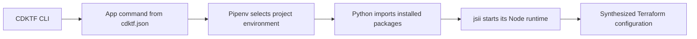

# Fix CDKTF Python Imports by Aligning Pipenv and the App Command

Author: [nawazdhandala](https://www.github.com/nawazdhandala)

Tags: CDKTF, Terraform, Python

Description: Diagnose Python imports during CDKTF synthesis by comparing interpreter paths, correcting the Pipenv app command, and checking package locations and the Node runtime.

You installed `cdktf`, but synthesis still reports `ModuleNotFoundError`. Before reinstalling it, check which Python interpreter is running the application. A package can be installed correctly in one virtual environment and unavailable to another interpreter launched by CDKTF.

A virtual environment is an isolated Python installation context with its own packages. Pipenv selects such an environment for a project. CDKTF, meanwhile, launches the application command in `cdktf.json`. If that command bypasses Pipenv, the two tools can disagree about where packages live.

The example uses Python 3.11.13, Pipenv 2026.11.0, CDKTF CLI/Python package 0.21.0, constructs 10.8.1, and Node.js 24.1.0. These are the local verification versions. CDKTF is deprecated, so this is maintenance guidance for existing projects; see the [official notice](https://developer.hashicorp.com/terraform/cdktf).

## Follow the interpreter CDKTF actually launches

The important relationship is between the configured command and its Python environment:



CDKTF's [Python template at version 0.21.0](https://github.com/hashicorp/terraform-cdk/blob/v0.21.0/packages/@cdktf/cli-core/templates/python/cdktf.json) uses `pipenv run python main.py`. An app command of `python main.py` relies on whichever `python` the invoking process finds. That may happen to work in an activated terminal and fail in an editor, CI job, or fresh shell.

Inspect the existing app command first. Preserve other fields in `cdktf.json`, including provider and module declarations. The fix is often to restore explicit environment selection rather than replace the entire configuration.

## Compare the environments without importing CDKTF

Save this standard-library-only script as `diagnose_runtime.py` beside `main.py`:

```python
import sys
from importlib.metadata import PackageNotFoundError, version
from importlib.util import find_spec

print("Python:", sys.executable)
print("Version:", sys.version.split()[0])
for name in ("cdktf", "constructs", "jsii"):
    try:
        installed = version(name)
    except PackageNotFoundError:
        installed = "not installed in this interpreter"
    spec = find_spec(name)
    print(name, installed, "origin:", spec.origin if spec else "not importable")
```

It reports the executable, Python version, installed distribution versions, and import origins. It does not print environment variables or credentials. [`sys.executable`](https://docs.python.org/3.11/library/sys.html#sys.executable) identifies the interpreter; [`importlib.metadata`](https://docs.python.org/3.11/library/importlib.metadata.html) reads installed distribution metadata; [`find_spec`](https://docs.python.org/3.11/library/importlib.html#importlib.util.find_spec) checks where the import system would look.

From the project root, run:

```bash
python diagnose_runtime.py
pipenv --py
pipenv run python diagnose_runtime.py
```

If your shell has no `python` command, use the interpreter named in your current app command for the first comparison. The meaningful result is whether the interpreter used by synthesis matches the interpreter containing the dependencies, not whether both executables have similar names.

In the isolated reproduction, the ordinary interpreter had no CDKTF distribution, while the Pipenv interpreter reported 0.21.0 and a path inside the project environment. Changing only the configured app command from plain Python to `pipenv run python main.py` resolved the synthesis import failure.

## Restore the intended package environment

For an existing project with a reviewed `Pipfile.lock`, use:

```bash
pipenv verify
pipenv sync
```

Verification checks whether the lock matches the Pipfile. Synchronization installs the locked dependency set without relocking. If synthesis needs packages classified as development dependencies, use `pipenv sync --dev` deliberately. Do not turn a repair into an unreviewed dependency upgrade. See the [Pipenv command reference](https://pipenv.pypa.io/en/latest/commands.html).

For a new disposable reproduction only, this is the complete example `Pipfile`:

```toml
[[source]]
name = "pypi"
url = "https://pypi.org/simple"
verify_ssl = true

[requires]
python_version = "3.11"

[packages]
cdktf = "==0.21.0"
constructs = "==10.8.1"
```

With Python 3.11 and Pipenv available, run `pipenv install` in that new directory to create the environment and lock file. Retain the generated lock for repeatability. The top-level pins do not pin every transitive dependency by themselves. The [CDKTF package metadata](https://pypi.org/pypi/cdktf/0.21.0/json) describes its declared dependencies; the resolver must satisfy those alongside the other selected packages.

For CI, install the chosen Python and Pipenv versions before synchronization. Do not depend on a developer's activated shell being inherited. Pipenv can place the environment inside the project using `PIPENV_VENV_IN_PROJECT=1`, but that setting is a location choice, not the core import fix. See [Pipenv environment management](https://pipenv.pypa.io/en/latest/virtualenv.html).

## Make the app command explicit and prove synthesis

In the disposable example, use this complete `cdktf.json`:

```json
{
  "language": "python",
  "app": "pipenv run python main.py",
  "sendCrashReports": "false"
}
```

Use the following `main.py` to test CDKTF itself without a provider package or cloud account:

```python
from cdktf import App, TerraformStack, TerraformOutput

app = App()
stack = TerraformStack(app, "python-runtime")
TerraformOutput(stack, "message", value="Python environment is aligned")
app.synth()
```

Then run:

```bash
pipenv run python main.py
npx cdktf synth
```

Use the project's installed CDKTF CLI 0.21.0; do not let a missing CLI silently become an unrelated latest-version download. The direct Python command tests the package environment. The CLI command tests the actual configured application launch as well. Expect `cdktf.out/stacks/python-runtime/cdk.tf.json` with a `message` output containing `Python environment is aligned`.

This only generates configuration. It does not create infrastructure, initialize a backend, or apply the output to state. If direct execution works but CLI synthesis fails, compare the CLI's working directory, app override, PATH, and project selection before changing Python packages again.

## Distinguish other import and runtime failures

An installed distribution is not proof that the intended module will be imported. A project file named `cdktf.py`, `constructs.py`, or `jsii.py` can shadow the package. The diagnostic script's origin field helps expose that. Python documents the order of locations in the [module search path](https://docs.python.org/3.11/tutorial/modules.html#the-module-search-path).

| Failure | What to inspect next |
|---|---|
| `pipenv` command not found | Tool installation and the runner's PATH |
| `No module named cdktf` | Interpreter path and locked dependency installation |
| Import resolves to a local file | Module-name collision in the project |
| Missing locally generated provider module | Provider generation and the configured output directory |
| Node or jsii process failure | Node availability and supported runtime versions |

Python CDKTF still relies on jsii, the interoperability layer that runs the library's JavaScript implementation in a Node process. Repairing Python imports therefore does not eliminate the Node prerequisite. Check [jsii's runtime requirements](https://aws.github.io/jsii/user-guides/lib-user/) when a traceback moves past imports and fails while starting that process.

Finally, avoid installing globally as a workaround for a mismatched project interpreter. When using pip for a targeted diagnostic, `python -m pip` binds pip to that explicit interpreter, as explained in the [pip user guide](https://pip.pypa.io/en/stable/user_guide/#running-pip). Keep dependency changes in the project's declared environment.

The repair is complete when a fresh runner can synchronize the reviewed lock, report the expected interpreter and module origins, and synthesize through the unchanged project app command. That evidence is stronger than a successful import in one interactive terminal.
