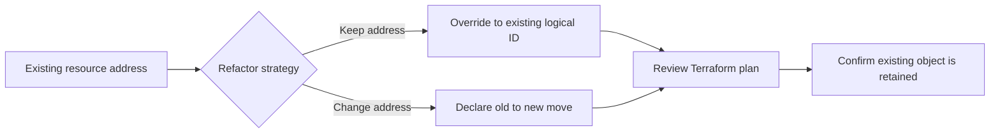

# Refactor CDKTF Construct IDs Without Recreating Resources

Author: [nawazdhandala](https://www.github.com/nawazdhandala)

Tags: CDKTF, Terraform, TypeScript, Troubleshooting

Description: Compare stable logical IDs with explicit moved blocks, inspect generated Terraform addresses, and test a CDKTF refactor without replacing the managed object.

Moving a resource into a reusable construct looks like a source-code cleanup. Terraform may see it as removing one resource and declaring another. The difference is the generated resource address: changing a construct's ID or parent can change the name CDKTF emits into Terraform configuration.

There are two useful approaches. Preserve the existing Terraform logical ID while reorganizing the code, or deliberately adopt a new address and record a move. Choose which identity should remain stable before editing the application. Neither approach makes unrelated configuration changes safe automatically.

This guide targets existing CDKTF projects using CLI/core `0.21.0`. HashiCorp deprecated CDKTF on December 10, 2025. The local experiment uses Terraform `1.11.4` and Random provider `3.6.3`, with no cloud infrastructure. [CDKTF status](https://developer.hashicorp.com/terraform/cdktf).

## Capture the address that state already uses

A Terraform address combines the resource type and logical name, possibly with module and instance components. The logical name is not necessarily the last construct ID in your TypeScript source. Capture the existing address from the current state and compare it with the current synthesized configuration before refactoring. [Terraform resource addressing](https://developer.hashicorp.com/terraform/cli/state/resource-addressing).

For a verified, initialized stack directory:

```bash
terraform -chdir=cdktf.out/stacks/names state list
```

This inspection should occur in the intended backend and workspace. Do not infer identity from a similarly named resource in another environment. Preserve the old generated configuration as review evidence so you can compare the old and new keys directly.



## Start with a harmless managed object

The Random provider generates a pet-name string and stores it in state. It provides a useful test because changing the managed object's identity is easy to observe without creating a cloud resource. [Random 3.6.3 pet resource](https://github.com/hashicorp/terraform-provider-random/blob/v3.6.3/docs/resources/pet.md).

Use a disposable TypeScript CDKTF project with local bindings generated for `hashicorp/random@=3.6.3` under `.gen/providers/random`. The complete starting `main.ts` is:

```typescript
import { App, TerraformStack, TerraformOutput } from "cdktf";
import { RandomProvider } from "./.gen/providers/random/provider";
import { Pet } from "./.gen/providers/random/pet";

const app = new App();
const stack = new TerraformStack(app, "names");
new RandomProvider(stack, "random", {});
const pet = new Pet(stack, "legacy", { length: 2 });
new TerraformOutput(stack, "pet_name", { value: pet.id });
app.synth();
```

The project application command should run this file, such as `npx ts-node main.ts`. In the tested setup, the direct child resource synthesized as `random_pet.legacy`. Your real application's address may contain additional path-derived text or a suffix; inspect it rather than assuming this short form.

Initialize and apply only this isolated example to establish the starting state:

```bash
cdktf synth
terraform -chdir=cdktf.out/stacks/names init -input=false
terraform -chdir=cdktf.out/stacks/names apply
terraform -chdir=cdktf.out/stacks/names output -raw pet_name
```

Review the plan before confirming. It should create one Random pet and no cloud resources. Record the output so you can verify that a later state move preserves the same generated name.

## Option one: keep the existing logical ID

To reorganize the code while keeping its Terraform address, add `import { Construct } from "constructs";` and replace the original `const pet` line with:

```typescript
const group = new Construct(stack, "naming");
const pet = new Pet(group, "current", { length: 2 });
pet.overrideLogicalId("legacy");
```

Keep the output and other application lines unchanged. The override takes the logical-name component, `legacy`, not the full `random_pet.legacy` address. It selects the name emitted for that element, even though its construct path changed. The exact API is implemented in [CDKTF 0.21.0 TerraformElement](https://github.com/hashicorp/terraform-cdk/blob/v0.21.0/packages/cdktf/lib/terraform-element.ts).

Call the override before using the resource's attributes in other constructs. Then synthesize and inspect the resource key. This approach avoids a state address migration only when the selected logical ID matches the existing one in the same Terraform scope. Inventing a cleaner override name would still change the address.

Use unique overrides within the relevant resource type and scope. Two resources cannot share one Terraform address. Document the retained ID so a later cleanup does not remove it as an apparently obsolete name.

## Option two: record the address change

If the new address is intentional, remove the override and use this replacement block instead:

```typescript
const group = new Construct(stack, "naming");
const pet = new Pet(group, "current", { length: 2 });
pet.moveFromId("random_pet.legacy");
```

Here the argument is the full old Terraform resource address. The old resource declaration must no longer remain as an ordinary managed resource at that address. In this example it was replaced, so there is only one `Pet` declaration.

CDKTF's `moveFromId` records the old address and emits a Terraform `moved` block pointing to the new resource. Confirm the generated `from` and `to` values in `cdk.tf.json`. [Tagged CDKTF resource implementation](https://github.com/hashicorp/terraform-cdk/blob/v0.21.0/packages/cdktf/lib/terraform-resource.ts).

Terraform uses the move declaration to interpret the object at the old address as belonging to the new address. The move is included in the plan and persisted when that plan is applied. It does not by itself change the remote object's name or settings. [Terraform moved block reference](https://developer.hashicorp.com/terraform/language/block/moved).

## Inspect the plan, not just the successful synth

For either option, synthesize and create a fresh plan in the same state context:

```bash
cdktf synth
terraform -chdir=cdktf.out/stacks/names plan -input=false -out=refactor.tfplan
terraform -chdir=cdktf.out/stacks/names show -no-color refactor.tfplan
```

Keep the plan artifact in approved storage. A saved plan can contain sensitive values in real applications. `terraform show` lets you inspect the saved plan; its JSON form is useful for automated checks but can expose sensitive values directly. [Terraform show reference](https://developer.hashicorp.com/terraform/cli/commands/show).

The local experiment compared three configurations against the original state:

| Configuration | Observed plan result |
| --- | --- |
| Reparented resource without mapping | One delete and one create |
| Reparented resource with `overrideLogicalId("legacy")` | Existing resource had no changes |
| Reparented resource with `moveFromId("random_pet.legacy")` | Address move, with no resource replacement |

The mapped move was applied in the isolated lab and preserved the pet name. The destructive unmapped plan was not applied. These results verify the mechanism for one resource type; they do not guarantee that a refactor of your stack has no other changes.

For a real plan, reject unexplained replacement, deletion, or creation. A correct address mapping cannot neutralize a provider argument change that independently requires replacement. Keep provider versions, resource settings, backend selection, and input values stable while reviewing the address refactor.

## Retain the migration path

Leave the move declaration available until every relevant state has passed through the migration. A development workspace applying it does not migrate staging or production. Removing historical moves too early can break upgrades from older addresses; Terraform recommends retaining move history for reusable modules. [Terraform refactoring guidance](https://developer.hashicorp.com/terraform/language/modules/develop/refactoring).

This example stays within one state. Moving resources between independent CDKTF stacks and backends is a different state migration and is not accomplished by adding a local move declaration alone. Manual `terraform state mv` is another tool, but it changes state separately from the configuration rollout and requires coordination with other operators. [State mv documentation](https://developer.hashicorp.com/terraform/cli/commands/state/mv).

Finish with the intended address in state and the original object identity intact. Preserve the reviewed mapping with the code so the next person can see that the address change was deliberate.
