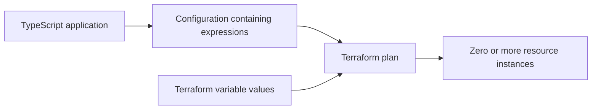

# Use Runtime Conditions in CDKTF with Count and For Each

Author: [nawazdhandala](https://www.github.com/nawazdhandala)

Tags: CDKTF, Terraform, TypeScript

Description: Replace JavaScript branches on CDKTF tokens with Terraform count and for_each expressions, then verify enabled and disabled plans from the same generated configuration.

An optional resource stays enabled even when you pass `enabled=false`. The variable may be correct. The problem can be an ordinary TypeScript `if` statement evaluating a CDKTF token before Terraform has read the variable.

A token is a placeholder for a value Terraform will resolve later. JavaScript can inspect the placeholder object, but it cannot turn that object into the future Terraform boolean. To make a deployment-time choice, generate a Terraform expression instead of making the decision while building the configuration.

This example uses CDKTF CLI/core 0.21.0, constructs 10.8.1, TypeScript 5.8.3, ts-node 10.9.2, and Terraform 1.11.4. CDKTF is deprecated; this is guidance for existing projects, as noted in the [official project documentation](https://developer.hashicorp.com/terraform/cdktf).

## Decide which program should make the decision

There are two different execution times:



TypeScript runs during synthesis. Terraform evaluates the generated configuration during planning and application. A normal JavaScript condition belongs to the first stage. CDKTF's [token documentation](https://developer.hashicorp.com/terraform/cdktf/concepts/tokens) explains why values needed at the second stage remain unresolved during the first.

For example, `if (enabled.booleanValue)` asks JavaScript whether the placeholder is truthy. In the pinned local test, `Boolean(enabled.booleanValue)` returned `true` even though the variable's declared default was `false`. Calling `Boolean`, applying `!!`, or comparing token strings does not recover the future input value.

A JavaScript branch is appropriate when you deliberately choose different generated artifacts from a real build-time boolean. It is inappropriate when you expect changing `-var=enabled=false` in Terraform to change that earlier branch.

## Generate both forms in a small local example

Use a disposable TypeScript CDKTF project configured to run `npx ts-node main.ts`, with the pinned toolchain installed. The following complete application demonstrates two alternatives side by side. In a real optional-resource implementation, choose one approach for that resource.

```typescript
import {
  App, Fn, TerraformCount, TerraformIterator,
  TerraformResource, TerraformStack, TerraformVariable,
} from "cdktf";

const app = new App();
const stack = new TerraformStack(app, "conditions");
const enabled = new TerraformVariable(stack, "enabled", {
  type: "bool",
  default: false,
});
const counted = new TerraformResource(stack, "counted", {
  terraformResourceType: "terraform_data",
  count: TerraformCount.of(Fn.conditional(enabled.booleanValue, 1, 0)),
});
counted.addOverride("input", "count example");

const selected = TerraformIterator.fromMap(
  Fn.conditional(enabled.booleanValue, { primary: "named example" }, {}),
);
const named = new TerraformResource(stack, "named", {
  terraformResourceType: "terraform_data",
  forEach: selected,
});
named.addOverride("input", selected.value);
app.synth();
```

The built-in [`terraform_data` resource](https://developer.hashicorp.com/terraform/language/resources/terraform-data) makes the example independent of cloud credentials. It can hold data in state; this example has no provisioners and no external side effects. We will plan it without applying.

`Fn.conditional` generates Terraform's conditional expression. Its name and signature are verified in the [CDKTF 0.21.0 implementation](https://github.com/hashicorp/terraform-cdk/blob/v0.21.0/packages/cdktf/lib/terraform-functions.ts). It is not JavaScript's ternary operator applied to the token.

For the first resource, the expression selects the number 1 or 0, and `TerraformCount.of` supplies it as `count`. The generated JSON contains:

```json
"count": "${var.enabled ? 1 : 0}"
```

This is a field excerpt, not a complete JSON document. Its interpolation syntax tells Terraform to evaluate the expression; the final number is not known to JavaScript at synthesis time.

For the second resource, the condition selects a map containing the stable key `primary`, or an empty map. `TerraformIterator.fromMap` supplies that map as `for_each`. `selected.value` becomes `each.value`, so the resulting instance receives `named example`. These APIs are described in the [CDKTF iterator documentation](https://developer.hashicorp.com/terraform/cdktf/concepts/iterators).

## Test both branches without changing the artifact

From the disposable project root:

```bash
npx tsc --noEmit
npx cdktf synth
terraform -chdir=cdktf.out/stacks/conditions init -input=false
terraform -chdir=cdktf.out/stacks/conditions validate
terraform -chdir=cdktf.out/stacks/conditions plan -input=false -var='enabled=false'
terraform -chdir=cdktf.out/stacks/conditions plan -input=false -var='enabled=true'
```

Initialization prepares the new local backend. Neither plan applies changes. The [plan command reference](https://developer.hashicorp.com/terraform/cli/commands/plan) documents variable assignment and the separation between planning and applying.

With no existing state, expect these results:

| Input | Count example | Map example |
|---|---|---|
| `enabled=false` | No instance | No instance |
| `enabled=true` | `terraform_data.counted[0]` | `terraform_data.named["primary"]` |

The true plan should propose two creations because the tutorial includes both alternatives. The local test produced exactly these addresses from an unchanged synthesized file. Supplying `enabled=maybe` failed the boolean input check. A plan against previously deployed state can behave differently: disabling an existing instance proposes its removal, not simply an empty plan.

Keeping the artifact unchanged matters. If you synthesize again with a different environment before each plan, you may only have tested two different build-time branches. This check demonstrates that Terraform owns the decision.

## Choose identities before adding conditions to existing resources

`count` identifies instances by numeric index. It is a straightforward fit for a single optional instance or genuinely interchangeable copies. `for_each` identifies instances by map key or set member, which is useful when names such as `primary` or `audit` have stable meaning. See the official [`count`](https://developer.hashicorp.com/terraform/language/meta-arguments/count) and [`for_each`](https://developer.hashicorp.com/terraform/language/meta-arguments/for_each) references.

Adding either mechanism can change resource addresses. An existing `resource.example` may become `resource.example[0]` or `resource.example["primary"]`. Review the plan and explicitly account for address changes; a source edit alone is not a guarantee that Terraform will preserve the existing object. Terraform's [refactoring guidance](https://developer.hashicorp.com/terraform/language/modules/develop/refactoring) explains how moved declarations describe intended address transitions.

References need review too. An unconditional index-zero lookup fails when count is zero, and a lookup of `primary` fails when the map is empty. Make downstream resources follow the same presence condition, or design an output that safely represents absence. Do not add a dummy instance merely to keep an invalid reference working.

## Keep the decision available during planning

Runtime here means Terraform evaluation time, not necessarily after resource creation. Terraform must know `count` before it performs resource operations. Similarly, `for_each` needs instance keys known during planning. A condition derived from an ordinary input variable works because the plan has that input. A condition derived from a newly created object's unpredictable result may not.

If the count or keys are unknown, redesign the input boundary. Supply the intended membership as configuration, or separate a genuinely dependent discovery step from the later deployment. Casting the token to another TypeScript type does not make the value known earlier. Also avoid sensitive values as instance keys: Terraform exposes keys as resource identity, and `for_each` rejects sensitive input values.

The conditional's two result branches must have compatible Terraform types. This example uses two numbers for count and compatible maps for iteration. Mixing a map with a boolean is not a useful way to express absence; choose an empty collection of the appropriate kind. See [Terraform conditional expressions](https://developer.hashicorp.com/terraform/language/expressions/conditionals).

A complete fix leaves the condition in the synthesized configuration, produces the intended instance addresses, and passes plans for both enabled and disabled inputs. After deployment, treat a switch to disabled as a possible deletion and review it with the same care as any other resource removal.
