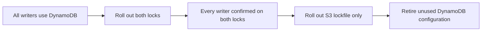

# Migrate CDKTF S3 State Locking from DynamoDB to Lockfiles

Author: [nawazdhandala](https://www.github.com/nawazdhandala)

Tags: CDKTF, Terraform, AWS, Amazon S3

Description: Move CDKTF-managed S3 backends to native lockfiles with a staged rollout, exact backend overrides, permission checks, and a shared lock throughout the transition.

State locking stops two Terraform operations from modifying the same state concurrently. Changing the locking mechanism is therefore a coordination change across every runner that can write that state, not just a property change in one repository.

The dangerous transition is a DynamoDB-only runner operating alongside an S3-lockfile-only runner. Each can acquire its own lock without noticing the other. Use an intermediate configuration that acquires both locks, then remove DynamoDB only after all writers have moved through that stage.

This guide uses CDKTF CLI/core 0.21.0 and Terraform 1.11.4. CDKTF is deprecated; the example is for maintaining an existing application. See the [CDKTF notice](https://developer.hashicorp.com/terraform/cdktf). Terraform introduced native S3 locking in [1.10.0](https://github.com/hashicorp/terraform/releases/tag/v1.10.0); upgrading only the AWS provider package does not add support to an older Terraform executable.

## Establish a transition that preserves mutual exclusion

Mutual exclusion means only one writer can hold the required lock at a time. The Terraform 1.11.4 [S3 client implementation](https://github.com/hashicorp/terraform/blob/v1.11.4/internal/backend/remote-state/s3/client.go) requires both locks when both mechanisms are configured. If acquiring the DynamoDB lock fails after the file lock succeeds, it attempts to release the file lock and returns an error.



The two rollout phases share different locks:

| Concurrent runner configurations | Shared lock |
|---|---|
| DynamoDB only and both locks | DynamoDB |
| Both locks and S3 lockfile only | S3 lockfile |
| DynamoDB only and S3 lockfile only | None: unsafe combination |

This table follows from the documented dual-lock behavior. It does not replace a contention test against your actual backend. Inventory CI jobs, scheduled maintenance, developer workstations, recovery scripts, and old release branches before changing anything. Block obsolete runners from writing after their migration window closes.

## Keep the state address unchanged

Record the current bucket, key, region, workspace, workspace prefix, and backend authentication setup. Preserve an approved state backup or backend-native object version. Pause new writers while changing initialization and access settings, and let current operations finish normally.

The goal is to change locking for the same state object. Do not combine this operation with a bucket rename, workspace change, encryption-key replacement, or state-layout refactor. Those are separate changes with different recovery requirements.

Check the Terraform binary used by each runner, including the binary CDKTF actually finds on PATH. A successful local synthesis does not establish that a CI runner understands `use_lockfile`. The field is part of Terraform's [versioned backend schema](https://github.com/hashicorp/terraform/blob/v1.11.4/internal/backend/remote-state/s3/backend.go).

## Generate the intermediate backend explicitly

The following complete synthesis example demonstrates the backend configuration for the transition. Merge its backend settings into your existing stack without removing application resources. Replace every placeholder with the existing values, including the existing lock table and region.

```typescript
import { App, S3Backend, TerraformStack } from "cdktf";

const app = new App();
const stack = new TerraformStack(app, "application");
new S3Backend(stack, {
  bucket: "replace-with-existing-state-bucket",
  key: "replace/with/existing/state.tfstate",
  region: "us-east-1",
  encrypt: true,
  dynamodbTable: "replace-with-existing-lock-table",
});
stack.addOverride("terraform.required_version", "= 1.11.4");
stack.addOverride("terraform.backend.s3.use_lockfile", true);
app.synth();
```

The exact TypeScript example was compiled with TypeScript 5.8.3, constructs 10.8.1, and ts-node 10.9.2. A CDKTF project running `npx ts-node main.ts` can synthesize it without accessing AWS.

CDKTF 0.21.0's [`S3Backend` interface](https://github.com/hashicorp/terraform-cdk/blob/v0.21.0/packages/cdktf/lib/backends/s3-backend.ts) includes `dynamodbTable` but not `useLockfile`. The stack override deliberately emits the Terraform field `use_lockfile`. A misspelled override can synthesize successfully, so inspect the output.

After `npx cdktf synth`, the `terraform.backend.s3` object in `cdktf.out/stacks/application/cdk.tf.json` must contain both `dynamodb_table` and `use_lockfile: true`. The example also pins Terraform to 1.11.4 through `required_version`. Adjust that constraint only as part of a reviewed toolchain choice.

## Grant lock-object access before enabling it

For a state key such as `services/api.tfstate`, the native lock object uses the `.tflock` suffix. The runner needs `s3:GetObject`, `s3:PutObject`, and `s3:DeleteObject` for the corresponding lock object, alongside its existing bucket-list and state-object permissions. Non-default workspaces change the effective object path, so permissions must match that path too. See the [S3 backend permission requirements](https://developer.hashicorp.com/terraform/language/backend/s3).

Keep the existing DynamoDB permissions throughout the intermediate stage. Removing them early makes a dual-lock operation fail even when S3 access is correct. Where encryption uses a customer-managed KMS key, review the associated key permissions and policies as well.

Do not broaden deletion permission to all bucket objects just to make unlocking work. The state object and the lock object have different operational purposes. Review narrowly scoped identity policies, bucket policies, and organizational restrictions together.

## Reinitialize and rehearse with controlled staging traffic

For an already deployed stack whose state address is unchanged, reinitialize its verified generated directory after updating the locking configuration:

```bash
stack_dir="/REPLACE/WITH/project/cdktf.out/stacks/application"
terraform -chdir="$stack_dir" init -reconfigure
terraform -chdir="$stack_dir" workspace show
terraform -chdir="$stack_dir" state list
```

Supply the same approved partial backend configuration inputs used previously, if any. Reconfiguration updates the working directory's backend setup; it does not copy state to another location. If the state address changed unexpectedly, stop and investigate rather than treating this command as a migration. See [terraform init](https://developer.hashicorp.com/terraform/cli/commands/init).

On a dedicated staging state, coordinate two authorized runners. While one legitimate Terraform operation is confirmed to hold the lock, run a competing plan from the second initialized checkout:

```bash
terraform -chdir="$stack_dir" plan -input=false -lock-timeout=5s
```

Provide the staging stack's normal non-interactive inputs. The second operation should wait and then report lock contention if the first still holds the lock for the full interval. If the first operation finishes earlier, success is inconclusive; it does not demonstrate a locking defect or a successful contention test. Repeat with a coordinated overlap, never by fabricating or deleting lock records.

After the first operation releases its lock, the second should succeed. Test the overlap combinations relevant to each rollout phase, confirm the same state identity, and verify lock cleanup. Terraform's [locking guidance](https://developer.hashicorp.com/terraform/language/state/locking) explains why disabling locks is not an appropriate workaround.

## Complete the rollout and retain a recovery path

Only after every authorized writer uses both locks should you begin removing `dynamodbTable`. Keep `use_lockfile` enabled, synthesize again, and reinitialize each affected working directory. Confirm contention and release behavior before resuming normal writers.

| Symptom | Investigate |
|---|---|
| Unsupported `use_lockfile` argument | Actual Terraform version on that runner |
| TypeScript rejects `useLockfile` | CDKTF interface versus explicit Terraform override |
| Access denied on `.tflock` | Lock-object path and read/write/delete permissions |
| Dual-lock acquisition fails | Both S3 and DynamoDB access and active owners |
| Unlock fails after work finishes | Cleanup permissions and operation ownership |

Do not delete the table merely because one stack has migrated; other state keys may still use it. Retire it only after an inventory confirms no remaining consumers and your retention requirements are satisfied.

If rollback is needed after any lockfile-only writers exist, first restore both-lock operation across those writers. Reintroducing DynamoDB-only writers prematurely recreates the unsafe mixed state. For an apparently stale lock, prove the owner has stopped before considering the documented [force-unlock procedure](https://developer.hashicorp.com/terraform/cli/commands/force-unlock). A backend error is evidence to investigate, not permission to bypass concurrency control.
