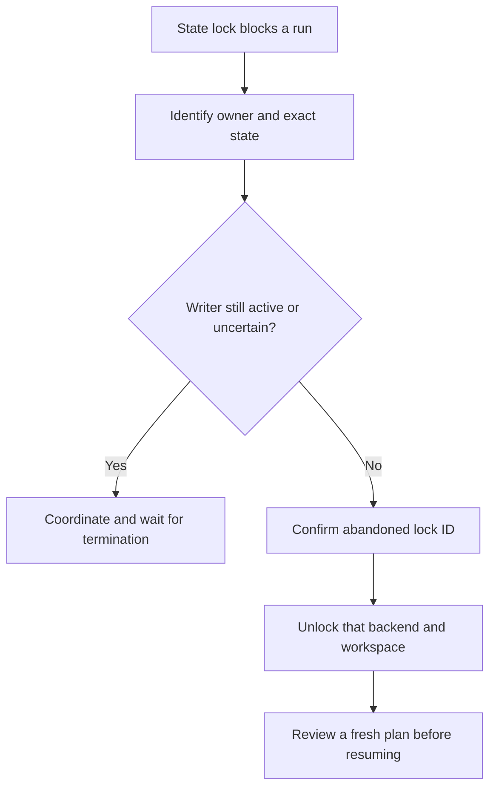

# Recover a Stale CDKTF State Lock After a Canceled Deploy

Author: [nawazdhandala](https://www.github.com/nawazdhandala)

Tags: CDKTF, Terraform, Troubleshooting

Description: Identify the exact CDKTF backend and workspace, prove a canceled writer has stopped, and use Terraform force-unlock only for a verified stale lock.

A canceled deployment leaves the next run waiting for a state lock. The tempting response is to copy the lock ID and unlock immediately. But a canceled job in the CI interface does not prove that its Terraform process, remote run, or child process has stopped.

A lock prevents cooperating Terraform processes from writing the same state concurrently. Removing it while a writer is still active removes that protection. The recovery task is therefore to establish ownership and termination first, then release a genuinely abandoned lock and review the interrupted deployment's effects.

This guide is for existing CDKTF installations. HashiCorp deprecated CDKTF on December 10, 2025. Command behavior below was checked against Terraform `1.11.4`; examples use the generated-directory layout of CDKTF `0.21.0`. [CDKTF status](https://developer.hashicorp.com/terraform/cdktf).

## Understand what unlocking does

Terraform locks state automatically for operations that need it, when the backend supports locking. A failure to obtain the lock is a reason to inspect the other operation. It is not a reason to turn locking off. HashiCorp recommends force-unlocking only your own lock when automatic unlocking has failed. [Terraform state locking](https://developer.hashicorp.com/terraform/language/state/locking).

`terraform force-unlock` releases a lock for the configured backend and current workspace. It does not roll back resource changes, restore an older state snapshot, or complete an interrupted apply. Its `-force` option only skips the confirmation prompt; it does not establish that unlocking is safe. [Force-unlock reference](https://developer.hashicorp.com/terraform/cli/commands/force-unlock).



The decision point is evidence that the writer has ended. The lock's age alone is not that evidence: legitimate operations can take a long time.

## Preserve the diagnostic and stop competing retries

Temporarily hold automatic retries for this state. Otherwise, one retry can acquire the lock while an operator is investigating another failure, making the original diagnostic stale.

Record the lock information from the failed run. Terraform's lock metadata includes an ID, operation, owner, version, creation time, and path. These fields help correlate the diagnostic with a runner and state location; they are not interchangeable identifiers. [Terraform 1.11.4 lock metadata](https://github.com/hashicorp/terraform/blob/v1.11.4/internal/states/statemgr/locker.go).

| Evidence | Question it answers |
| --- | --- |
| Lock ID | Which lock instance would be released? |
| Operation and creation time | Which run likely acquired it? |
| Owner or runner identity | Who can confirm that process ended? |
| Backend path and workspace | Which state is protected? |
| CI and remote-run status | Is execution actually finished? |

If the owner is another team or a different active job, coordinate with that owner. If the runner disappeared, confirm its termination through the execution platform. A missing browser tab, lost terminal connection, or disconnected log stream does not establish process termination.

## Open the exact generated stack directory

CDKTF applications can synthesize several independent Terraform stacks. Run recovery commands against the affected stack's generated directory, using the artifact and configuration associated with the failed run.

In Bash, replace this placeholder with that directory:

```bash
stack_dir='/absolute/path/to/cdktf.out/stacks/affected-stack'
terraform -chdir="$stack_dir" version
terraform -chdir="$stack_dir" workspace show
```

These inspection commands show the Terraform version and selected workspace. They do not prove that the backend points to the intended storage object. Compare the generated backend declaration, the initialization settings used by CI, and the failed run's path too. [Workspace show reference](https://developer.hashicorp.com/terraform/cli/commands/workspace/show).

For an S3 backend, include the bucket, base key, region, and workspace prefix in that comparison. Non-default workspaces can change the effective object path. Also identify whether this deployment uses S3 lock files, legacy DynamoDB locking, or a different backend's locking mechanism. Recover using the established configuration; changing the mechanism during an incident introduces another variable. [S3 backend documentation](https://developer.hashicorp.com/terraform/language/backend/s3).

If the recovery directory is not initialized, reproduce the original backend initialization through your normal process. Do not use `-migrate-state` or change backend destinations merely to reach an unlock command. Initialization can configure or migrate backends, so it deserves a separate review when settings differ. [Terraform init reference](https://developer.hashicorp.com/terraform/cli/commands/init).

## Release only the verified abandoned lock

Proceed after the owning operation has terminated, competing retries are held, and the selected backend and workspace match the diagnostic. Copy the lock ID from the relevant failure, not a CI run number or storage-table key:

```bash
lock_id='REPLACE_WITH_THE_VERIFIED_LOCK_ID'
terraform -chdir="$stack_dir" force-unlock "$lock_id"
```

The command requests confirmation for a remote backend. Read the prompt and confirm only after the checks above. Keeping the prompt is useful during a one-off recovery; this example deliberately does not bypass it.

If unlocking reports an ID mismatch, stop and inspect the current owner. The old lock may have been released and replaced. If it reports a permissions or connectivity failure, resolve that failure using the backend's documented access path. Repeating the command with guessed IDs does not fix authorization.

Local-state locking behaves differently. Terraform `1.11.4` rejects an ordinary force-unlock of local state with “Local state cannot be unlocked by another process.” This behavior was checked in an isolated local fixture. Adding `-force` is not a solution for releasing another live process's filesystem lock. [Tagged unlock implementation](https://github.com/hashicorp/terraform/blob/v1.11.4/internal/command/unlock.go).

## Review what the interrupted deployment changed

After a successful unlock, keep the recovery serialized and request a fresh plan through the normal workflow. For a verified, initialized stack using local Terraform execution, this command allows up to two minutes to acquire the lock:

```bash
terraform -chdir="$stack_dir" plan -input=false -lock-timeout=2m
```

It retains locking. The timeout waits for acquisition; it does not remove another lock. The plan can contact the backend and provider APIs, and it requires the same approved inputs and authentication as the deployment. Add those through your established configuration rather than changing the example to skip refresh or locking. [Terraform plan options](https://developer.hashicorp.com/terraform/cli/commands/plan).

An interrupted apply can leave a mixture of completed operations and unfinished work. Review unexpected creates, replacements, and deletes against the failed run's logs and actual infrastructure. If an object exists but is not represented correctly in state, investigate that discrepancy before approving another apply. Unlocking is complete when access is restored; deployment recovery is complete only after the state and proposed actions make sense.

Preserve state versions through your backend's existing recovery process. If you inspect a downloaded snapshot, keep it in approved restricted storage because state can contain secrets. Terraform's `state pull` retrieves state and may upgrade its representation to the locally compatible format, so it should not be treated as an untouched storage-object backup. [State pull documentation](https://developer.hashicorp.com/terraform/cli/commands/state/pull).

## Make the next cancellation easier to recover

Serialize deployment jobs by the actual state identity, not just repository or branch name. Ensure cancellation reaches the running Terraform process and allows its cleanup to finish. Record the stack artifact, backend location, workspace, Terraform version, and runner identity with each deployment.

A useful incident record states who confirmed termination, which lock was released, and what the fresh plan showed. Avoid automatic unlock-on-failure handlers: a transient error is not proof that the writer is gone. The goal is a controlled return to one writer with a reviewed plan, not simply a green retry button.
