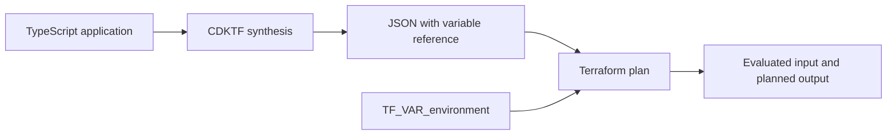

# Why TF_VAR Values Stay as Tokens During CDKTF Synth

Author: [nawazdhandala](https://www.github.com/nawazdhandala)

Tags: CDKTF, Terraform, TypeScript, Troubleshooting

Description: Understand when CDKTF tokens resolve, test Terraform input variables without deploying resources, and separate synthesis inputs from plan-time values.

You set `TF_VAR_environment=production`, run `cdktf synth`, and still see a token instead of the word `production`. Adding a TypeScript comparison does not help: the application chooses a branch before Terraform has evaluated the variable.

This behavior comes from two programs running at different times. CDKTF writes a Terraform program; Terraform later evaluates that program's inputs. An environment variable can exist in both processes without CDKTF automatically replacing a Terraform variable reference with its contents.

This tutorial is for maintaining existing projects. HashiCorp deprecated CDKTF on December 10, 2025. The example uses CLI and core `0.21.0`, with Terraform `1.11.4`, rather than assuming a future release changes these semantics. [Official CDKTF notice](https://developer.hashicorp.com/terraform/cdktf).

## Follow the value through both stages

A token is a placeholder representing a value that the application cannot directly use yet. CDKTF uses tokens to preserve references to Terraform variables and resource attributes. During synthesis, a token becomes a Terraform expression, such as `${var.environment}`. That conversion does not fetch the variable's eventual value. [CDKTF token documentation](https://developer.hashicorp.com/terraform/cdktf/concepts/tokens).



`TF_VAR_environment` is Terraform's convention for supplying a root input variable named `environment`. It is not a command telling every process to interpolate strings. Terraform reads it when it needs input values, subject to other variable sources taking precedence. [Terraform environment variables](https://developer.hashicorp.com/terraform/cli/config/environment-variables#tf_var_name).

This also separates two kinds of deferred values. An ordinary supplied input can be known during planning. A newly created resource's computed identifier may remain unknown until apply. Seeing a token during synthesis does not mean every value must wait until apply.

## Build a small example with no resources

Use a disposable TypeScript CDKTF project with core and CLI `0.21.0`. The tested environment also used Constructs `10.8.1`, TypeScript `5.8.3`, ts-node `10.9.2`, and Node `24.1.0`. Its `cdktf.json` application command was `npx ts-node main.ts`. No provider bindings are needed because this stack declares only a variable and an output.

Replace that disposable project's `main.ts` with:

```typescript
import { Construct } from "constructs";
import { App, TerraformStack, TerraformVariable, TerraformOutput } from "cdktf";

class VariableStack extends TerraformStack {
  constructor(scope: Construct, id: string) {
    super(scope, id);
    const environment = new TerraformVariable(this, "environment", {
      type: "string",
      description: "Deployment environment label",
    });
    new TerraformOutput(this, "selected_environment", {
      value: environment.stringValue,
    });
  }
}

const app = new App();
new VariableStack(app, "variables");
app.synth();
```

`TerraformVariable` declares the input. Its `stringValue` supplies a reference that other Terraform configuration can consume. `TerraformOutput` exposes the evaluated value later. The variable has no default, so Terraform needs a supplied value when planning. These constructs are documented in [CDKTF variables and outputs](https://developer.hashicorp.com/terraform/cdktf/concepts/variables-and-outputs).

With the intended CLI on your path, run this Bash example from the project directory:

```bash
TF_VAR_environment=staging cdktf synth
```

The assignment applies to this command and its children. Open `cdktf.out/stacks/variables/cdk.tf.json`. Inside its output block, expect the following value, with possible additional CDKTF metadata nearby:

```json
{
  "selected_environment": {
    "value": "${var.environment}"
  }
}
```

Repeat synthesis with `TF_VAR_environment=production`. The reference should remain the same. In the isolated lab, the complete synthesized JSON was identical for both inputs. Nothing in the application directly reads the process environment, so changing that environment does not change its generated expression.

## Let Terraform evaluate the input

For this resource-free lab, initialize the generated local-backend directory and plan twice:

```bash
terraform -chdir=cdktf.out/stacks/variables init -input=false
TF_VAR_environment=staging terraform -chdir=cdktf.out/stacks/variables plan -input=false
TF_VAR_environment=production terraform -chdir=cdktf.out/stacks/variables plan -input=false
```

These commands assume the output belongs to the disposable example above. Initialization prepares local working files. Each plan evaluates the input without applying it. The first plan should propose `selected_environment = "staging"`; the second should propose `selected_environment = "production"`. Both outcomes were observed with Terraform `1.11.4`. No apply was run.

The example intentionally avoids providers and managed resources. A plan in an existing infrastructure project can contact backends and providers and read remote objects. Treat that as a separate operation using the project's normal access controls, rather than assuming it behaves like this tiny lab. [Terraform plan behavior](https://developer.hashicorp.com/terraform/cli/commands/plan).

## Decide whether an input belongs to synthesis

Sometimes the application really does need a value before it can generate configuration. For example, it might choose which local configuration file to load. In that case, read a deliberately named synthesis input from the application environment:

```typescript
const synthEnvironment = process.env.SYNTH_ENVIRONMENT;
if (synthEnvironment !== "staging" && synthEnvironment !== "production") {
  throw new Error("Set SYNTH_ENVIRONMENT to staging or production");
}
```

This optional fragment is ordinary TypeScript, separate from the complete variable example. It validates a string available to Node immediately. It does not declare a Terraform input or make Terraform's variable precedence rules apply. Node exposes environment values through [`process.env`](https://nodejs.org/api/process.html#processenv).

A synthesis input becomes part of the build context. Changing it can require regenerating and reviewing the artifact. Reading `process.env.TF_VAR_environment` yourself is technically possible, but then your application has independently consumed that value during synthesis. Terraform can still receive a different value during planning. A separate prefix makes that distinction easier to see in CI configuration.

Do not use a normal TypeScript `if` to compare `environment.stringValue` against `"production"`. That comparison happens while constructing the program, before Terraform evaluates the reference. If the choice belongs to Terraform, express it using a Terraform conditional or another suitable Terraform construct. Check the resulting JSON rather than trying to strip or parse CDKTF's token text. [Terraform conditional expressions](https://developer.hashicorp.com/terraform/language/expressions/conditionals).

## Diagnose the remaining surprises

| Symptom | Check first | What it tells you |
| --- | --- | --- |
| Synthesis still contains `${var.environment}` | Whether the application uses `TerraformVariable` | A preserved reference is expected |
| Plan says a required input is missing | Variable name, spelling, and environment of the planning process | The value may never have reached Terraform |
| Plan uses a different value | Explicit CLI inputs and variable files | Another source may override the environment |
| CI synth succeeds but remote planning fails | Inputs configured on the execution worker | A local shell assignment does not configure a different machine |
| Changing an input leaves a TypeScript branch unchanged | Whether that branch compares a token | The choice was evaluated at the wrong stage |

For local Terraform CLI execution, explicit `-var` and `-var-file` arguments and automatically loaded variable files can override `TF_VAR_*`; defaults have lower precedence. Check the effective working directory too: a file beside the TypeScript source is not necessarily beside the generated Terraform root module. [Terraform input assignment and precedence](https://developer.hashicorp.com/terraform/language/values/variables).

Use harmless labels while diagnosing this flow. A direct environment read can embed a value into generated JSON, and plan artifacts can retain input values. Avoid proving the mechanism with a real credential. Once the small example behaves correctly, compare the failing project's declaration, generated expression, and planning environment one stage at a time.
