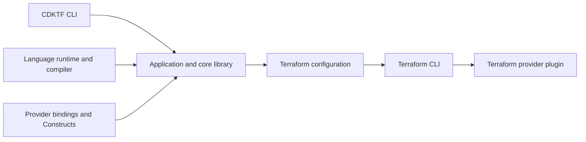

# Fix CDKTF Version Skew Across the CLI, Core, and Providers

Author: [nawazdhandala](https://www.github.com/nawazdhandala)

Tags: CDKTF, Terraform, TypeScript, Troubleshooting

Description: Diagnose CDKTF version mismatches by checking CLI and core alignment, provider compatibility, language tooling, and Terraform lock files.

A CDK for Terraform project can install successfully and still fail before producing any Terraform configuration. The command-line tool might come from a global installation, the application might load a different core library, and its provider bindings might expect another release. Updating everything together makes the failure harder to explain.

Start by finding the first failing layer and recording the versions it actually uses. This guide targets existing projects: HashiCorp deprecated CDKTF on December 10, 2025. Its archived toolchain needs deliberate maintenance rather than assumptions about future compatibility. See the [official CDKTF notice](https://developer.hashicorp.com/terraform/cdktf).

## Understand which versions belong together

CDKTF has two execution stages. During synthesis, your application runs and writes Terraform configuration. Later, Terraform loads provider plugins to validate, plan, or change infrastructure. A provider binding is the language interface used during synthesis; a provider plugin is the executable Terraform uses afterward.



That separation explains why a successful package install does not prove a deployment will work. Use this map when reading an error:

| Component | Relationship to check | Evidence |
| --- | --- | --- |
| CDKTF CLI and `cdktf` core | Use the same release | CLI output and installed library version |
| `constructs` | Must satisfy the core and binding peer ranges | Published package metadata |
| Prebuilt provider package | Has its own version and compatibility requirements | Package peer dependencies and embedded provider metadata |
| Node, TypeScript, ts-node | Must run the application's configured synthesis command | Runtime version, compiler version, application command |
| jsii | Enables libraries to work across supported languages | Language package dependencies and Node availability |
| Terraform CLI and provider plugin | Separate versions with their own constraints | Synthesized requirements and Terraform lock file |

HashiCorp explicitly recommends matching the CLI and core library versions. A newer generator can expect APIs absent from an older core, while a newer core can produce output an older CLI does not understand. This is different from requiring every dependency to share one version number. [CDKTF debugging guidance](https://developer.hashicorp.com/terraform/cdktf/test/debugging).

## Inventory the environment before repairing it

Run these commands from the project directory, using the same shell or CI job that fails. The first command shows which installed executable the shell will select; it does not install a replacement.

```bash
command -v cdktf
cdktf debug
node --version
terraform version
npm ls cdktf constructs typescript ts-node --depth=0
```

For a project-local CLI, replace `cdktf` with `./node_modules/.bin/cdktf`. If your CI uses a separate tooling installation, inspect that exact executable instead. Running an unpinned download just to obtain debug output can report a different CLI from the failing job.

`npm ls` reports installed versions rather than merely the ranges written in `package.json`. A missing package or invalid dependency relationship is useful evidence; preserve the output before changing the installation. [npm ls documentation](https://docs.npmjs.com/cli/v11/commands/npm-ls/).

In an isolated TypeScript lab, the inventory was CLI `0.21.0`, core `0.21.0`, Constructs `10.8.1`, TypeScript `5.8.3`, ts-node `10.9.2`, Node `24.1.0`, and Terraform `1.11.4`. Locally generated Random bindings targeted provider `3.6.3`. This is a tested configuration for that small lab, not a universal support matrix.

## Read provider compatibility instead of guessing

A prebuilt binding's release number does not identify the underlying Terraform plugin version. These read-only registry queries inspect two exact releases:

```bash
npm view cdktf@0.21.0 peerDependencies --json
npm view @cdktf/provider-random@12.0.1 peerDependencies --json
npm view @cdktf/provider-random@12.0.1 cdktf.provider --json
npm view @cdktf/provider-random@12.0.1 engines --json
```

They require access to your configured npm registry. The metadata says core `0.21.0` expects Constructs `^10.4.2`. Random package `12.0.1` expects CDKTF `^0.21.0` and Constructs `^10.4.2`, describes Terraform Random provider `3.7.2`, and declares Node `>=20.9.0`. A caret range allows compatible updates under npm's version rules; it is not an instruction to install that minimum release exactly.

These values come from the published [core metadata](https://registry.npmjs.org/cdktf/0.21.0) and [Random package metadata](https://registry.npmjs.org/@cdktf/provider-random/12.0.1). The query syntax is documented by [npm view](https://docs.npmjs.com/cli/v11/commands/npm-view/).

Do not silently substitute that prebuilt package into a project using local Random `3.6.3` bindings. That would change both the source of the language bindings and the provider schema being targeted. Choose one intended path, inspect its requirements, and review the generated configuration before accepting it.

## Check the language toolchain separately

A matching CLI and core cannot repair an incompatible compiler. In the lab, an unconstrained template dependency selected TypeScript `7.0.2`; synthesis failed while ts-node tried to load the compiler, with a `fileExists` error. Pinning the lab to TypeScript `5.8.3` and ts-node `10.9.2` allowed compilation and synthesis to pass. That observation identifies one failure, not a general diagnosis for every similar message.

Check `cdktf.json` for the application command. It may launch ts-node, a compiled JavaScript file, or another language environment. Inspect the dependencies that command actually resolves. ts-node documents that it looks for the compiler from the current working directory before its own installation. [ts-node installation guidance](https://typestrong.org/ts-node/docs/installation/).

Also avoid treating `jsii: null` in `cdktf debug` as proof of corruption. The same value appeared in the successful TypeScript lab and HashiCorp's debug example. jsii provides cross-language interoperability; installing a global jsii compiler is not a general application repair. For Python, Java, or other jsii consumers, confirm the language environment and a compatible Node executable are available to the running process. [jsii consumer prerequisites](https://aws.github.io/jsii/user-guides/lib-user/).

## Repair one relationship, then reproduce the installation

Work in a reviewable branch or disposable copy. First align CLI and core to the intended release. Next choose provider bindings and Constructs versions satisfying their declared requirements. Then address compiler or runtime failures independently. Preserve the old lock file so reviewers can see exactly what changed.

After reviewing and updating the dependency manifest and lock file, test a clean installation:

```bash
npm ci
npm run build
```

Here `npm run build` assumes the project defines a TypeScript build script; inspect it first. `npm ci` requires a consistent lock file, replaces `node_modules`, and does not rewrite the manifest or lock file to resolve disagreements. Run it in the disposable copy, not an active working installation you need to preserve. [npm ci behavior](https://docs.npmjs.com/cli/v11/commands/npm-ci/).

Keep the Terraform lock file as a separate concern. `package-lock.json` records JavaScript packages; `.terraform.lock.hcl` records selected Terraform providers and checksums. For generated stack directories, deliberately preserve and restore the reviewed provider lock file in your build workflow rather than losing it whenever output is regenerated. [Terraform dependency locking](https://developer.hashicorp.com/terraform/language/files/dependency-lock).

## Prove how far the repair works

Run synthesis with the intended CLI, inspect the generated provider requirements, then validate the resulting stack in a disposable directory. For an already synthesized stack named `recovery`, the lab used:

```bash
terraform -chdir=cdktf.out/stacks/recovery init -backend=false -input=false
terraform -chdir=cdktf.out/stacks/recovery validate -json
```

Replace the directory with your stack's output. Initialization installs required modules and plugins and writes local working files; it can require network access. Disabling backend initialization avoids configuring a state backend for this validation step. A successful JSON result reports `valid: true`. Validation checks configuration consistency, not credentials, remote state access, or the proposed effects of an apply. [Terraform validate documentation](https://developer.hashicorp.com/terraform/cli/commands/validate).

The lab passed compilation, synthesis, and this Terraform validation without deploying infrastructure. For a real repair, record those outcomes separately and review a plan through your normal deployment process. A useful incident record names the mismatched dependency, the selected replacement, and the first stage that changed from failing to passing.
