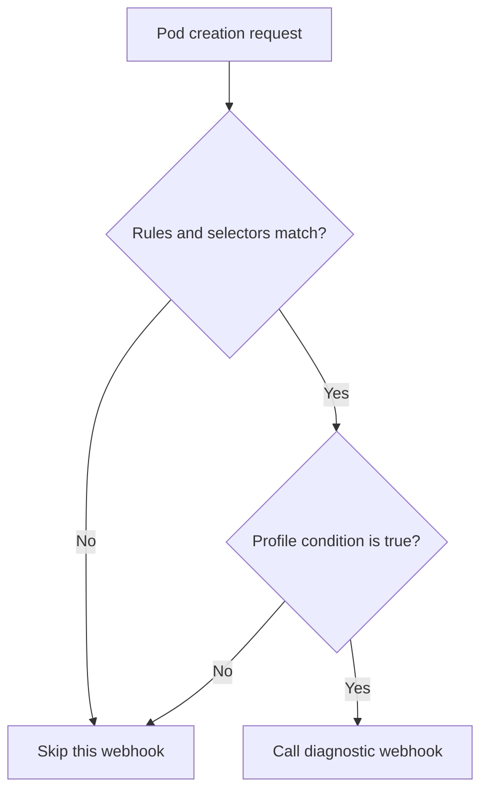

# Skip Irrelevant Mutating Webhook Calls with CEL Match Conditions

Author: [nawazdhandala](https://www.github.com/nawazdhandala)

Tags: Kubernetes, Reliability, Performance

Description: Filter optional webhook calls inside the API server with guarded CEL expressions, predictable error handling, and a practical canary test matrix.

A webhook can return an empty patch for an irrelevant Pod, but Kubernetes still had to contact its service. That costs a network round trip and makes the request depend on the service being available. If the API server can decide that the webhook is irrelevant before calling it, the application does not need to make that trip.

`matchConditions` provides that extra filter. Each condition is an expression written in Common Expression Language, or CEL. The expression returns a boolean: `true` or `false`. CEL is useful when the decision depends on something that ordinary resource rules and label selectors cannot express, such as an annotation value.

This tutorial uses **Kubernetes v1.35.0** as its reference version. Webhook match conditions have been stable since Kubernetes 1.30. The example assumes you already have a working, narrowly scoped webhook service and registration. It adds filtering; it does not deploy a webhook server. See the [Kubernetes match condition documentation](https://kubernetes.io/docs/reference/access-authn-authz/extensible-admission-controllers/#matching-requests-matchconditions).

## Decide what should reach the service

Suppose your platform offers optional diagnostic configuration for newly created Pods. Workloads request it with the annotation `diagnostics.example.com/profile: basic`. The webhook supplies the configuration, but ordinary Pods should never contact that service.

This is a feature opt-in, not a mandatory security control. Anyone allowed to set the Pod annotation can request the feature, and anyone allowed to omit it can avoid the mutation. If the mutation is mandatory, use eligibility criteria that the workload owner cannot bypass and enforce the required result separately.

Keep the simple boundaries in their existing places: resource rules choose Pod creation requests, and a namespace selector chooses enrolled application namespaces. CEL then checks the annotation. This follows Kubernetes guidance to [limit webhook scope and avoid unnecessary calls](https://kubernetes.io/docs/concepts/cluster-administration/admission-webhooks-good-practices/).



The diagram shows normal boolean outcomes. Expression errors have separate behavior, explained below. Skipping this webhook does not skip other admission checks.

## Add a guarded annotation condition

The following YAML is a fragment of **one entry inside `webhooks`**, not a complete `MutatingWebhookConfiguration`. Merge it into the existing owned entry while retaining its name, service reference, CA bundle, admission review versions, timeout, and accurate `sideEffects` setting. Replace the example annotation domain with one you control.

```yaml
rules:
  - operations: ["CREATE"]
    apiGroups: [""]
    apiVersions: ["v1"]
    resources: ["pods"]
    scope: Namespaced
matchPolicy: Exact
namespaceSelector:
  matchLabels:
    platform.example.com/admission: enabled
failurePolicy: Fail
matchConditions:
  - name: diagnostic-profile-requested
    expression: >-
      object != null &&
      has(object.metadata.annotations) &&
      'diagnostics.example.com/profile' in object.metadata.annotations &&
      object.metadata.annotations['diagnostics.example.com/profile'] == 'basic'
```

The rule uses the empty API group for core resources. It matches Pod creation, including Pods created by workload controllers, but not a Deployment request or a Pod status update. Keep existing protected-namespace exclusions when incorporating this fragment; the enrollment label alone is not an exclusion list.

Read the expression from top to bottom. First, an incoming object must exist. Next, it must have annotations. Then, the specific annotation key must be present. Finally, its value must be exactly `basic`. An absent annotation and a value such as `Basic` both produce `false`. Neither should become an expression error.

The `has` macro tests field presence, while `in` tests membership in the annotation map. These guards keep missing optional fields from becoming failed lookups. CEL's operators and presence checks are described in the [Kubernetes CEL reference](https://kubernetes.io/docs/reference/using-api/cel/).

The null guard is defensive for future changes: the CREATE rule already means an object is present. If you later extend the rule to DELETE, `object` is null and the existing resource is available as `oldObject`. Do not just broaden the operations list and assume a create-time predicate has the right deletion semantics. The variables available to match conditions are defined in the [v1.35.0 API types](https://github.com/kubernetes/kubernetes/blob/v1.35.0/staging/src/k8s.io/api/admissionregistration/v1/types.go).

## Understand false, error, and rejection

A false condition is an intentional exclusion. It is not a denial of the Pod. With multiple conditions, all must be true before Kubernetes calls this webhook.

| Condition results | Outcome for this webhook |
|---|---|
| All true | Call the service |
| At least one false | Skip the service |
| Error, no false, `failurePolicy: Fail` | Reject the admission request without calling the service |
| Error, no false, `failurePolicy: Ignore` | Continue without calling this service |

A false result takes precedence even if another condition reports an evaluation error. Do not use that rule as an excuse to leave unsafe expressions in the configuration: a future edit can remove the false result and expose the error. The [v1.35.0 matcher implementation](https://github.com/kubernetes/kubernetes/blob/v1.35.0/staging/src/k8s.io/apiserver/pkg/admission/plugin/webhook/matchconditions/matcher.go) shows this distinction directly.

Keep dependent presence checks in the same guarded expression. Do not treat separate named conditions as an imperative program where one condition initializes or safely prepares the next. Conditions are filters, not sequential statements.

`failurePolicy: Fail` in this example makes unexpected evaluation failures visible instead of silently omitting requested diagnostics. It also means a service failure can reject an eligible Pod request. Choose that tradeoff deliberately for your feature. Switching to `Ignore` does not repair an incorrect expression.

## Test the decisions before expanding enrollment

Use an isolated test namespace with the enrollment label and a known working webhook. Keep the existing registration under version control so you can restore its previous filtering. Exercise the following cases with otherwise valid Pod manifests and approved images:

| Input | Expected result |
|---|---|
| No annotations | No call |
| An unrelated annotation only | No call |
| Profile is `disabled` | No call |
| Profile is `Basic` | No call |
| Profile is `basic` in an enrolled namespace | Call and expected mutation |
| Profile is `basic` outside enrollment | No call |
| Deployment creation | No call for the Deployment request; assess its subsequently created Pods separately |

For a Deployment, put the opt-in annotation on `spec.template.metadata.annotations` if its Pods should receive the feature. An annotation on the Deployment's own metadata does not express that Pod request; see the [Pod template documentation](https://kubernetes.io/docs/concepts/workloads/pods/#pod-templates).

Confirm both the resulting object and the webhook's request records. A successful creation alone cannot distinguish a skipped webhook from a called webhook that returned no patch. Conversely, missing service logs can also indicate a rule mismatch or a connectivity problem. Correlate a uniquely named canary Pod with the expected decision, without logging entire admission objects containing sensitive workload configuration.

The expression shown here was compiled and evaluated locally using **cel-go v0.26.0**, the version referenced by [Kubernetes v1.35.0's module file](https://github.com/kubernetes/kubernetes/blob/v1.35.0/go.mod). The local checks covered absent annotations, missing keys, alternate values, the requested value, and a null object. They did not run a Kubernetes API server or test network delivery. Standalone CEL evaluation is useful evidence, but the cluster canary remains necessary because Kubernetes supplies its own variable bindings and evaluation limits.

## Keep the filter smaller than the feature

A good match condition answers one routing question: should this request reach this webhook? It should not duplicate the mutation algorithm or become a second policy engine maintained separately from the service.

When the condition grows difficult to explain, simplify the enrollment contract. A small, guarded predicate is easier to review, exercise with negative cases, and maintain across API changes. Preserve the distinction between an intentionally skipped call, an evaluation failure, and a successful mutation throughout your monitoring and rollout process.
