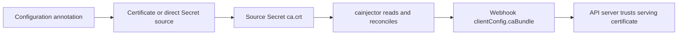

# Fix Stalled cert-manager CA Injection for Mutating Webhooks

Author: [nawazdhandala](https://www.github.com/nawazdhandala)

Tags: Kubernetes, Cert-Manager, Security, Troubleshooting

Description: Trace stalled webhook CA injection through source annotations, Certificate Secrets, controller permissions, feature settings, and version-aware rotation checks.

A ready serving certificate does not guarantee that the API server trusts your webhook. cert-manager's certificate controller issues certificates; its separate `cainjector` component distributes CA data into supported API fields such as a webhook's `clientConfig.caBundle`.

When injection stalls, trace that distribution path before renewing certificates or restarting every component. This guide uses **cert-manager v1.19.1** source as a pinned diagnostic reference. Check your installed image and feature configuration before applying its version-specific conclusions.

## Identify the intended source

CA means certificate authority. The injector needs to know which CA data should authenticate the webhook server.



The source annotation belongs on the **MutatingWebhookConfiguration object's metadata**, not on its Service, Deployment, or individual `webhooks` entry. The [CA injector documentation](https://cert-manager.io/docs/concepts/ca-injector/) describes the three supported source paths:

| Annotation on the target configuration | Meaning |
|---|---|
| `cert-manager.io/inject-ca-from` | Read CA data associated with a named Certificate |
| `cert-manager.io/inject-ca-from-secret` | Read CA data directly from a named Secret |
| `cert-manager.io/inject-apiserver-ca: "true"` | Use the API-server CA known to cainjector |

Choose one source. The API-server CA is not a universal signing authority for arbitrary webhook certificates.

For a Certificate named `injector-serving` in namespace `platform-system`, the relevant metadata fragment is:

```yaml
metadata:
  name: platform-hooks
  annotations:
    cert-manager.io/inject-ca-from: platform-system/injector-serving
```

This is a fragment to review in the existing configuration, not a complete manifest to apply. The referenced name is the **Certificate name**, which may differ from its `spec.secretName`.

For direct Secret injection, the target uses `inject-ca-from-secret: platform-system/webhook-trust`, and that source Secret must explicitly allow it with `cert-manager.io/allow-direct-injection: "true"`. Put the permission annotation on the source Secret. It is not required merely because Certificate-based injection eventually reads a Secret.

## Check issuance separately from readable CA data

Use the actual namespace and object names in these read-only commands:

```bash
kubectl get mutatingwebhookconfiguration platform-hooks -o yaml
kubectl -n platform-system get certificate injector-serving -o yaml
kubectl -n platform-system get secret injector-serving-tls \
  -o jsonpath='{.metadata.annotations}'
kubectl -n platform-system get secret injector-serving-tls \
  -o jsonpath='{.data.ca\.crt}' > source-ca.b64
```

These [kubectl get output formats](https://kubernetes.io/docs/reference/kubectl/generated/kubectl_get/) select only the requested fields. Here `injector-serving-tls` is an example `spec.secretName`; read that field first. The commands inspect metadata and public CA data without printing `tls.key`. Secret reads still require authorization.

For Certificate-based injection in v1.19.1, the controller follows the Certificate's `spec.secretName`, checks the Secret's `cert-manager.io/certificate-name` annotation, and reads `ca.crt`. The ownership check is not an `ownerReferences` check. Missing namespace prefixes, the wrong associated Secret, and absent CA data have distinct failure paths in the [tagged source reader](https://github.com/cert-manager/cert-manager/blob/v1.19.1/pkg/controller/cainjector/sources.go).

If the association is wrong, investigate who created or replaced the Secret. Do not simply relabel unrelated certificate material to bypass the check.

A Certificate can be issued without a useful `ca.crt` field. For example, cert-manager documents that ACME issuance does not supply that field because the CA is not known in the required way. A populated `tls.crt` is not a substitute. See [Certificate target Secret contents](https://cert-manager.io/docs/usage/certificate/#target-secret).

## Confirm cainjector can observe the source

Replace the deployment name if your Helm release uses different names:

```bash
kubectl -n cert-manager get deployment cert-manager-cainjector -o yaml
kubectl -n cert-manager logs deployment/cert-manager-cainjector \
  --since=15m --tail=300
```

Check the image version, ServiceAccount, arguments, and any mounted component configuration. Inspect logs from the active leader when several replicas exist; one replica's quiet log is not proof that no reconciliation happened. The [kubectl logs reference](https://kubernetes.io/docs/reference/kubectl/generated/kubectl_logs/) explains the log-selection options.

In this release, relevant flags include `--namespace`, `--enable-certificates-data-source`, and `--enable-mutatingwebhookconfigurations-injectable`. A namespace restriction can exclude the Certificate or Secret even though the target configuration itself is cluster-scoped. A disabled Certificate data source will not be repaired by restarting the Certificate controller. These flags are defined in the [v1.19.1 cainjector options](https://github.com/cert-manager/cert-manager/blob/v1.19.1/cmd/cainjector/app/options/options.go).

Look for source-fetch errors, missing CA data, rejected ownership, and failures updating the target. Some missing-source cases wait for a relevant resource change rather than continuously retrying; the [reconciler implementation](https://github.com/cert-manager/cert-manager/blob/v1.19.1/pkg/controller/cainjector/reconciler.go) distinguishes those paths. Fix the identified cause rather than using a restart as the acceptance test.

## Check the controller's permissions

RBAC, or role-based access control, can allow you to read the resources while preventing the controller from reading or updating them.

If you are authorized to impersonate the controller's actual ServiceAccount, inspect its permissions:

```bash
CAINJECTOR_ID='system:serviceaccount:cert-manager:cert-manager-cainjector'
kubectl auth can-i get certificates.cert-manager.io/injector-serving \
  -n platform-system --as="$CAINJECTOR_ID"
kubectl auth can-i get secrets/injector-serving-tls \
  -n platform-system --as="$CAINJECTOR_ID"
kubectl auth can-i update mutatingwebhookconfigurations.admissionregistration.k8s.io/platform-hooks \
  --as="$CAINJECTOR_ID"
kubectl auth can-i patch mutatingwebhookconfigurations.admissionregistration.k8s.io/platform-hooks \
  --as="$CAINJECTOR_ID"
```

Expected answers are `yes` for the operations your configured controller uses. An impersonation error is a limitation of this diagnostic account, not evidence that cainjector lacks access. See [kubectl auth can-i](https://kubernetes.io/docs/reference/kubectl/generated/kubectl_auth/kubectl_auth_can-i/).

These checks are only a starting point. Inspect list/watch permissions and leader-election Lease permissions too. Compare the installed bindings with the [release's RBAC template](https://github.com/cert-manager/cert-manager/blob/v1.19.1/deploy/charts/cert-manager/templates/cainjector-rbac.yaml), including the ServiceAccount namespace. Repair the specific missing permission through the installation owner; granting cluster-admin hides the real dependency.

## Compare certificate identities, not just bundle text

In v1.19.1, `CAInjectorMerging` is beta and **enabled by default**, according to the [feature definitions](https://github.com/cert-manager/cert-manager/blob/v1.19.1/internal/cainjector/feature/features.go). Its [bundle implementation](https://github.com/cert-manager/cert-manager/blob/v1.19.1/internal/cainjector/bundle/bundle.go) combines certificates, avoids duplicates, and removes expired certificates when reconciliation runs. Consequently, an effective bundle may contain valid older certificates as well as the current source.

Export the target configuration to `target.json` with `kubectl get mutatingwebhookconfiguration platform-hooks -o json > target.json`. Then compare certificate fingerprints with this Python 3.11 helper:

```python
import base64
import hashlib
import json
import re
import ssl
from pathlib import Path


def fingerprints(encoded):
    pem = base64.b64decode(encoded.strip(), validate=True).decode("ascii")
    blocks = re.findall(
        r"-----BEGIN CERTIFICATE-----.*?-----END CERTIFICATE-----",
        pem, re.S,
    )
    if not blocks:
        raise ValueError("No PEM certificates found")
    return {hashlib.sha256(ssl.PEM_cert_to_DER_cert(b)).hexdigest()
            for b in blocks}


source = fingerprints(Path("source-ca.b64").read_text())
config = json.loads(Path("target.json").read_text())
for webhook in config["webhooks"]:
    target = fingerprints(webhook["clientConfig"].get("caBundle", ""))
    print(webhook["name"], "missing:", sorted(source - target),
          "additional:", sorted(target - source))
```

For a valid, unexpired source bundle, expect no missing fingerprints. Additional fingerprints require review, not an automatic declaration that injection stalled. This helper compares certificate bytes using Python's [PEM-to-DER conversion](https://docs.python.org/3.11/library/ssl.html#ssl.PEM_cert_to_DER_cert); it does not validate certificate lifetimes, CA constraints, or a serving chain.

The injector operates across the webhook entries in the annotated configuration. Review every entry, especially if different servers were grouped under one configuration. See the [target update implementation](https://github.com/cert-manager/cert-manager/blob/v1.19.1/pkg/controller/cainjector/injectables.go).

## Verify rotation reaches the actual server

A renewed leaf under the same CA may leave `caBundle` unchanged; that is normal. For a CA change, confirm the new CA is trusted before switching serving material, keep needed old trust during overlap, and verify all server replicas load the new chain.

Do not assume removing a still-valid CA from the source immediately removes it from a merged target. Plan explicit trust retirement with the field owner and review the installed feature behavior. Also inspect GitOps or Helm reconciliation if the target repeatedly changes back.

Close the incident only after the intended CA reaches the target, the served certificate matches that trust, and a scoped admission request succeeds. Injection success and webhook TLS success are related but separate results.
