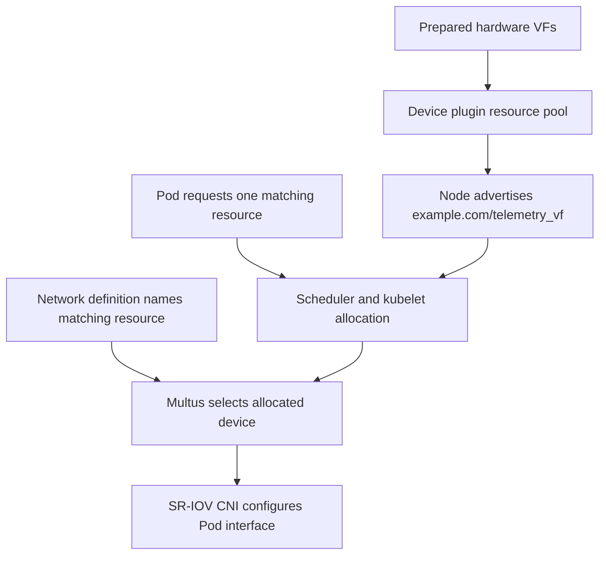

# Match SR-IOV Device Resources to Multus Network Attachments

Author: [nawazdhandala](https://www.github.com/nawazdhandala)

Tags: Multus, Kubernetes, Networking

Description: Connect SR-IOV device allocation to Multus network attachments by matching resource names, choosing the correct driver mode, and verifying a single-VF staging workload.

A Kubernetes node can advertise available network devices while a Pod still fails to attach its requested SR-IOV network. Often the pieces are individually valid but disagree about which resource is being requested.

SR-IOV, short for Single Root I/O Virtualization, lets a supported network adapter expose virtual functions, or VFs. The physical function, or PF, manages the hardware. A device plugin advertises eligible devices to Kubernetes; Multus connects a requested network to an allocated device; the SR-IOV CNI plugin configures that device for the Pod.

This guide uses source references from **Multus v4.3.1**, **SR-IOV network device plugin v3.11.0**, and **SR-IOV CNI v2.10.0**. The examples were parsed and cross-checked locally. No physical adapter, VF allocation, or live cluster was tested, and these versions are not a blanket hardware compatibility certification.

## Follow the resource from discovery to attachment

The important identifier is the full extended resource name, including its prefix. In this example it is `example.com/telemetry_vf`.



An extended resource request participates in scheduling. A Multus annotation selects a network definition. Neither substitutes for the other in a basic deployment. An optional admission component may automate resource requests, but the examples below specify them explicitly. [Kubernetes device resources](https://kubernetes.io/docs/concepts/extend-kubernetes/compute-storage-net/device-plugins/).

Here, “chain” means connecting the allocation and attachment workflow. It does not require adding unrelated plugins to a CNI `plugins` array.

## Prepare a kernel-network staging pool

Before using the example, prepare VFs through your supported node-management process. The device plugin discovers eligible devices; it does not create VFs or bind their drivers. Confirm firmware, kernel, PF configuration, switch connectivity, and the intended VF driver with your platform owner.

This configuration fragment defines one device-plugin resource pool:

```json
{
  "resourceList": [
    {
      "resourceName": "telemetry_vf",
      "resourcePrefix": "example.com",
      "selectors": {
        "pfNames": ["REPLACE_PF_NAME"],
        "drivers": ["REPLACE_KERNEL_VF_DRIVER"]
      }
    }
  ]
}
```

Replace both placeholders with verified values on the eligible nodes, then merge the pool into the device plugin's managed configuration. Do not overwrite unrelated pools. `pfNames` selects devices associated with the chosen physical function; `drivers` restricts the selected driver. Ensure pools do not unintentionally compete for the same devices. [Pinned device-plugin configuration](https://github.com/k8snetworkplumbingwg/sriov-network-device-plugin/blob/v3.11.0/README.md).

After the managed rollout, inspect an eligible node:

```bash
kubectl get node REPLACE_NODE -o json
kubectl describe node REPLACE_NODE
```

Look for `example.com/telemetry_vf` in capacity and allocatable resources. Allocatable is not a live “free VF” counter: account for existing Pod requests when evaluating remaining scheduling capacity. If the resource is absent, solve discovery and registration before editing the network definition.

## Associate the network with that exact resource

Assume the `sriov-lab` namespace already exists and the node has the `sriov` and `static` CNI binaries installed. This single-Pod staging example also requires one exclusively reserved address on the real secondary network. Replace the documentation address before use.

```yaml
apiVersion: k8s.cni.cncf.io/v1
kind: NetworkAttachmentDefinition
metadata:
  name: telemetry-sriov
  namespace: sriov-lab
  annotations:
    k8s.v1.cni.cncf.io/resourceName: example.com/telemetry_vf
spec:
  config: |
    {
      "cniVersion": "0.3.1",
      "name": "telemetry-sriov",
      "type": "sriov",
      "ipam": {
        "type": "static",
        "addresses": [
          {"address": "192.0.2.50/24"}
        ]
      }
    }
```

The metadata annotation connects the network to the resource pool. Multus uses the corresponding allocated device identity when loading the delegate configuration. Do not hard-code a VF's PCI address in a shared network definition: allocation decides which device belongs to each workload. [Multus resource lookup](https://github.com/k8snetworkplumbingwg/multus-cni/blob/v4.3.1/pkg/k8sclient/k8sclient.go).

Static IPAM assigns the supplied address but does not provide cluster-wide uniqueness management. Run only one instance of this example, reserve its address, and use an appropriate allocator for a larger deployment. No gateway or default route is added here, so this example does not intentionally replace the primary network's default route. [Static IPAM](https://www.cni.dev/plugins/current/ipam/static/).

## Request one device and one attachment

Use an approved diagnostic image containing `sleep` and `ip`; replace the image placeholder with an immutable digest available to your nodes:

```yaml
apiVersion: v1
kind: Pod
metadata:
  name: sriov-check
  namespace: sriov-lab
  annotations:
    k8s.v1.cni.cncf.io/networks: |
      [{"name":"telemetry-sriov","interface":"telemetry0"}]
spec:
  restartPolicy: Never
  containers:
    - name: check
      image: REPLACE_APPROVED_DIAGNOSTIC_IMAGE_DIGEST
      command: ["sleep", "3600"]
      resources:
        requests:
          example.com/telemetry_vf: "1"
        limits:
          example.com/telemetry_vf: "1"
```

The full resource key matches the NAD annotation and the device-plugin prefix/name combination. Both request and limit are one. For extended resources, requests and limits must agree when both are specified. Multiple attachments that consume separate VFs need sufficient device requests; duplicating the annotation does not create extra capacity. [Extended-resource consumption](https://kubernetes.io/docs/concepts/extend-kubernetes/compute-storage-net/device-plugins/).

Save the resources as separate YAML files and validate them through your normal deployment process before applying them in staging. Server-side validation can check installed schemas and admission rules, but it cannot prove the adapter will successfully configure a VF.

## Verify the stage where a failure occurs

```bash
kubectl -n sriov-lab describe pod sriov-check
kubectl -n sriov-lab exec sriov-check -- ip -d link show telemetry0
kubectl -n sriov-lab exec sriov-check -- ip address show dev telemetry0
```

A Pending Pod with insufficient resource events points toward capacity, resource naming, or scheduling constraints. A scheduled Pod stuck creating its sandbox points toward the Multus lookup, delegate installation, device configuration, or IPAM. Inspect the matching node's device-plugin and Multus logs rather than changing all components at once.

For this kernel-driver example, expect a Linux network interface with the reserved address. Test a known peer on the attached network and verify the primary network still works. If the interface exists but traffic fails, inspect VLAN expectations, switch configuration, VF settings, MTU, and return routing. Device allocation alone proves none of those paths.

A userspace driver such as `vfio-pci` serves a different workflow, commonly used by DPDK applications. Do not expect the same Linux `ip address` result or reuse this kernel-interface acceptance test unchanged. [SR-IOV CNI driver modes](https://github.com/k8snetworkplumbingwg/sriov-cni/blob/v2.10.0/README.md).

Finally, delete the disposable Pod through Kubernetes and confirm the allocation can be reused by a fresh instance. Record the selected node and observed device identity for the test. The reliable contract is a consistent resource name, a correctly prepared device, a matching driver mode, and successful attachment and release.
