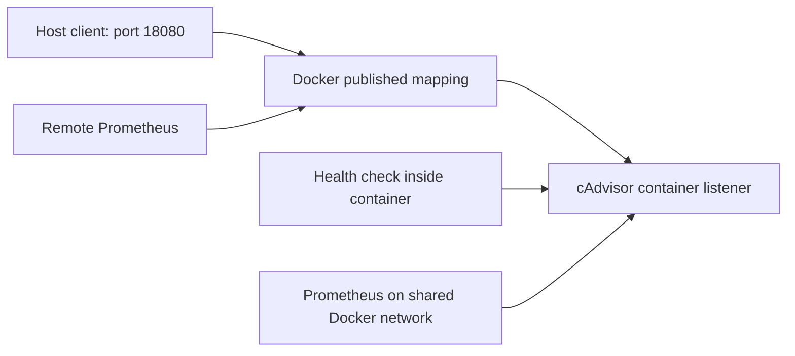

# Change cAdvisor's Port Without Breaking Its Health Check

Author: [nawazdhandala](https://www.github.com/nawazdhandala)

Tags: Docker, Prometheus, Monitoring, Troubleshooting

Description: Keep cAdvisor's listener, Docker port mapping, internal health URL, and Prometheus target aligned when moving the service to another port.

You move cAdvisor from port 8080 to 18080. The browser opens its interface, but Docker marks the container unhealthy. Or Docker reports healthy while Prometheus cannot connect. Both outcomes are possible because the listener, published port, and health check are separate settings.

Start by deciding whether you need a different host port or a different port inside the container. A host-port collision usually requires only a new mapping. Changing the application listener adds another setting that must stay aligned with the image's internal health check.

The examples below are scoped to cAdvisor 0.55.1. They are fragments for an existing working deployment: preserve its reviewed host mounts, device access, security settings, and unrelated command arguments.

## Know where each connection starts

Docker's image health check runs inside the container. A host browser connects through a published host port. Prometheus may use either that host route or the container's address on a shared Docker network.



A URL using `localhost` means the network environment of the process making the request. Inside the health check, it refers to the cAdvisor container itself, not the Docker host or a neighboring Prometheus container.

Docker documents the difference between host and container ports in its [port-publishing guide](https://docs.docker.com/engine/network/port-publishing/). Keep this boundary visible when comparing configuration files.

## Prefer a mapping-only change for a host conflict

If another host service already occupies 8080, keep cAdvisor listening internally on 8080 and publish it on host loopback port 18080:

```yaml
services:
  cadvisor:
    image: ghcr.io/google/cadvisor:0.55.1@sha256:e02855207ec07bb45ee41f720645945251f093f24c28f8c29cf718490f784922
    ports:
      - '127.0.0.1:18080:8080'
```

The image also declares `EXPOSE 8080`, but that is image metadata. It does not rewrite the listener or publish a host port for you. Inspect the running configuration after recreation instead of treating the image declaration as proof of the route.

The last number is the container port. The first port number is the host port. In this case, do not add `--port=18080` to cAdvisor merely because the host uses 18080.

The reviewed [image Dockerfile](https://github.com/google/cadvisor/blob/v0.55.1/deploy/Dockerfile) defines `CADVISOR_HEALTHCHECK_URL=http://localhost:8080/healthz` and uses `wget` to check it. Since the internal listener has not moved, that health URL remains correct.

Loopback publication intentionally limits this example's host route; use a current Docker Engine and verify host firewall behavior. Docker documents a same-network exposure caveat for loopback publishing before Engine 28.0.0. A remote scraper cannot reach the host's loopback address. Provide a protected reachable route if remote collection is required; changing ports does not add authentication or encryption.

## Change the internal listener only when required

If your deployment genuinely requires cAdvisor itself to listen on 18080, change both its command and the health URL:

```yaml
services:
  cadvisor:
    image: ghcr.io/google/cadvisor:0.55.1@sha256:e02855207ec07bb45ee41f720645945251f093f24c28f8c29cf718490f784922
    command:
      - --port=18080
    environment:
      CADVISOR_HEALTHCHECK_URL: http://localhost:18080/healthz
    ports:
      - '127.0.0.1:18080:18080'
```

The [`port` flag](https://github.com/google/cadvisor/blob/v0.55.1/cmd/cadvisor.go) controls cAdvisor's listener. The environment variable controls the image's health command; it does not configure the listener by itself. The published mapping now forwards to the changed internal port.

Merge the argument into your actual command list. Replacing an existing list with this one-line example can remove metric-selection or runtime-endpoint arguments. Similarly, check for a custom Compose `healthcheck` override: it can replace the image's behavior and continue probing an old hard-coded URL.

Do not try to repair this mismatch by disabling health checks. Correct the route they use and keep the signal.

## Align the Prometheus target with its network position

For Prometheus on the same Docker network, use the service name and container port. With the second example, a scrape configuration fragment would be:

```yaml
scrape_configs:
  - job_name: cadvisor
    static_configs:
      - targets: ['cadvisor:18080']
```

With the mapping-only example, that same-network target would still be `cadvisor:8080`. A Prometheus process running directly on the Docker host can instead use `127.0.0.1:18080` for either example. A Prometheus container's own loopback is not the Docker host.

The [Prometheus configuration reference](https://prometheus.io/docs/prometheus/latest/configuration/configuration/) describes static targets and scrape settings. Preserve any existing authentication, TLS, metrics path, or relabeling configuration when changing the target address.

For host-networked containers, the ordinary published-port model does not apply in the same way. Review the actual network mode before copying either bridge-network example.

## Inspect effective state after deployment

Validate your complete Compose project before applying the change:

```bash
docker compose config
```

Review the resolved command, environment, mapping, and any health-check override. The [Compose config command](https://docs.docker.com/reference/cli/docker/compose/config/) renders the configuration that will be applied; it does not prove the service is reachable.

After updating the deployment through its normal procedure, inspect the running container. Replace `cadvisor-container` with its actual name:

```bash
docker container inspect cadvisor-container \
  --format '{{json .Config.Healthcheck}} {{json .State.Health}}'
docker container inspect cadvisor-container \
  --format '{{json .NetworkSettings.Ports}}'
```

The first command shows the configured health check and recent results, if present. The second shows effective published ports. See [Docker inspect](https://docs.docker.com/reference/cli/docker/container/inspect/). A connection refusal in health output suggests a listener or port mismatch; a host connection failure with successful internal health suggests investigating publication and the caller's network position.

If you changed the bind-address flag as well as the port, verify that the health URL reaches that address. Port alignment cannot compensate for a listener bound somewhere the probe cannot access.

## Remember what a successful health check proves

In this release, the [health handler](https://github.com/google/cadvisor/blob/v0.55.1/cmd/internal/healthz/healthz.go) returns an `ok` response. It is a basic HTTP liveness check, not proof that every container, filesystem, or metric family is being collected.

After health becomes successful, verify the Prometheus target and one known application container's metrics independently. An inherited image health check can be green while the scrape points at a stale address, and a scrape can succeed while discovery coverage is incomplete.

Local validation for this article checked the Compose fragments and Prometheus configuration, plus the versioned health handler's HTTP response. No Docker port publishing or live cAdvisor deployment was performed. In your acceptance check, test the internal health result and the actual scraper route separately, then record the intended host and container ports so the next upgrade preserves them.
