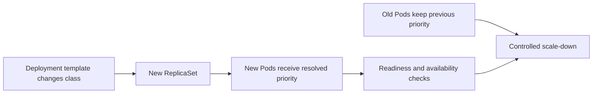

# Change Deployment Priority Through a Controlled Pod Rollout

Author: [nawazdhandala](https://www.github.com/nawazdhandala)

Tags: Kubernetes, Deployment, Change Management

Description: Change a Deployment's PriorityClass through its Pod template, plan surge capacity, and verify new Pod priorities without assuming existing Pods mutate in place.

A Deployment's priority change is a replacement operation. Existing Pods do not acquire a different priority because you edit the Deployment template, and attempting to patch their admitted priority in place is not the supported path.

The safe approach is to introduce the reviewed class in the Pod template, let the Deployment create replacements under a suitable rollout strategy, and verify their actual admitted values. The difficult part is the transition: old and new Pods coexist, compete for resources, and may have different preemption relationships.

This guide uses **Kubernetes 1.34.0** behavior. It assumes an existing Deployment and a separately reviewed PriorityClass; it is not a procedure for changing every workload in a cluster at once.

## Identify the mutable configuration boundary

`spec.template.spec.priorityClassName` belongs to the Deployment's template for future Pods. The resulting Pod's priority fields are resolved at admission and cannot simply be changed like an annotation on a running Pod.

The [priority admission source](https://github.com/kubernetes/kubernetes/blob/v1.34.0/plugin/pkg/admission/priority/admission.go) documents preservation on updates, while [Pod update validation](https://github.com/kubernetes/kubernetes/blob/v1.34.0/pkg/apis/core/validation/validation.go) restricts mutable fields. Changing the template initiates the normal replacement lifecycle rather than rewriting existing objects.



A template change is enough to trigger a rollout. An additional rollout restart is normally unnecessary and can complicate the revision history.

## Record the starting point

Substitute the context, namespace, and Deployment name. These commands only inspect state:

```bash
kubectl --context staging -n payments get deployment checkout -o yaml
kubectl --context staging -n payments rollout history deployment/checkout
kubectl --context staging get priorityclass service-important -o yaml
kubectl --context staging -n payments get pods -l app=checkout \
  -o custom-columns='NAME:.metadata.name,UID:.metadata.uid,CLASS:.spec.priorityClassName,PRIORITY:.spec.priority,NODE:.spec.nodeName'
```

Use the Deployment's actual selector instead of assuming `app=checkout` is correct. Record the current revision, template class, numeric priorities, requested resources, strategy, and readiness behavior. A template that omits the class may still have Pods whose class was supplied by the global default.

Confirm that `service-important` exists and has the intended value and preemption policy. Check namespace admission rules and class-scoped quota. A valid Deployment update can still fail when its controller tries to create a Pod rejected by those controls.

## Plan the temporary capacity and victim relationship

For a three-replica Deployment, a strategy with `maxSurge: 1` and `maxUnavailable: 0` asks the controller to add capacity before deliberately reducing available old replicas. It requires room for the extra Pod, plus any temporary overhead from terminating Pods that have not released resources.

The [Deployment rolling-update documentation](https://kubernetes.io/docs/concepts/workloads/controllers/deployment/#rolling-update-deployment) explains surge and unavailability controls. They govern the Deployment controller's actions; they do not prevent a scheduler from preempting an old lower-priority replica to fit a new higher-priority one.

That distinction is important during a priority increase. A “zero unavailable” rollout setting is not a promise of zero disruption if the new Pod can preempt the old Pods or another service. Provide suitable headroom or reconsider the target class's preemption behavior before rollout.

If the new class is non-preempting, the extra Pod can wait when capacity is unavailable. That may safely stall the rollout instead of forcing progress through victim removal, but the delay needs an operational plan. Do not remove healthy replicas blindly to make the rollout status advance.

## Make one reviewed template change

For an approved staging example, this JSON merge patch changes only the strategy and class name:

```bash
kubectl --context staging -n payments patch deployment checkout \
  --type=merge -p '{
    "spec": {
      "strategy": {
        "type": "RollingUpdate",
        "rollingUpdate": {"maxSurge": 1, "maxUnavailable": 0}
      },
      "template": {
        "spec": {"priorityClassName": "service-important"}
      }
    }
  }'
```

This is a change command for a workload already reviewed for those settings. It does not set an integer priority directly, alter container images, or replace the container list. The new Pods obtain the integer value from the named class.

If GitOps or another deployment system owns the object, make the equivalent change in its source configuration and reconcile through that workflow. A direct patch can otherwise be reverted by the owner or create a configuration disagreement. Avoid making an unrelated image change in the same rollout unless it is deliberately part of the review.

## Watch admission, scheduling, and readiness separately

Observe the rollout and current ReplicaSets:

```bash
kubectl --context staging -n payments rollout status deployment/checkout --timeout=5m
kubectl --context staging -n payments get replicasets -l app=checkout
kubectl --context staging -n payments describe deployment checkout
kubectl --context staging -n payments get events \
  --sort-by=.metadata.creationTimestamp
```

A local command timeout does not cancel or roll back the Deployment. Inspect the current state before issuing another change. Likewise, a reported progress failure does not by itself mean Kubernetes restored the old template.

Classify the delay. `FailedCreate` can indicate missing classes, admission denial, or quota. A created Pod that cannot schedule needs placement analysis. An assigned Pod that is not ready needs runtime and application investigation. These problems require different fixes even though the rollout command reports an unfinished rollout in all three cases.

Check new Pod UIDs and admitted numeric priorities with the earlier listing. During transition, a mixed population is expected. At completion, verify the desired replicas use the intended class and that clients observe acceptable availability and latency.

## Roll back the template, not the past

If the change causes problems, restore the reviewed previous source configuration or select a known Deployment revision through your normal rollback procedure. The [rollout undo reference](https://kubernetes.io/docs/reference/kubectl/generated/kubectl_rollout/kubectl_rollout_undo/) describes revision selection.

Rollback creates another transition. It does not mutate the priority of the new Pods already running, undo preemptions that have happened, or restore work lost by unrelated victims. Keep the old PriorityClass available while templates or rollback revisions still reference it.

Also remember that a Deployment revision tracks its Pod template. Restoring a template is not a complete rollback of every separate strategy or policy change made during the incident. Review the final strategy, class definitions, quotas, and source configuration explicitly.

The patch payload was parsed locally and applied to a fixture to check that unrelated image and replica fields remained intact. Shell syntax and Kubernetes 1.34.0 schema checks passed. No live rollout, scheduling, admission, or rollback was performed. Successful completion requires both the intended admitted priority and an observed healthy replacement process.
