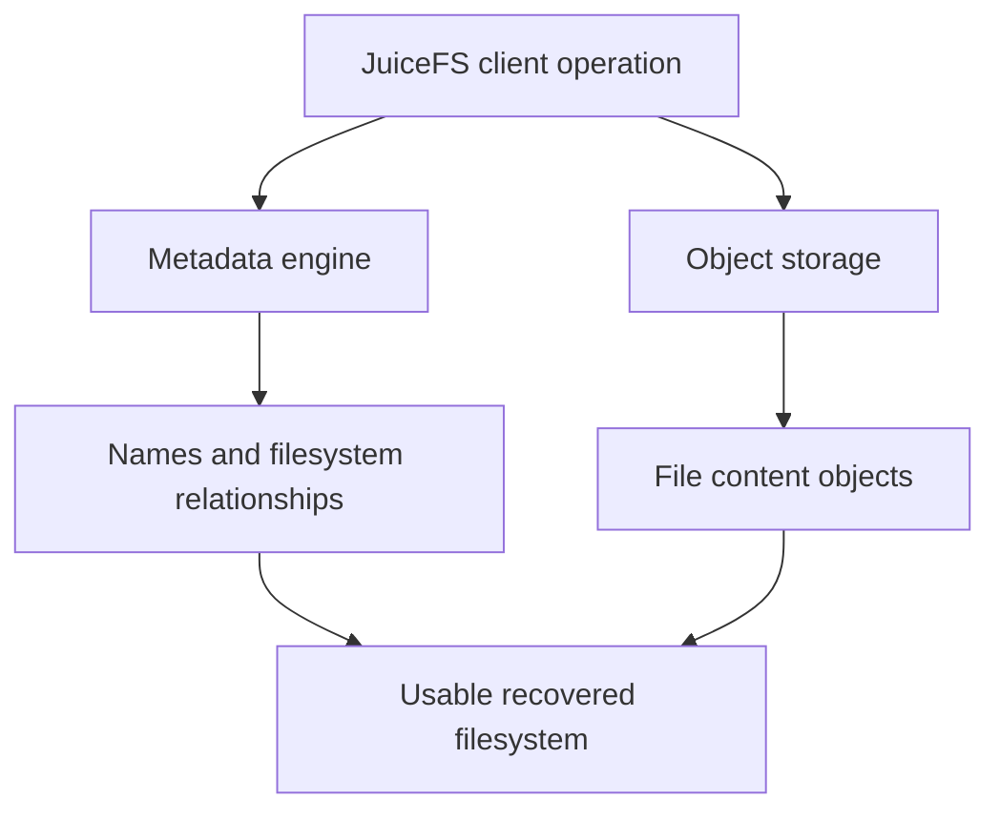

# Choose a JuiceFS Metadata Engine for Your Workload

Author: [nawazdhandala](https://www.github.com/nawazdhandala)

Tags: JuiceFS, Storage, Database

Description: Compare Redis, MySQL, PostgreSQL, TiKV, and etcd for JuiceFS metadata using workload shape, durability, capacity, and recovery requirements.

Choosing a JuiceFS metadata engine is a database operations decision as much as a filesystem performance decision. The engine stores the information that gives object-storage content its filesystem meaning: names, directories, attributes, and relationships to stored data.

An object bucket that remains intact does not make lost metadata harmless. Choose an engine whose failure behavior, capacity limits, and recovery process your team can operate confidently.

This guide uses **JuiceFS Community Edition 1.4.2** as the client baseline. It compares five supported engine families without treating historical benchmark numbers as guarantees for a new deployment. Confirm the exact database version and topology against the pinned client's documentation before provisioning.

## Start with the workload and recovery requirements

Count files and directories, not just stored terabytes. A workload with millions of small files can stress namespace operations while a smaller collection of large files spends more time moving object data.

Write down the operations that dominate: creating files, traversing directories, renaming, checking attributes, or repeatedly overwriting existing files. Include client count, concurrency, file-name lengths, extended attributes, and expected growth.

Then define recovery requirements. How much acknowledged metadata can you afford to lose? How long can clients wait during a primary failure? Can the team restore the database without guessing which object-storage recovery point belongs with it?



The two branches need coordinated protection. Database replication helps availability, but it can replicate accidental deletion too; backups and tested recovery remain separate responsibilities.

## Compare candidates by operating model

Use this table to create a shortlist, then verify it with your workload:

| Engine | Reason to investigate it | Main operating question |
|---|---|---|
| Redis | Low-latency metadata service with an in-memory working set | Can memory, persistence, and failover meet the recovery contract? |
| MySQL | Existing expertise in transactional SQL and managed database operations | Can the selected topology handle metadata transactions and client connections? |
| PostgreSQL | Established PostgreSQL backup, monitoring, and availability practices | Can connection and transaction behavior stay healthy at mount scale? |
| TiKV | Distributed transactional key-value storage for a larger metadata footprint | Can the team operate TiKV and its placement service reliably? |
| etcd | A bounded metadata footprint with a dedicated consensus-backed service | Will quota, history growth, and maintenance remain safely within limits? |

These are decision criteria, not a measured ranking. Two deployments of the same engine can behave very differently because of persistence settings, storage devices, network distance, and replication topology.

## Redis: treat metadata as durable data

Redis can be attractive when metadata fits comfortably in memory and latency matters. It must not be configured like an expendable cache. JuiceFS requires a no-eviction policy; deleting metadata under memory pressure is not an acceptable cache-management strategy.

Capacity planning must include database overhead, persistence work, replication, and growth headroom. A rough per-file estimate is useful for a first calculation, but measure a representative namespace before committing to a memory budget.

JuiceFS's Redis Cluster support does not mean one filesystem's metadata is automatically distributed across every shard. Its documented placement keeps one filesystem's transactional metadata together. Do not choose Redis Cluster on the assumption that adding shards indefinitely expands a single volume. [Pinned metadata setup guide](https://github.com/juicedata/juicefs/blob/v1.4.2/docs/en/reference/how_to_set_up_metadata_engine.md).

Review Redis persistence explicitly. RDB snapshots and append-only files have different recovery characteristics; the append-only file's synchronization policy changes the durability/performance tradeoff. A faster test with weaker persistence is not a fair comparison against a synchronously durable alternative. [Redis persistence documentation](https://redis.io/docs/latest/operate/oss_and_stack/management/persistence/).

Also rehearse failover. JuiceFS's Redis guidance calls out that asynchronous replication can lose acknowledged writes during failures. Decide whether the resulting window is acceptable rather than equating “has replicas” with “cannot lose writes.” [JuiceFS Redis practices](https://github.com/juicedata/juicefs/blob/v1.4.2/docs/en/administration/metadata/redis_best_practices.md).

## MySQL and PostgreSQL: budget connections as well as storage

A relational database can be a practical choice when the organization already operates its backups, failover, and monitoring well. That advantage is operational familiarity, not a promise that every SQL-compatible service is interchangeable.

JuiceFS relies on transactions. Its MySQL guidance requires a transactional engine such as InnoDB and warns against assuming full compatibility from distributed MySQL-like products. Validate the actual service rather than relying on the protocol name. [JuiceFS MySQL practices](https://github.com/juicedata/juicefs/blob/v1.4.2/docs/en/administration/metadata/mysql_best_practices.md).

For PostgreSQL, include the connection budget across all mounts. A pool setting that looks small for one client can become large across hundreds of workers. The JuiceFS guide documents connection controls such as `max_open_conns` and connection lifetimes; choose them from concurrency measurements and database capacity. [JuiceFS PostgreSQL practices](https://github.com/juicedata/juicefs/blob/v1.4.2/docs/en/administration/metadata/postgresql_best_practices.md).

For either engine, test the application-visible pause during primary replacement, transaction retries, and connection recovery. Keep metadata databases close enough to clients that network round trips do not dominate namespace operations. Preserve verified TLS and secret handling in the benchmark environment so the tested topology resembles production.

## TiKV: evaluate the whole distributed system

TiKV provides a distributed transactional key-value layer. Its architecture includes TiKV storage nodes and Placement Driver, or PD, nodes that manage cluster placement. The operational scope therefore includes more than installing a single database process. [TiKV architecture overview](https://tikv.org/docs/7.1/concepts/overview/).

Investigate TiKV when the required scale and workload justify that distributed operating model. Include quorum placement, disk latency, network faults, rolling upgrades, backup, and restore in the evaluation. Do not extrapolate a small single-client test into a claim about a large production cluster.

If your team already operates TiKV, that experience may make it a stronger candidate. If not, account for the engineering time and on-call responsibility in the decision rather than treating infrastructure complexity as free.

## etcd: respect the capacity boundary

Etcd is a supported option, but metadata growth and revision history need deliberate limits. Its backend quota and maintenance requirements make capacity planning especially important. Compaction and defragmentation solve different storage problems, and reaching quota can prevent writes. [etcd maintenance guidance](https://etcd.io/docs/v3.6/op-guide/maintenance/).

Use a dedicated etcd service for JuiceFS instead of the Kubernetes control plane's own datastore. JuiceFS's etcd guidance recommends this separation to avoid filesystem load affecting cluster stability. [JuiceFS etcd practices](https://github.com/juicedata/juicefs/blob/v1.4.2/docs/en/administration/metadata/etcd_best_practices.md).

A familiar etcd cluster is not automatically spare capacity. Forecast namespace growth, retained revisions, and recovery headroom, then prove the maintenance procedure on a disposable environment.

## Run a fair, bounded evaluation

JuiceFS's published engine benchmark documents an older client and specific database versions, hardware, and persistence settings. Use it to identify relevant operations, not as a current universal performance ranking. [Pinned benchmark methodology](https://github.com/juicedata/juicefs/blob/v1.4.2/docs/en/benchmark/metadata_engines_benchmark.md).

With JuiceFS 1.4.2 installed and a verified, disposable staging mount, this Bash example creates an isolated test directory and runs a small-file check:

```bash
set -eu
mount='/mnt/REPLACE_WITH_VERIFIED_STAGING_JUICEFS_MOUNT'
work=$(mktemp -d "$mount/engine-evaluation.XXXXXX")
juicefs bench --big-file-size 0 --small-file-size 4K \
  --small-file-count 100 -p 4 "$work"
```

This writes test files. Run it only on dedicated staging capacity. The benchmark attempts to clear kernel caches; inspect warnings and do not grant extra privileges merely to obtain a better-looking result. Record cache conditions consistently. Its flags were checked against the official 1.4.2 binary.

Repeat with representative concurrency, directory sizes, and failure tests. Keep object storage, network placement, client options, and durability policy comparable. Measure tail latency and recovery behavior alongside averages.

For this article, the official Darwin ARM64 binary's SHA-256 matched the published release checksum. Its version/help and the bounded benchmark command were checked on a temporary local filesystem. That was a CLI smoke test, not a JuiceFS mount or database comparison; cache clearing failed and no performance conclusion is drawn from it.

Choose the engine whose measured behavior and recovery procedure meet your requirements with an operating burden your team can sustain. Record the decision, capacity trigger, and restore test so growth or changing workloads can prompt a deliberate reassessment.
