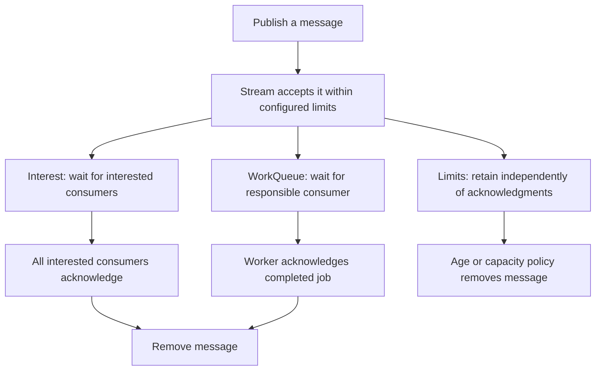

# Choose NATS JetStream Retention: Limits, Interest, or Work Queue

Author: [nawazdhandala](https://www.github.com/nawazdhandala)

Tags: NATS, Messaging, Python

Description: Choose JetStream retention by message lifetime, replay needs, and consumer ownership, then verify acknowledgment and capacity behavior in a small lab.

A shipping service processes an order successfully. Should the message disappear immediately, wait for the billing service, or remain available for an audit next week? That question determines the stream's retention policy.

Retention describes when stored messages become eligible for removal. It does not tell you whether a business operation ran exactly once. A worker can still fail between changing a database and acknowledging its message. Choose retention around the lifetime of the record, then design retries and idempotency separately.

This guide uses NATS Server 2.11.4 and nats-py 2.10.0 for a small, disposable local example. The versions pin the demonstrated behavior; they are not a recommendation to replace your supported production release.

## Start with the record's purpose

| Requirement | Policy | What an acknowledgment changes | No consumer exists yet |
| --- | --- | --- | --- |
| Retained event history, including later replay | Limits | Consumer progress advances; the record remains within stream limits | Messages can remain within limits |
| Independent consumers must each finish with a record | Interest | Removal follows acknowledgment by all interested consumers | No interested consumer means the message is not retained |
| One logical worker group owns each job | WorkQueue | Successful acknowledgment removes the job | Jobs can wait within stream limits |

These are lifecycle rules, not infinite-storage promises. The [official retention guide](https://docs.nats.io/learn/jetstream/retention-policies) explains the three policies and their interaction with stream limits.

For example, keep `orders.created` as history if another team may need to replay it tomorrow. Use a separate work stream for `shipping.requested` if completed shipping jobs no longer belong in that queue. Keeping history and unfinished work separate also makes their capacity requirements easier to explain.



The diagram omits administrative deletion and highlights normal processing. Age and capacity limits also constrain the Interest and WorkQueue branches.

## Create three separate lab streams

Use an isolated server with JetStream enabled and an empty store. Do not run this against existing stream names. The example assumes the server is listening only on `127.0.0.1:14229`; change that address to your disposable instance. A secured deployment also needs its normal authentication and verified TLS configuration.

Install the pinned client in a virtual environment:

```bash
python3 -m venv .venv
.venv/bin/python -m pip install 'nats-py==2.10.0'
```

Save this as `retention_lab.py` and run it with that environment's Python interpreter:

```python
import asyncio
import nats
from nats.js.api import RetentionPolicy, StorageType

async def main():
    nc = await nats.connect("nats://127.0.0.1:14229")
    try:
        js = nc.jetstream()
        choices = [
            ("LIMITS_LAB", RetentionPolicy.LIMITS),
            ("INTEREST_LAB", RetentionPolicy.INTEREST),
            ("WORK_LAB", RetentionPolicy.WORK_QUEUE),
        ]
        for name, policy in choices:
            info = await js.add_stream(
                name=name,
                subjects=[name.lower()],
                storage=StorageType.FILE,
                retention=policy,
                max_msgs=10,
                max_age=3600,
            )
            print(info.config.name, info.config.retention)
    finally:
        await nc.close()

asyncio.run(main())
```

The result is three small streams on different subjects. File storage puts messages in the server's configured store, not beside this Python script. In this client, `max_age` is expressed in seconds: `3600` means one hour. The enum names and configuration fields come from the [tagged nats-py API definitions](https://github.com/nats-io/nats.py/blob/v2.10.0/nats/js/api.py). This is a single-server exercise, not a replicated deployment.

To inspect counts without changing state, use this fragment inside the connected `try` block:

```python
for name in ("LIMITS_LAB", "INTEREST_LAB", "WORK_LAB"):
    info = await js.stream_info(name)
    print(name, info.state.messages, info.state.first_seq,
          info.state.last_seq)
```

A zero count means no messages are currently retained. It does not prove that nothing was ever published.

## Test ownership before adding real traffic

The useful acceptance test is a sequence of actions, not just checking the policy string. In a disposable NATS 2.11.4 server, I ran these cases with explicit acknowledgments and checked stream state after each step:

| Test | Observed result |
| --- | --- |
| Publish to Limits, then create a reader and acknowledge | One message remained |
| Publish to Interest before creating any consumer | Zero messages remained |
| Create two interested consumers, publish, acknowledge from only one | One message remained |
| Acknowledge from the second interested consumer | Zero messages remained |
| Publish to WorkQueue before creating its consumer | One message remained |
| Create a second overlapping WorkQueue consumer | Server rejected the configuration |
| Acknowledge through the WorkQueue consumer | Zero messages remained |

For Interest, provision durable consumers before producers start. A durable consumer is named server-side state that can survive the application disconnecting. Stopping its application is different from deleting that consumer. Deletion changes which consumers have an interest in outstanding records, so treat consumer removal as a data-lifecycle operation.

For WorkQueue, several worker processes can share one pull consumer. They do not each need a separate consumer over the same subject. Non-overlapping subject filters can partition responsibility, but overlapping consumers violate WorkQueue's ownership model. The [server's consumer implementation](https://github.com/nats-io/nats-server/blob/v2.11.4/server/consumer.go) enforces those constraints, including explicit acknowledgment requirements.

Do not interpret the rejected overlap as an exactly-once business guarantee. An unacknowledged job can be redelivered. Keep stable operation identifiers and make repeated handling safe.

## Choose the overflow behavior separately

Retention and overflow answer different questions. Retention asks whether consumers are finished. Overflow asks what happens when storage limits are reached.

With `DiscardOld`, making room can evict older records. With `DiscardNew`, a publish that would exceed the applicable capacity is rejected. The producer must inspect the JetStream publication result and handle rejection; merely sending bytes on a Core NATS connection is insufficient evidence of storage. Age expiration remains relevant even when new publications are rejected. See [shaping stream limits](https://docs.nats.io/learn/jetstream/shaping-the-stream) and the [pinned stream implementation](https://github.com/nats-io/nats-server/blob/v2.11.4/server/stream.go).

I tested both capacity outcomes separately: a two-message Limits stream using `DiscardOld` retained sequences two and three after three publications. A one-message stream using `DiscardNew` rejected its second publication and retained the first. These small tests exercise behavior, not storage throughput.

Estimate required headroom from arrival rate, average stored record size, and the longest outage you intend to tolerate. Then allow for replication and storage overhead. Validate that estimate with representative messages. An Interest consumer that stays offline and a WorkQueue that stops draining both turn normal traffic into accumulated storage demand.

## Make the decision reviewable

Write down who owns each record, whether a future reader must replay it, and what should happen during a full-storage incident. For Interest, include consumer creation and deletion in the deployment plan. For WorkQueue, record the subject partitions and the shared consumer name. For Limits, document the actual retention window under both age and capacity pressure.

Before adopting the policy, repeat the acceptance cases with your client version and application permissions. Add an outage case that exceeds your expected processing delay, and verify alerts before retention removes required records. The local checks here did not exercise clustered failover, disk exhaustion, or production traffic. Their purpose is to make the lifecycle observable before those larger operational tests begin.
