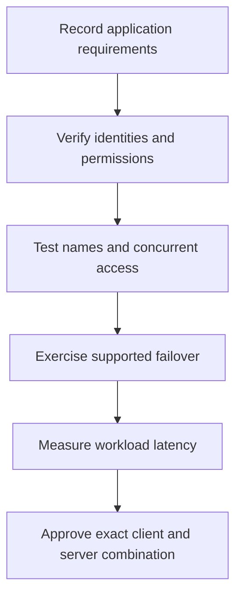

# Choose SMB or NFS for a Mixed Windows and Linux Fleet

Author: [nawazdhandala](https://www.github.com/nawazdhandala)

Tags: SMB, NFS, File Storage

Description: Compare SMB and NFS using identity, filename, locking, and failover tests before moving a mixed Windows and Linux fleet onto shared storage.

A Windows desktop opens a project folder successfully. A Linux build worker reads it too. That proves connectivity, but it does not prove that both clients agree about permissions, filenames, or concurrent writes.

Server Message Block (SMB) and Network File System (NFS) both provide remote file access. Choose between them by testing the application's requirements against a specific client and server combination. A successful mount is the beginning of that assessment.

## Start with the applications that share files

List who reads and writes each directory. Separate interactive document editing, build outputs, immutable media, and applications that update shared state. These workloads need different guarantees, even when their capacity requirements match.

Write down the client operating system, kernel or Windows build, server product and release, protocol version, authentication method, and mount or share settings. Keep that record with the acceptance results. An operating system upgrade can change behavior without changing the path applications use.

The first compatibility trap is version asymmetry. Microsoft's current overview lists NFSv2, NFSv3, and NFSv4.1 for Windows Server's NFS server, but NFSv2 and NFSv3 for the built-in Windows NFS client. A Windows machine serving NFSv4.1 does not establish that another Windows machine can mount it with its built-in client using that version. Check the actual client implementation. [Microsoft NFS overview](https://learn.microsoft.com/en-us/windows-server/storage/nfs/nfs-overview).

Use this table to turn preferences into acceptance criteria:

| Decision | Evidence to collect | Reject a candidate when |
| --- | --- | --- |
| Identity | Server-observed identity for two users and one service | Unrelated users become the same privileged account |
| Permissions | Allowed and denied operations from both operating systems | Either client bypasses the intended policy |
| Names | Case-only names, rename behavior, application path lookup | Names collide or become inaccessible |
| Coordination | Competing writes using the application's locking API | Both writers enter a supposedly exclusive section |
| Recovery | Open files and acknowledged writes during staged failover | Data or application recovery exceeds the agreed limit |
| Performance | Directory operations and representative reads/writes | A required workload misses its latency budget |

## Decide whose identity reaches the server

An access control list (ACL) records which identities may perform operations. The important identity is the one the server authorizes, which may differ from the local account running a program.

On Linux, a conventional SMB mount normally uses one set of mount credentials for server access. Showing a local owner through `uid=` or `gid=` does not turn that session into a separate authenticated user. The `multiuser` option supports separate sessions, but requires an appropriate credential arrangement. Do not use `noperm` as a permission repair: it disables client permission checking while server authorization still applies. [Linux mount.cifs manual](https://man7.org/linux/man-pages/man8/mount.cifs.8.html).

For NFS, distinguish numeric user and group identifiers from authenticated principals. A design using `sec=sys` has different trust assumptions from one using Kerberos. Linux documents `krb5` for authentication, `krb5i` for integrity protection, and `krb5p` for privacy protection. NFS is therefore not automatically an unauthenticated or unencrypted choice; the selected security mode matters. [Linux NFS security options](https://man7.org/linux/man-pages/man5/nfs.5.html).

Run the same access test as an authorized employee, a deliberately unauthorized employee, and the actual service identity. Check reading, creating, modifying, renaming, and deleting separately. Record the server's account or principal for each operation. Include a fresh login after changing group membership so an old session does not conceal a mapping problem.

## Measure filename behavior instead of assuming it

Case preservation means a server remembers the spelling of `Report.txt`. Case sensitivity means `Report.txt` and `report.txt` can identify different files. These are separate properties.

Do not reduce the choice to “SMB ignores case, NFS respects it.” Samba exposes configurable case behavior, including an automatic mode influenced by client requests. The server filesystem and application expectations also belong in the assessment. [Samba case handling](https://www.samba.org/samba/docs/current/man-html/smb.conf.5.html).

This Python 3.11 probe creates a unique temporary directory inside an existing, writable staging share. It attempts an exclusive second create, so it cannot silently overwrite the first name. Save it as `case_probe.py`:

```python
import sys
import tempfile
from pathlib import Path

root = Path(sys.argv[1])
if not root.is_dir():
    raise SystemExit('Supply an existing, writable staging directory')
with tempfile.TemporaryDirectory(prefix='case-probe-', dir=root) as directory:
    probe = Path(directory)
    (probe / 'Report.txt').write_text('upper-name payload', encoding='utf-8')
    try:
        with (probe / 'report.txt').open('x', encoding='utf-8') as writer:
            writer.write('lower-name payload')
    except FileExistsError:
        print('Second exclusive create: blocked by existing name')
    else:
        print('Second exclusive create: distinct file created')
    for entry in sorted(probe.iterdir()):
        print(entry.name, repr(entry.read_text(encoding='utf-8')))
```

Run it with Python 3.11 and the candidate directory as its argument, for example `python3.11 case_probe.py /mnt/share/staging` on Linux. On Windows, pass the staging directory using your installed Python 3.11 launcher and quote paths containing spaces.

If the second create is blocked, the two spellings resolve to an existing name in that client view. If it succeeds, inspect both displayed entries and their different payloads. The context manager removes only the generated directory and its test files. Python documents both exclusive creation and temporary-directory cleanup. [Python open modes](https://docs.python.org/3.11/library/functions.html#open), [temporary directories](https://docs.python.org/3.11/library/tempfile.html).

The probe was run on a local macOS filesystem, where the second create was blocked. That validates the example's operation, not a network share. Run it on each proposed client path. Then perform a separate, coordinated two-client test with retained fixtures: create from one client and open from the other. A single-client probe cannot establish cross-protocol consistency.

## Test the application's actual locking method

A lock asks other operations to respect a coordination rule. Applications may use byte-range locks, whole-file locks, exclusive opens, or temporary-file replacement. Testing one mechanism does not certify all the others.

Linux illustrates why versions matter. Its `flock()` behavior over SMB changed in Linux 5.5 to use SMB byte-range locks, with mandatory-lock consequences for some I/O. NFS behavior also depends on client support and mount options. A local filesystem test is not enough to certify network locking. [Linux flock behavior over NFS and SMB](https://man7.org/linux/man-pages/man2/flock.2.html).

In staging, have client A hold the application's normal lock while client B attempts the conflicting operation. Confirm the expected wait or error, release the lock, and confirm B can proceed. Repeat with Windows and Linux in opposite roles. Also verify fresh reads after publication; mutual exclusion and cache freshness are different requirements.

If you expose the same files through both protocols, require the storage vendor's supported identity, ACL, and lock-interoperability configuration. Two working endpoints do not prove a shared coordination model. Prefer separate datasets when the product cannot support the required mixed access safely.

## Make failover an application test

SMB Transparent Failover is a specific capability, not a promise attached to every SMB share. Microsoft's documented requirements include a suitable failover cluster, continuously available shares, and clients that support the feature. Do not assume a Linux client inherits the Windows client's behavior simply because both negotiate SMB 3. [SMB feature requirements](https://learn.microsoft.com/en-us/windows-server/storage/file-server/smb-feature-descriptions).

Use an approved staging failover while the application has open files and outstanding operations. Track acknowledged writes, read results, errors, retries, and time until useful work resumes. Include the application's own deadline: storage can recover eventually while the job has already failed.



Finally, benchmark metadata operations such as creating files and listing large directories separately from sequential throughput. Use representative file counts, concurrency, and cold and warm runs. Choose the candidate that passes the required behavior first, then compare its performance and operating cost. Keep the failed cases as regression tests for future client, server, and configuration upgrades.
