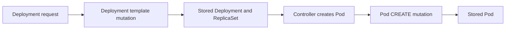

# Choose Between Workload Template and Pod Admission Mutation

Author: [nawazdhandala](https://www.github.com/nawazdhandala)

Tags: Kubernetes, DevOps, Automation

Description: Decide whether to mutate a workload's Pod template or each generated Pod, with correct metadata placement, admission rules, rollout tradeoffs, and inspection examples.

A Deployment and the Pods it eventually creates pass through separate API requests. A webhook that changes the Deployment's Pod template affects the stored recipe. A webhook that changes a Pod at creation affects that particular instance.

Neither choice is universally better. Choose based on where users should see the resolved configuration, which creators you must support, and how policy changes should reach replacement Pods. Applying the same mutation at both boundaries without an ownership rule creates unnecessary ambiguity.

The examples below use **Kubernetes v1.35.0** resource schemas. They illustrate a custom admission contract; the annotation names are not built-in Kubernetes features or settings for a particular injection product.

## Trace the two admission boundaries



The Deployment controller manages ReplicaSets, and a ReplicaSet creates Pods from its template. Those generated Pods are distinct resources with their own metadata and lifecycle. The [Deployment](https://kubernetes.io/docs/concepts/workloads/controllers/deployment/) and [ReplicaSet](https://kubernetes.io/docs/concepts/workloads/controllers/replicaset/) documentation describe this relationship.

A Pod mutator does not automatically write its result back into the Deployment. Conversely, changing the stored Deployment template does not edit existing Pod objects in place. Keep both facts in mind when comparing Git, workload YAML, and running instances.

## Put opt-in metadata where its consumer reads it

Suppose your Pod mutator checks `platform.example.com/profile: standard`. To pass that request to Pods created by a Deployment, put the annotation in the Pod template:

```yaml
apiVersion: apps/v1
kind: Deployment
metadata:
  name: profile-demo
  namespace: team-canary
spec:
  replicas: 1
  selector:
    matchLabels:
      app: profile-demo
  template:
    metadata:
      labels:
        app: profile-demo
      annotations:
        platform.example.com/profile: standard
    spec:
      containers:
        - name: app
          image: registry.example.internal/demo/app:REPLACE_WITH_PINNED_IMAGE
```

Replace the namespace and image before deployment. The image placeholder is deliberate; no application was run for this example.

The key is under `spec.template.metadata.annotations`, not `metadata.annotations`. The latter belongs to the Deployment itself and is not automatically copied into each Pod. A Deployment mutator could explicitly interpret top-level annotations, but that would be a different documented contract. The [Pod template guide](https://kubernetes.io/docs/concepts/workloads/pods/#pod-templates) explains the nested structure.

Also distinguish an input annotation from generated output. The example requests a profile; your implementation must define what concrete fields that profile adds and who owns them.

## Choose template mutation for a stored workload plan

Template mutation fits when users should inspect the workload and see the fields that future Pods are intended to receive. For example, a Deployment mutator can add an approved environment variable or volume directly to `spec.template.spec`.

The generated configuration then belongs to the workload's stored template. Changes to a Deployment Pod template can initiate a rollout, while changes only to top-level Deployment metadata do not have the same effect. Avoid mutations that produce a new random value or timestamp every update: they can turn unrelated operations into repeated rollouts.

Template mutation also requires explicit support for each workload API and path. A webhook registered for Deployments does not automatically cover directly created Pods, StatefulSets, DaemonSets, or custom controllers. Do not use a wildcard resource rule with a handler that assumes every object contains `spec.template`.

This matching fragment selects Deployment creates and updates:

```yaml
rules:
  - operations: ["CREATE", "UPDATE"]
    apiGroups: ["apps"]
    apiVersions: ["v1"]
    resources: ["deployments"]
    scope: Namespaced
```

It belongs inside an existing webhook entry with valid client configuration and appropriate namespace scope. It is not a complete registration. The handler must understand both operations and preserve user-owned fields. The [admission rule reference](https://kubernetes.io/docs/reference/access-authn-authz/extensible-admission-controllers/#matching-requests-rules) explains how resource and operation selection work.

## Choose Pod mutation for a shared creation boundary

Pod CREATE mutation covers ordinary Pods from several kinds of controllers as well as directly submitted Pods, subject to the webhook's selectors and conditions. It avoids implementing every workload's template nesting in the injector.

The corresponding rules are narrower in operation but broader in creator coverage:

```yaml
rules:
  - operations: ["CREATE"]
    apiGroups: [""]
    apiVersions: ["v1"]
    resources: ["pods"]
    scope: Namespaced
```

Use this as an alternative entry or design, not an instruction to activate duplicate injection at both layers. Retain exclusions for static mirror Pods, the webhook's own infrastructure, and other resources outside its contract.

This approach resolves configuration when each Pod is admitted. If policy changes between two Pod creations, replacement Pods can differ even when the workload template is unchanged. That may be desirable for a current platform default, but it can surprise teams expecting exact reproduction from an older template.

If reproducibility matters, put a supported policy version in the template's input metadata and make the injector honor it. Define what happens when that version is retired. A version label that the injector ignores does not provide reproducibility.

## Compare the operational consequences

| Question | Template mutation | Pod CREATE mutation |
|---|---|---|
| Where is generated configuration visible? | Stored workload template | Admitted Pod |
| Does a Deployment-only handler cover direct Pods? | No | A matching Pod handler can |
| When can policy resolve? | Workload create/update | Each Pod creation |
| Can changing policy affect existing running Pods immediately? | Requires appropriate controller rollout behavior | No; new admission is required |
| What shapes must the handler understand? | Each supported workload template | Pod schema |

Do not generalize Deployment rollout behavior to every controller. StatefulSets can use partitioned rolling updates or `OnDelete`, and DaemonSets have their own update strategies. Consult the [StatefulSet](https://kubernetes.io/docs/concepts/workloads/controllers/statefulset/#update-strategies) and [DaemonSet](https://kubernetes.io/docs/concepts/workloads/controllers/daemonset/#updating-a-daemonset) guides before promising automatic replacement.

## Inspect both the recipe and the result

For the illustrative Deployment, these read-only commands display its nested input annotation and the actual selected Pods:

```bash
kubectl -n team-canary get deployment profile-demo \
  -o jsonpath='{.spec.template.metadata.annotations}'
kubectl -n team-canary get pods -l app=profile-demo -o yaml
```

Use the documented [`kubectl get` output options](https://kubernetes.io/docs/reference/kubectl/generated/kubectl_get/). Compare the template's requested profile with each Pod's resolved fields. The label query can include more than one revision during a rollout; inspect owner references and creation times rather than assuming every returned Pod is identical.

A successful dry run of a Deployment does not cause its controller to create Pods, so it cannot prove a Pod CREATE mutator will work. Test a real staging workload lifecycle as well as separate admission fixtures for each boundary you support.

## Assign each generated field one owner

If both layers intentionally participate, divide their responsibilities. A template handler might normalize a user request, while the Pod handler materializes runtime fields. Avoid two independent handlers each appending the same helper container.

Every handler should recognize its own existing output, preserve user overrides according to contract, and report conflicts instead of relying on invocation order. Kubernetes recommends [idempotent mutation](https://kubernetes.io/docs/concepts/cluster-administration/admission-webhooks-good-practices/#mutating-webhook-ordering-and-idempotence).

Test direct Pods, generated Pods, template updates, replacement Pods after a policy change, and already-injected objects. The best boundary is the one whose visibility, coverage, and rollout behavior match the promise you make to workload owners.
