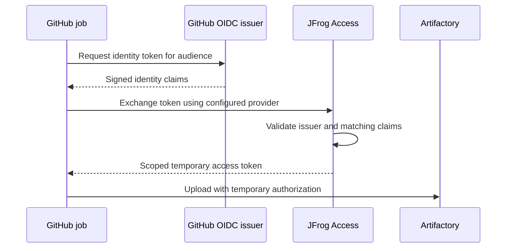

# Give CI Jobs Short-Lived Artifact Access with OIDC

Author: [nawazdhandala](https://www.github.com/nawazdhandala)

Tags: CI/CD, Artifact Management, Security, OIDC, GitHub Action

Description: Exchange GitHub Actions identity for scoped JFrog access, pin the setup action, restrict trusted claims, and validate the migration from stored tokens.

A stored repository token often outlives the build that needs it. It can remain in CI configuration through team changes, repository renames, and forgotten pipelines. OpenID Connect, or OIDC, offers a different approach: the CI platform proves which job is running, and the artifact service issues temporary access for that identity.

Temporary does not automatically mean narrowly authorized. If the trust policy accepts every repository in an organization, a short-lived credential can still grant the wrong job access. Design the identity conditions and repository permissions together.

This example uses GitHub Actions and JFrog Artifactory. It is not a universal configuration for every artifact server. JFrog's [OIDC integration documentation](https://docs.jfrog.com/administration/docs/openid-connect-integration) lists Enterprise X and Enterprise+ licensing for this feature. Verify availability and supported configuration in your installed platform before planning the migration.

## Understand the two tokens

The first token comes from GitHub. It describes the workflow identity and is presented to JFrog's token exchange. The second token comes from JFrog and authorizes repository operations for a limited period.



The job must reach the required GitHub services and JFrog endpoint. JFrog must be able to validate the issuer's signing information through its supported configuration. Internal certificates need a trusted CA chain on the relevant clients; disabling TLS verification defeats the identity boundary you are establishing.

## Define the job you intend to trust

For this example, only pushes to `main` in `acme/payments` may publish a staging probe. The workflow file is `.github/workflows/artifact-oidc.yml`. These are placeholders for your real repository, branch, and workflow path.

In JFrog, create an OIDC provider with the GitHub issuer `https://token.actions.githubusercontent.com`. Give it a recognizable provider name, such as `github-payments`. Apply the organization restriction supported by your version, and avoid permissive organization configuration.

Use an identity mapping with explicit claims. For example:

```json
{
  "repository": "acme/payments",
  "ref": "refs/heads/main",
  "event_name": "push",
  "workflow_ref": "acme/payments/.github/workflows/artifact-oidc.yml@refs/heads/main",
  "aud": "jfrog-payments-ci"
}
```

These are matching conditions, not a real token. [GitHub's OIDC reference](https://docs.github.com/en/actions/reference/security/oidc) documents the repository, reference, event, workflow, and audience claims. Compare conditions with the claims your actual job receives. Customized subject formats and reusable workflows require deliberate review rather than copying a generic `sub` string.

The custom audience is repeated in the workflow below. The [pinned setup action documentation](https://github.com/jfrog/setup-jfrog-cli/blob/v4.16.0/README.md) specifically cautions that the integration's Audience field is not a substitute for validating `aud` in the identity mapping's Claims JSON. Include the intended audience condition explicitly.

## Map identity to the smallest useful permission

Select a dedicated JFrog identity or group with the permissions needed for the staging repository. Grant publication only under the intended path, plus any required read operations. Do not give the probe identity administration, broad deletion, or access to unrelated projects.

Configure a short token expiration that covers the intended upload stage with a reasonable margin. The JFrog identity-mapping UI documents expiration in minutes. Request access near the publishing stage so a long compilation does not consume most of that lifetime.

Review other mappings for the same provider. A narrow new mapping is not sufficient if another matching configuration can grant broader access. Review mapping precedence for the installed JFrog version, especially when project-scoped mappings are involved.

Short lifetime limits exposure time; it does not repair an overbroad permission target or an untrusted job running inside the authorized context.

## Use a pinned workflow for a staging probe

Create the configured staging repository first. Set the GitHub repository variable `JF_URL` to the JFrog Platform URL. Configure the matching provider and identity mapping before running this workflow.

The action below is pinned to the commit for **setup-jfrog-cli v4.16.0**, with **JFrog CLI 2.131.0** explicitly selected. Its inputs were checked against the [tagged action definition](https://github.com/jfrog/setup-jfrog-cli/blob/v4.16.0/action.yml).

```yaml
name: Artifact OIDC probe
on:
  push:
    branches: [main]

jobs:
  probe:
    runs-on: ubuntu-24.04
    permissions:
      contents: read
      id-token: write
    steps:
      - name: Configure temporary JFrog access
        uses: jfrog/setup-jfrog-cli@76f97e1f8bb39a6bc22052265732581d73325212
        env:
          JF_URL: ${{ vars.JF_URL }}
        with:
          version: '2.131.0'
          oidc-provider-name: github-payments
          oidc-audience: jfrog-payments-ci
          disable-auto-build-publish: 'true'
          disable-auto-evidence-collection: 'true'

      - name: Upload a disposable staging probe
        shell: bash
        run: |
          set -euo pipefail
          printf 'OIDC staging probe\n' > probe.txt
          jf rt upload "probe.txt" \
            "oidc-staging-local/ci/${GITHUB_RUN_ID}-${GITHUB_RUN_ATTEMPT}/"
```

This writes one harmless file to an explicitly designated staging path. Replace that repository name with your approved staging repository. The run ID and attempt distinguish retries. No checkout is needed for this probe because it creates its own file.

`id-token: write` lets the job request an identity token; it is not an Artifactory permission grant. JFrog still evaluates the configured claims and permission target. Automatic build-info publication and evidence collection are disabled here to keep the probe's intended repository operation narrow.

The action handles the exchange and configures the CLI. Do not print its token outputs, decode tokens into public logs, or copy temporary credentials into later jobs. [JFrog's authentication guide](https://docs.jfrog.com/integrations/docs/github-actions-oidc-authentication) describes the setup flow and identifies provider-name, audience, and claim mismatches as troubleshooting points.

## Verify rejection as well as success

First confirm that the intended main-branch push exchanges identity and uploads the probe. Check the destination and repository audit record, including the recognized identity and operation.

Then test the trust boundaries in a controlled staging configuration:

- The same workflow from an unauthorized branch must not obtain publishing access.
- A different repository or workflow path must not satisfy the mapping.
- A different audience must be rejected.
- The temporary credential must not authorize an unrelated repository.
- Access must cease after the configured expiration.

Do not weaken the production mapping to perform these tests. Use staging mappings and owned test repositories, and ensure tests cannot publish production releases. A successful ping alone does not establish upload authorization or validate negative cases.

## Remove the old credential only after the new path works

Inspect the job for old token variables, saved CLI configurations, and credential injection inherited from reusable workflows. Perform the staging test without those credentials so success cannot come from an unnoticed fallback.

After the new flow passes, remove the old credential from the job and revoke it through your normal process. Preserve an approved recovery procedure that does not silently restore a broad permanent token.

The workflow received local YAML, action-input, and actionlint checks. The pinned commit was verified against the official release tag. No GitHub identity token was requested, no JFrog integration was configured, and no probe was uploaded for this article. The acceptance tests above remain necessary in your licensed deployment before replacing the existing publication path.
