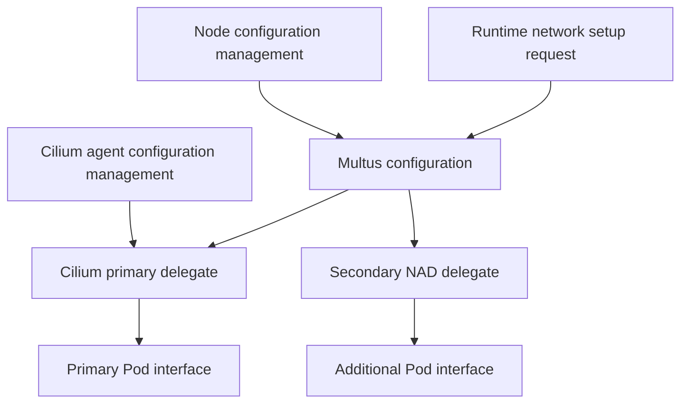

# Keep Multus Secondary Interfaces When Cilium Is the Primary CNI

Author: [nawazdhandala](https://www.github.com/nawazdhandala)

Tags: Cilium, Multus, Kubernetes

Description: Preserve Multus configuration alongside Cilium, verify the primary-delegate path, and test secondary interfaces across fresh Pods and controlled agent restarts.

A cluster can use Cilium for its primary Pod network and Multus to attach additional networks. The arrangement fails when the runtime bypasses Multus, when Cilium removes another CNI configuration from active use, or when Multus points at the wrong primary delegate.

The key is to assign each component a clear responsibility. Multus must receive the network setup request and delegate the primary interface to Cilium. Separate delegates provide the additional interfaces. Configuring Cilium as an arbitrary second attachment is a different design and is not what this walkthrough demonstrates.

The examples use the upstream **Cilium Helm chart 1.18.17** and reference **Multus v4.3.1** configuration. The chart was rendered and linted locally with Helm 3.12.3. This is a reproducible configuration review, not a live-tested compatibility certification or a recommendation to change an existing cluster's version without its upgrade review.

## Map configuration ownership first



Identify the process that writes each node's CNI configuration directory: Cilium, Multus startup logic, a distribution operator, or your provisioning automation. Inspect actual host and container mount paths. A generated configuration may be correct briefly and then replaced by its owner during an agent restart.

Record the active Multus entry, its primary delegate configuration, and the Cilium configuration it uses. For thick Multus, the shim and daemon have separate filesystem views; a delegate path valid on the host may need a mapped path inside the daemon. The tagged Multus configuration supports a primary `clusterNetwork` reference and documents its configuration-directory behavior. [Multus configuration reference](https://github.com/k8snetworkplumbingwg/multus-cni/blob/v4.3.1/docs/configuration.md).

Do not edit generated files without identifying their owner. A hand-restored file that disappears after the next restart has not solved the underlying conflict.

## Disable exclusive ownership where required

In the upstream Cilium 1.18.17 chart, `cni.exclusive` defaults to true. The value's documentation says Cilium takes ownership of the CNI directory and renames non-Cilium configurations with a `.cilium_bak` suffix. That behavior conflicts with an active Multus entry if the integration does not otherwise account for it. [Pinned chart values](https://github.com/cilium/cilium/blob/v1.18.17/install/kubernetes/cilium/values.yaml).

For this upstream-chart pattern, merge the following into the reviewed Cilium values:

```yaml
cni:
  exclusive: false
```

This is a small override, not a complete cluster installation configuration. Preserve the existing routing, IPAM, API connectivity, encryption, kube-proxy replacement, and other approved values. Apply it through the system that owns Cilium rather than making a separate Helm release that competes with the distribution.

Do not substitute `cni.customConf: true` casually. In this chart, that setting skips normal CNI configuration writing. It is appropriate only when external automation intentionally supplies the needed configuration. Likewise, Cilium chaining modes have their own purpose; enabling `generic-veth` is not a generic requirement for adding a Multus secondary interface.

Distribution behavior can differ. RKE2 documents version gates beginning with its November 2025 releases where manually disabling the exclusive flag is no longer required for its integration. Check the exact distribution release and rendered settings rather than applying an old workaround universally. [RKE2 Multus/Cilium guidance](https://docs.rke2.io/networking/multus_sriov).

## Render the exact chart before rollout

For a local review workspace with Helm available, download the pinned chart and save the override above as `multus-values.yaml`:

```bash
helm pull cilium --repo https://helm.cilium.io \
  --version 1.18.17 --untar
helm template cilium ./cilium --namespace kube-system \
  -f multus-values.yaml > rendered.yaml
helm lint ./cilium -f multus-values.yaml
```

These commands download and render files locally; they do not install Cilium. In the rendered `cilium-config` ConfigMap, expect `cni-exclusive: "false"` and, for the chart's normal CNI-writing mode, the configured `write-cni-conf-when-ready` path. The pinned template is the source of those keys. [ConfigMap template](https://github.com/cilium/cilium/blob/v1.18.17/install/kubernetes/cilium/templates/cilium-configmap.yaml).

Repeat the render using the complete production values in your review process. Passing a render or lint check establishes template validity, not API compatibility, node routing, or successful Multus delegation. Use the cluster's staged rollout and recovery procedure for the actual change.

After rollout, inspect the effective ConfigMap and running agent configuration. Confirm that every eligible node retains the active Multus entry and the intended primary Cilium delegate. A ConfigMap value alone does not prove that all agents have consumed it.

## Request a separate secondary delegate

Start with an existing, approved secondary NAD whose plugin binaries, node interfaces, and allocator are already prepared. This metadata fragment requests `telemetry-net` on `metrics0`:

```yaml
metadata:
  annotations:
    k8s.v1.cni.cncf.io/networks: >-
      [{"name":"telemetry-net","interface":"metrics0"}]
```

Place it at Pod metadata or under a Deployment's `spec.template.metadata`. The NAD is assumed to be in the workload namespace. Its delegate could be macvlan, a supported device plugin combination, or another network suited to the requirement. The annotation does not install those dependencies. [Multus attachment selection](https://github.com/k8snetworkplumbingwg/multus-cni/blob/v4.3.1/docs/how-to-use.md).

Keep primary and secondary routing requirements explicit. Moving the default route to the secondary interface can affect cluster DNS and Services even when both interfaces are present. Also verify secondary-network policy and observability independently; do not infer coverage merely because Cilium manages the primary interface.

## Test fresh Pods and restart persistence

Use a disposable canary with the secondary annotation and another without it. For each, record Pod UID, node, events, primary connectivity, and network-status. The annotated Pod should also have the requested secondary interface and reach its intended dependency.

| Observation | Likely investigation boundary |
| --- | --- |
| Primary works, annotation produces no secondary setup | Runtime selection and whether Multus was invoked |
| Multus entry renamed after an agent restart | Effective Cilium ownership setting and distribution reconciliation |
| Multus cannot load its primary delegate | Path, mount, generation order, or stale reference |
| Primary works but secondary CNI ADD fails | NAD, secondary binary, node resource, or allocator |
| Both interfaces exist but traffic fails | Routes, policy, upstream network, and application binding |

In staging, exercise the approved Cilium-agent and Multus restart procedures one at a time, then create fresh canaries. Existing connected Pods can mask a broken configuration for new sandbox creation. Recheck the node files and effective settings after each restart.

Finish with normal teardown and a replacement-node rehearsal. The integration is ready when Cilium remains the primary delegate, Multus consistently receives setup requests, and the additional network survives configuration regeneration as well as the first deployment.
