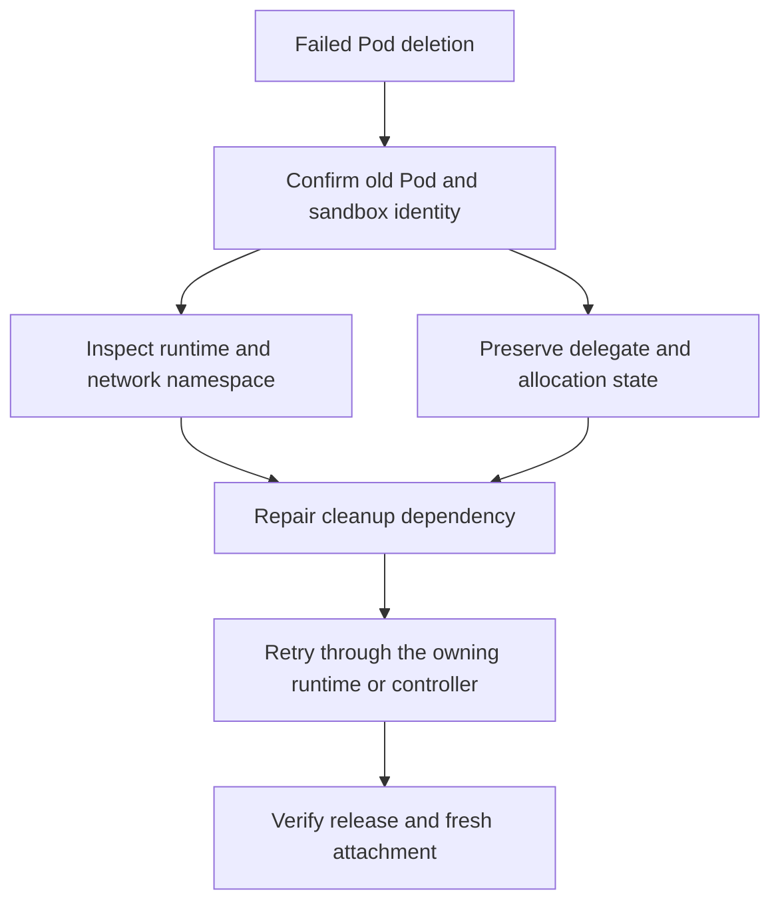

# Clean Up Orphaned Multus Interfaces and CNI State Safely

Author: [nawazdhandala](https://www.github.com/nawazdhandala)

Tags: Multus, Kubernetes, Troubleshooting

Description: Investigate failed Multus Pod cleanup, distinguish cached configuration from IP allocations, and recover orphaned resources without deleting state used by live workloads.

A Pod disappears from Kubernetes, but its address remains allocated. A node accumulates interfaces after sandbox deletion fails. The tempting response is to clear the CNI directory and start again. That can turn a localized cleanup problem into duplicate addresses and broken networking for unrelated Pods.

Multus coordinates other networking plugins. Its saved delegate configuration, a plugin's interface state, and an IP address manager's allocation records serve different purposes. Recover them through their owners, using the exact old sandbox identity, rather than treating them as interchangeable cache files.

This guide references **Multus v4.3.1**, **CNI plugins v1.8.0**, and the CNI deletion contract. Commands are read-only inspection examples for a Linux Kubernetes node with approved access. They were syntax-checked; no live cleanup was performed.

## Start with identity, not the interface name

A Pod name can be reused. A sandbox ID can change when a runtime recreates a sandbox for the same workload. An interface called `net1` exists in many different network namespaces. None of these values alone proves ownership.

Build an incident record containing the Pod namespace and name, Pod UID, node, runtime sandbox ID, attachment name, interface name, assigned addresses, and deletion timestamps. If the API object is gone, obtain its old identity from retained events, runtime records, or logs.



Force deletion from the Kubernetes API does not guarantee that processes on an unreachable node have stopped. Before releasing an address from such a node, establish that the old workload cannot still use it. That may require fencing the node, meaning reliably preventing its old workloads from continuing to access the network. [Kubernetes forced termination](https://kubernetes.io/docs/concepts/workloads/pods/pod-lifecycle/#pod-termination-forced).

## Compare Kubernetes and runtime evidence

If the old Pod still exists, inspect it without changing its lifecycle:

```bash
kubectl -n REPLACE_NAMESPACE get pod REPLACE_POD -o yaml
kubectl -n REPLACE_NAMESPACE describe pod REPLACE_POD
```

Read its UID, node, deletion timestamp, annotations, and events. A new Pod with the same name is a different object; do not use its network status to justify deleting the old sandbox's resources.

On the affected node, use a configured `crictl` matching your supported runtime setup:

```bash
sudo crictl pods
sudo crictl inspectp REPLACE_OLD_SANDBOX_ID
```

These commands inspect the Container Runtime Interface, or CRI, view of sandboxes. Configure the actual runtime endpoint rather than guessing a socket. Record whether the sandbox remains present and what runtime-specific namespace information is available. A NotFound response is useful evidence, but must still be reconciled with host and allocation state. [Kubernetes crictl guide](https://kubernetes.io/docs/tasks/debug/debug-cluster/crictl/).

## Inspect interfaces in the right namespace

Use iproute2 on the node to inspect links and named network namespaces:

```bash
sudo ip -d link show
sudo ip netns list
```

The first command shows the current namespace's interfaces. The second lists named namespaces under the tool's conventional namespace directory; it is not a complete inventory of every namespace held by a process or runtime.

If you have verified that a particular named namespace belongs to the old sandbox, inspect it explicitly:

```bash
sudo ip netns exec REPLACE_VERIFIED_NAMESPACE ip -d link show
sudo ip netns exec REPLACE_VERIFIED_NAMESPACE ip address show
```

Do not assume a missing namespace name means every reference to that namespace has vanished. Processes and open references can keep a namespace alive. Likewise, deleting a namespace name is not equivalent to completing the delegate's IPAM cleanup. [ip-netns behavior](https://man7.org/linux/man-pages/man8/ip-netns.8.html).

## Separate the state stores

| State | Purpose | Why indiscriminate deletion is dangerous |
| --- | --- | --- |
| Multus saved delegate configuration | Remembers how the sandbox was attached | DEL may need the original network configuration |
| CNI result cache | Records attachment results used by CNI libraries | Other operations can depend on the recorded result |
| IPAM allocation state | Prevents reuse of an address still assigned | Removing a live allocation can create duplicate addresses |
| Interfaces and namespace references | Represent actual kernel networking objects | Shared or live resources may still carry traffic |

In Multus v4.3.1, DEL first attempts to recover saved delegate configuration. If that is unavailable, it can try Pod information when possible. Losing both can prevent proper delegate cleanup even when the runtime proceeds. Preserve those records before attempting recovery. [Multus deletion implementation](https://github.com/k8snetworkplumbingwg/multus-cni/blob/v4.3.1/pkg/multus/multus.go).

For host-local IPAM, allocation state is stored on the node. The v1.8.0 backend defaults to `/var/lib/cni/networks`, with a network-specific directory, unless configured otherwise. This is allocation state, not disposable temporary data. Whereabouts and DHCP use different ownership and reconciliation mechanisms, so a host-local repair procedure does not apply to them. [host-local documentation](https://www.cni.dev/plugins/current/ipam/host-local/), [v1.8.0 storage backend](https://github.com/containernetworking/plugins/blob/v1.8.0/plugins/ipam/host-local/backend/disk/backend.go).

## Repair the cause before retrying cleanup

Read the Multus, delegate, runtime, and kubelet errors around the failed deletion. Typical investigation paths include an unavailable thick-plugin socket, a missing delegate binary, an inaccessible IPAM service, changed configuration paths, or lost cached delegate configuration.

Restore the missing dependency through its normal deployment owner. Then let the runtime or supported platform recovery procedure retry cleanup with the original sandbox identity and configuration. Avoid manually invoking a CNI binary using a newly edited network definition: it may no longer describe the attachment that actually exists.

The CNI contract requires plugins to handle repeated DEL calls and tolerate an already-missing interface or namespace where specified. This supports retryable cleanup; it does not make an arbitrary DEL request with guessed parameters safe. [CNI deletion contract](https://www.cni.dev/docs/spec/#del-remove-container-from-network).

Multus has a `retryDeleteOnError` setting, but it is not a universal repair switch. Review the pinned configuration and implementation: cache retention depends on the deletion outcome, including special handling for certain missing-file errors. Changing the setting after records have disappeared cannot reconstruct them. [Multus configuration](https://github.com/k8snetworkplumbingwg/multus-cni/blob/v4.3.1/docs/configuration.md).

## Escalate only proven orphaned resources

If normal cleanup cannot finish, establish a maintenance boundary for that node and network. Preserve a restricted copy of relevant configuration, allocation records, and logs. Confirm the old sandbox is stopped or fenced, no live attachment owns the address or device, and the owning plugin's recovery procedure matches the installed version.

At that point, use the plugin-specific repair procedure to release the individual allocation and remove only the identified orphan. An SR-IOV virtual function, a bridge port, and a macvlan interface need different handling. Removing a kernel link alone does not release a DHCP lease or a distributed allocation. There is deliberately no blanket directory-removal command here: the required action depends on the verified owner and evidence.

Finish with a new disposable Pod on the repaired node. Check its primary and secondary connectivity, then delete it and verify that its allocations and interfaces are cleaned up normally. Confirm unrelated workloads still communicate. Keep the old incident identity in the record so a later reuse of the same Pod name cannot obscure what was repaired.
