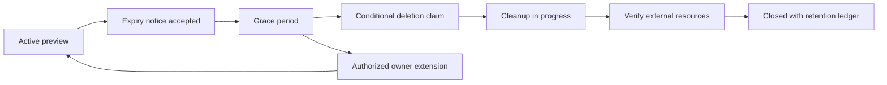

# Clean Up Preview Environments with Expiry Rules and Owner Extensions

Author: [nawazdhandala](https://www.github.com/nawazdhandala)

Tags: Kubernetes, Cloud Automation, Cost Optimization

Description: Give preview environments enforceable expiry rules, race-safe owner extensions, and orphan sweeps that catch resources left outside the namespace.

A preview environment should disappear when its review work ends. In practice, pull requests remain open, cleanup jobs fail, and someone needs an extra day to reproduce a bug. Deleting everything older than a week handles none of those cases well.

Treat expiry as a small lifecycle with a clear owner, a documented extension policy, and a final cleanup record. The key is to make the cleanup decision reproducible and to prevent an owner extension from racing with deletion.

## Separate selection labels from expiry data

TTL means time to live. For a preview environment, define it as a policy-controlled lifetime rather than an arbitrary string interpreted differently by each script.

Use labels to select managed environments. Store full timestamps and explanatory metadata in annotations. Kubernetes label values have a restricted character set; an ISO timestamp containing colons does not fit it. Annotations support non-identifying metadata. See the official [label rules](https://kubernetes.io/docs/concepts/overview/working-with-objects/labels/) and [annotation guidance](https://kubernetes.io/docs/concepts/overview/working-with-objects/annotations/).

This `v1` Namespace example documents a convention for your controller. Replace the example prefix, owner, identity, and dates before using it. Creating it does not install a cleanup controller or automatically enforce expiry.

```yaml
apiVersion: v1
kind: Namespace
metadata:
  name: preview-481-g3
  labels:
    preview.example.com/managed: "true"
    preview.example.com/environment-id: preview-481-g3
    preview.example.com/lifetime-class: short
  annotations:
    preview.example.com/owner: team-payments
    preview.example.com/expires-at: "2026-11-20T12:00:00Z"
    preview.example.com/policy-revision: "4"
```

The generation suffix distinguishes this environment from an earlier preview for the same pull request. Record the namespace UID, cluster identity, repository, pull request, and associated cloud resource IDs in a durable registry outside the namespace.

Kubernetes has a native `.spec.ttlSecondsAfterFinished` field for completed Jobs. It is not a namespace lifetime field and does not retire an entire preview environment. Use it for appropriate finished Jobs while separately managing the preview lifecycle. See [TTL cleanup for finished Jobs](https://kubernetes.io/docs/concepts/workloads/controllers/ttlafterfinished/).

## Make expiry a state transition

Choose defaults that match the team's workflow. For example: expire after three days, notify when expired, allow a 24-hour grace period after accepted notification, and permit authenticated owner extensions within a seven-day maximum lifetime. Those durations are policy examples, not platform defaults.



A pull-request close event can request early retirement, but it should enter the same lifecycle. A missed webhook should not make the environment immortal. Periodic reconciliation must discover expired records independently of repository events.

Do not use an empty traffic graph as proof that a preview is abandoned. Missing telemetry may mean a broken collector. Conversely, an active health check should not silently extend an environment forever. Expiry, extensions, and holds should be explicit decisions.

## Test the decision function locally

The following Python 3.11 example evaluates a registry record without sending notifications or deleting resources. Save it as `policy.py` and run it locally. The registry's `revision` increases whenever an accepted policy change, including an extension, changes the decision.

Notification acceptance means the delivery provider accepted the message; it does not prove the owner read it. If delivery fails, keep a visible exception and retry or escalate according to policy instead of inventing a successful receipt.

```python
from datetime import datetime, timedelta, timezone


def timestamp(value):
    parsed = datetime.fromisoformat(value.replace('Z', '+00:00'))
    if parsed.tzinfo is None:
        raise ValueError('Timezone required')
    return parsed.astimezone(timezone.utc)


def next_action(record, now):
    if now.tzinfo is None:
        raise ValueError('Timezone required')
    if record['state'] == 'deleting':
        return 'resume-cleanup'
    if record['state'] == 'deleted':
        return 'verify-orphans'
    if record['state'] != 'active':
        return 'manual-review'
    if record['hold'] is not False:
        return 'held'
    expires = timestamp(record['expires_at'])
    if now < expires:
        return 'active'
    notice = record.get('notice')
    if not notice or notice['revision'] != record['revision']:
        return 'notify-current-revision'
    sent = timestamp(notice['accepted_at'])
    if sent > now:
        raise ValueError('Notice time is in the future')
    if now < max(expires, sent) + timedelta(hours=24):
        return 'grace-period'
    return 'request-deletion-claim'


if __name__ == '__main__':
    record = {
        'state': 'active', 'hold': False, 'revision': 4,
        'expires_at': '2026-11-20T12:00:00Z',
        'notice': {'revision': 4,
                   'accepted_at': '2026-11-20T13:00:00Z'},
    }
    print(next_action(record, timestamp('2026-11-21T13:00:00Z')))
```

The example prints `request-deletion-claim` exactly 24 hours after the recorded notification acceptance. One second earlier it returns `grace-period`. An old notification revision requests a new notice rather than reusing a previous grace period after an extension.

The function assumes schema-validated registry input. Malformed or timezone-free timestamps raise errors; production code should record those errors and hold the environment for review. It deliberately returns a request to claim deletion, not permission to immediately call a delete API.

## Resolve extensions and cleanup claims atomically

Suppose a cleanup worker reads revision 4 while an owner submits an extension producing revision 5. A second read just before deletion narrows the race but does not eliminate it.

Both operations must update one authoritative record conditionally. An extension requires the expected revision and an active state. A deletion claim requires that same expected revision, the active state, no hold, and satisfied grace conditions. Only one update wins. The loser reloads and reevaluates; it must not continue using its old decision.

If the authoritative record is a Kubernetes object, a conditional update using `resourceVersion` detects stale updates; Kubernetes returns a conflict when that version is stale. Treat the version as an opaque value, not a counter to calculate yourself. The [API update documentation](https://kubernetes.io/docs/reference/using-api/api-concepts/#updates-to-existing-resources) explains these concurrency controls.

After the deletion claim wins, reject ordinary extensions and clearly show “cleanup in progress.” Persist that state before the first destructive action. Restrict who can change the authoritative fields; otherwise a direct annotation edit could bypass the extension policy. An external registry and namespace annotations must not both act as independent authorities.

The example decision function does not implement this storage transaction, authentication, or maximum-extension enforcement. Those are integration requirements to test before enabling deletion.

## Sweep beyond the namespace

Keep a provisioning journal of external databases, disks, snapshots, DNS records, and load balancers. When cleanup starts, stop new deployments for that environment generation and record each resource's intended disposition. Then reconcile actual service state until deletion is confirmed or an intentional retention exception is recorded.

Namespace deletion alone cannot prove that external storage disappeared. A persistent volume's reclaim policy matters: `Retain` preserves the backing storage for manual handling, while supported `Delete` policies remove the backing asset. Check the actual volume and provisioner behavior, following [persistent volume reclaim policies](https://kubernetes.io/docs/concepts/storage/persistent-volumes/#reclaiming).

A stuck terminating object is also evidence to investigate. Finalizers postpone object removal while cleanup occurs. Repair the responsible controller or its permissions before considering manual intervention; stripping finalizers can discard the mechanism intended to clean up external infrastructure. Kubernetes explains this in its [finalizer lifecycle](https://kubernetes.io/docs/concepts/overview/working-with-objects/finalizers/).

Run a separate orphan sweep against the resource journal and current cloud inventory, including environments already marked deleted. Match immutable generation IDs, not just namespace names. Classify discoveries as intentionally retained, cleanup pending, or ownership unresolved. Never use “no matching namespace” as the sole authorization to delete a cloud resource.

## Roll out with evidence

Start in report-only mode. Compare proposed actions with owner expectations and test exact expiry boundaries, timezone handling, stale notification revisions, holds, and failed delivery. Then exercise an extension racing a deletion claim against the real backing store in staging.

Finally, interrupt a cleanup worker halfway through and verify that another worker resumes from recorded state without recreating resources or extending the deadline. Track expired-environment age, failed notices, stuck cleanup steps, and unowned survivors. The useful outcome is a bounded lifetime with understandable exceptions, not merely a daily script that reports success.
