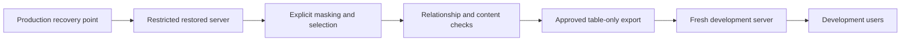

# Clone Azure MySQL for Development and Mask Sensitive Data

Author: [nawazdhandala](https://www.github.com/nawazdhandala)

Tags: Azure, MySQL, Data Masking, Development

Description: Build a development clone through a restricted Azure MySQL restore, explicit masking rules, relationship checks, and a clean destination containing only approved data.

A restored production database is still production data. Renaming the server to `dev` does not remove personal details, payment references, session tokens, or credentials stored in application tables.

Use two separate destinations: a restricted restore for preparing data, followed by a fresh development server that receives only approved output. This separation matters because the restored server can retain the original values in backups, logs, and other tables even after you update visible fields.

## Choose the smallest useful clone

Begin with the test you need to support. A checkout test may need customers and orders, but not support conversations, uploaded documents, or real payment identifiers. A query-performance test might need representative row counts and distributions, while a UI test often works better with entirely synthetic fixtures.

Write a table-and-column policy before restoring anything:

| Data | Development treatment |
|---|---|
| Names and contact details | Replace with generated values |
| Password hashes, sessions, API tokens | Exclude; provision development authentication separately |
| Free text, JSON payloads, attachments | Exclude unless a specific reviewed transformation exists |
| Relationship keys | Preserve only if approved, or remap consistently across related tables |
| Dates, amounts, locations | Generalize or synthesize according to the test need |
| Integration settings | Replace with development destinations and credentials |

Masking means changing selected values. It does not automatically make a dataset anonymous. Original identifiers, uncommon activity patterns, or combinations of retained fields can still connect records to people. Keep access restricted unless your data owner has approved the resulting dataset for its intended audience.

## Restore inside a restricted preparation area

Azure MySQL point-in-time restore creates a new server from a selected recovery point; it does not restore one chosen table into an existing server. The new server can also inherit source settings. Review the [backup and restore behavior](https://learn.microsoft.com/en-us/azure/mysql/flexible-server/concepts-backup-restore) before planning network isolation.

In the source server's portal page, choose **Restore**, select the approved recovery time, and provide a distinct preparation-server name. Review the Networking tab and use the supported options to keep access limited to the preparation operator. Do not assume a new hostname means a new security boundary. The [portal restore procedure](https://learn.microsoft.com/en-us/azure/mysql/flexible-server/how-to-restore-server-portal) describes networking choices during restore.

Establish the network restrictions before initiating the restore. Do not restore into a broadly reachable development network and plan to close access afterward. Verify effective firewall rules, routes, identities, and database logins when it becomes ready. Keep application clients and background workers disconnected.

Inspect scheduled database events too. The MySQL Event Scheduler can run scheduled SQL independently of your application workers; its [configuration documentation](https://dev.mysql.com/doc/refman/8.0/en/events-configuration.html) explains the scheduler states. Arrange an approved procedure for preventing restored jobs from running, and keep production integrations unreachable. If your restore path cannot satisfy the required isolation, use a controlled extraction process instead.



Developers receive access only at the final step. They do not receive credentials or backup access for the preparation server.

## Build an explicit sanitized schema

The following example targets **MySQL 8.0.46**. It demonstrates a small relational fixture, not a universal masking script. On the isolated restored server, assume `appdb.customers` has a unique, non-null numeric `id`, and `appdb.orders` has `id` and `customer_id`. Assume every retained order belongs to a customer.

Create a new, empty schema named `dev_export`. Use reviewed definitions instead of copying every source column. Here, the destination intentionally contains only customer aliases and order relationships:

```sql
CREATE DATABASE dev_export;

CREATE TABLE dev_export.customers (
  id BIGINT UNSIGNED NOT NULL PRIMARY KEY,
  full_name VARCHAR(100) NOT NULL,
  email VARCHAR(254) NOT NULL UNIQUE
) ENGINE=InnoDB;

CREATE TABLE dev_export.orders (
  id BIGINT UNSIGNED NOT NULL PRIMARY KEY,
  customer_id BIGINT UNSIGNED NOT NULL,
  CONSTRAINT fk_dev_order_customer
    FOREIGN KEY (customer_id) REFERENCES dev_export.customers(id)
) ENGINE=InnoDB;
```

The foreign key requires each order's customer to exist. Types must match the real identifiers you choose to retain; signed identifiers, composite keys, or nullable relationships need a different definition. See [MySQL foreign-key requirements](https://dev.mysql.com/doc/refman/8.0/en/create-table-foreign-keys.html).

Populate these tables while the restored source remains unchanged:

```sql
START TRANSACTION;

INSERT INTO dev_export.customers (id, full_name, email)
SELECT id,
       CONCAT('Customer ', id),
       CONCAT('customer-', id, '@example.invalid')
FROM appdb.customers;

INSERT INTO dev_export.orders (id, customer_id)
SELECT id, customer_id
FROM appdb.orders;

COMMIT;
```

This uses [INSERT ... SELECT](https://dev.mysql.com/doc/refman/8.0/en/insert-select.html) to copy only named fields and [CONCAT](https://dev.mysql.com/doc/refman/8.0/en/string-functions.html) to generate replacement strings. Unique numeric IDs produce unique email aliases, including for people who shared an original email address. No original name or email appears in the output projection.

The `.invalid` suffix is reserved for special use, as recorded by [IANA](https://www.iana.org/assignments/special-use-domain-names). Still disable outbound email and other real integrations. A non-deliverable address is not a substitute for controlling what the development application sends.

Run the transaction through an operator-controlled session. If an insert fails, stop and roll back that transaction rather than proceeding to `COMMIT`. The schema creation is a separate setup phase. Do not rerun successful inserts into populated tables; rebuild an empty export schema under the approved procedure.

This fixture retains source IDs and relationship patterns. It therefore remains linkable to the source. If that is unacceptable, generate a private ID mapping and apply it consistently to every parent and child reference, then exclude the mapping from the released dataset.

## Test content and relationships before export

First compare expected row counts with the policy. If the policy selects only a subset, compare against that subset rather than the whole source. Then run an explicit orphan check:

```sql
SELECT COUNT(*) AS orphan_orders
FROM dev_export.orders AS o
LEFT JOIN dev_export.customers AS c ON c.id = o.customer_id
WHERE c.id IS NULL;
```

Expect zero. Also verify that every email follows the approved generation rule, that no unapproved columns or tables exist, and that known synthetic markers for secrets are rejected by the release checks. Review representative values through restricted tooling without copying raw production records into CI logs.

Treat the checks as a release gate with a recorded result. A sampling query alone cannot establish that every sensitive field was covered. Maintain the masking policy alongside application schema changes so a newly added JSON column does not quietly bypass review.

## Move only the approved output

Use Oracle `mysqldump` 8.0.46 on an approved preparation host. Replace the hostname, username, and CA path below. The password option prompts interactively; use your approved secret mechanism for automation.

```bash
set -euo pipefail
umask 077

mysqldump \
  --host=REPLACE_PREPARATION_SERVER.mysql.database.azure.com \
  --user=REPLACE_EXPORT_USER --password \
  --ssl-mode=VERIFY_IDENTITY --ssl-ca=/REPLACE/ca-bundle.pem \
  --single-transaction --no-tablespaces --set-gtid-purged=OFF \
  --skip-triggers --skip-add-drop-table \
  dev_export customers orders > approved-dev-fixture.sql
```

This exports the two named tables, not all databases or user accounts. Routines and events are not requested. Keep the export tables unchanged during the dump, and check its exit status before releasing the file. The options are documented in [mysqldump](https://dev.mysql.com/doc/refman/8.0/en/mysqldump.html).

Inspect the resulting SQL and transfer it through your protected artifact process. Import it into a fresh, empty `dev_export` schema on the development server using the [SQL-format reload procedure](https://dev.mysql.com/doc/refman/8.0/en/reloading-sql-format-dumps.html). The deliberately matching schema name also avoids ambiguity in qualified foreign-key references.

Dumps can temporarily disable foreign-key checks. Repeat the orphan query after import; reenabling checks does not retroactively validate all loaded rows. Provision development-only users and credentials, then run the intended application tests before granting wider access.

The minimal schema above supports relationship tests, not an unchanged full application. For a fuller clone, expand the explicit definitions and masking policy together. Finally, retire the restricted preparation environment and its artifacts according to retention requirements. Keep the recovery point, policy version, validation results, and approved export checksum as the provenance record for each refresh.
