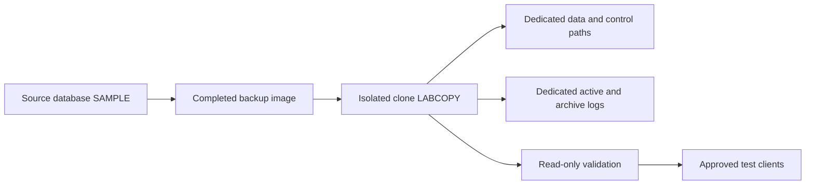

# Clone Db2 Under a New Database Name Without Overwriting the Source

Author: [nawazdhandala](https://www.github.com/nawazdhandala)

Tags: Database, SQL, Backup

Description: Restore a Db2 backup into a separately named clone with dedicated storage and logs, then review inherited settings before allowing test traffic.

A database clone needs more than a different alias. Its data files, control files, logs, archive destinations, and application connections must all point to the intended environment. A correctly named clone can still cause trouble if it shares a source container or sends logs to a production archive destination.

This guide uses a backup-based clone of **Db2 LUW 11.5**. The example restores a full online image from `SAMPLE` into an unused database named `LABCOPY` on an isolated recovery host. It assumes one database partition and automatic-storage tablespaces whose storage groups can all use the same destination path.

For manually managed containers or storage groups that must remain on different filesystems, use a reviewed redirected-restore script instead of this simplified storage mapping.

## Separate source identity from target identity

In `RESTORE DB SAMPLE ... INTO LABCOPY`, the first name selects the source backup and the second identifies the destination database. IBM's [restore command reference](https://www.ibm.com/docs/en/db2/11.5.x?topic=commands-restore-database) documents restoring an existing database's image into a new database.

That naming distinction does not isolate storage by itself. Treat the clone as a new environment with its own ownership and access boundaries:



Use a separate host or instance with no access to production data mounts where practical. Block accidental application connections and access to production outbound services during preparation. This makes mistakes easier to detect before they affect the source.

## Verify the destination really is unused

In the intended destination's Db2 command environment, inspect the catalog:

```bash
db2 list db directory
```

For an already provisioned destination database-path root, also inspect its local directory:

```bash
db2 list db directory on /srv/db2-clones/control
```

Replace the path. The [directory command reference](https://www.ibm.com/docs/en/db2/11.5.x?topic=commands-list-database-directory) distinguishes system entries from the local directory at a specified path. Review database names, aliases, entry types, and locations; a remote catalog entry is not a local clone.

Catalog absence alone does not prove that every filesystem location is unused. Have the host owner verify the planned directories and mounts against existing databases, uncataloged files, and storage assignments. Do not delete a directory because its name looks like an abandoned clone.

Choose another unused name if `LABCOPY` already exists. This procedure intentionally does not use `REPLACE EXISTING` or instructions to drop a destination database.

## Prepare the image and separate paths

Use a completed, validated full backup image set. For an online image, retain the required recovery logs; `INCLUDE LOGS` can package the end-of-backup inputs with it. Keep the source backup and its validation record intact while cloning.

The example uses four destination paths, provisioned in advance with suitable permissions and capacity:

| Path | Purpose |
| --- | --- |
| `/srv/db2-clones/data` | Automatic-storage data |
| `/srv/db2-clones/control` | Database control files |
| `/srv/db2-clones/active` | Permanent active-log location |
| `/srv/db2-clones/extracted/run01` | Empty extraction root for included logs |

IBM's [storage-path rules](https://www.ibm.com/docs/en/db2/11.5.x?topic=databases-implications-restoring) distinguish the database path from storage-group paths. `ON` redirects automatic-storage paths; `DBPATH ON` selects the database control-file location. With multiple storage groups, the same `ON` list applies to every group. Do not use it if that would erase required placement differences.

Check the actual mounted filesystems, not just the textual path names. Two differently named paths can still lead to shared storage.

## Restore into the new database

The following is a state-changing example for the isolated destination. Replace the source alias, exact backup timestamp, image location, and destination paths:

```bash
db2 "restore db SAMPLE \
  from /srv/recovery/images/run01 \
  taken at 20261120010000 \
  on /srv/db2-clones/data \
  dbpath on /srv/db2-clones/control \
  into LABCOPY \
  logtarget /srv/db2-clones/extracted/run01 \
  newlogpath /srv/db2-clones/active"
```

`NEWLOGPATH` makes the permanent log location explicit. `LOGTARGET` extracts included logs for recovery and is a separate purpose. The extraction root must already exist and be writable; Db2 creates its partition and log-stream hierarchy below it.

Inspect the returned messages. If a prompt says an existing database will be overwritten, stop and reconcile the target identity. Do not add `WITHOUT PROMPTING` to make an unexpected warning disappear.

After restore, record the target's configuration before it accepts traffic:

```bash
db2 get db cfg for LABCOPY show detail
```

This is also the point to review inherited destinations, before completing recovery can generate new log activity.

## Review inherited archive and service settings

IBM's [post-restore considerations](https://www.ibm.com/docs/en/db2/11.5.x?topic=restore-restoring-data) call out archive methods, mirror and overflow paths, HADR hosts and services, and encryption-library settings. HADR is Db2's high-availability disaster-recovery replication facility; a disposable clone should not be accidentally attached to the source's replication topology.

Work with the backup owner to establish clone-specific archive destinations and credentials. Preserve required recovery inputs while doing this. Disabling archive logging blindly is not a substitute for isolation and can interfere with the recovery plan.

This review belongs **before finalizing rollforward**, not merely before application writes. IBM's [renamed-database archive guidance](https://www.ibm.com/support/pages/node/254147) describes how inherited archive options can address the original database's vendor filespace, including new log activity during recovery completion.

`NORETRIEVE` prevents archive retrieval during rollforward. It is not a switch that disables all archive writes or external connections. Keep production sinks inaccessible and configure approved clone destinations deliberately.

## Recover to the chosen backup point

For this online backup, replay the included logs to the end of backup:

```bash
db2 "rollforward db LABCOPY to end of backup \
  overflow log path (/srv/db2-clones/extracted/run01) \
  noretrieve"
db2 rollforward db LABCOPY query status
```

The [rollforward reference](https://www.ibm.com/docs/en/db2/11.5.x?topic=commands-rollforward-database) documents this target and recommends inspecting progress separately from completion. Resolve missing logs or chain errors rather than substituting unrelated files.

Only after the recovery target and inherited destinations have been reviewed, complete the clone's recovery:

```bash
db2 rollforward db LABCOPY stop
```

This finalizes recovery; it does not pause it for later log application. Retain the image if another recovery target may be needed.

## Validate identity before giving the clone to clients

Connect explicitly to the new database and inspect its server identity:

```bash
db2 connect to LABCOPY
db2 "values current server"
```

The [CONNECT reference](https://www.ibm.com/docs/en/db2/11.5.x?topic=statements-connect-type-1) states that `CURRENT SERVER` reports the actual application-server name rather than the client alias. Combine that result with the verified host, instance, and filesystem mapping; the returned name alone does not prove isolation.

Run read-only checks for expected schemas and business records at the selected recovery point. Confirm tablespace placement and clone-owned log destinations. Review copied data access and any application configuration capable of sending email, invoking jobs, or contacting production systems before enabling controlled test traffic.

Finally, verify source health independently. Successful clone queries do not establish that source paths and clients remained correct.

The examples were documentation-reviewed and shell-syntax checked. No Db2 runtime was available, so no backup, clone, rollforward, configuration change, or source-health test was executed for this article.
