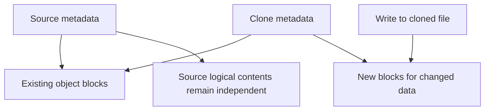

# Clone JuiceFS Directory Trees While Preserving Ownership

Author: [nawazdhandala](https://www.github.com/nawazdhandala)

Tags: JuiceFS, Storage, Linux

Description: Create metadata-only JuiceFS clones with explicit ownership preservation, plan for non-atomic directory copies, and verify access and logical capacity.

Copying a large dataset to create a test workspace does not always require uploading another copy of every data block. JuiceFS can clone the filesystem metadata while the source and destination initially reference the same object-storage data.

That makes cloning useful for staging datasets and repeatable experiments. It also creates two important responsibilities: preserving the intended access permissions, and ensuring the source tree represents a consistent application state while the clone is created.

This guide uses **JuiceFS Community Edition 1.4.2 on Linux**. It assumes an existing healthy mount, an approved source tree, and a destination parent on that same mount. Cloning changes filesystem metadata and consumes quota and metadata capacity, even when it does not initially duplicate object data.

## Understand what the clone shares

JuiceFS's clone creates new metadata references to existing blocks. When either copy changes, new data is written to new blocks and the modified file's metadata is redirected. Unchanged portions can continue sharing their original blocks. The official guide calls this redirect-on-write behavior. See the [pinned clone guide](https://github.com/juicedata/juicefs/blob/v1.4.2/docs/en/guide/clone.md).



The sharing is below the file namespace. This is not the same as creating a hard link to the same inode, and it is not an independent backup in another storage failure domain. If shared backend data is lost, the clone cannot supply an unrelated second copy of those bytes.

Keep metadata backups and object-storage protection in place. A convenient working clone complements those controls; it does not replace them.

## Plan the source state and destination shape

Choose a source such as `/mnt/jfs/datasets/release-a` and a new destination such as `/mnt/jfs/workspaces/release-a-review`. Confirm both paths are on the same JuiceFS mount, that the destination parent exists, and that the destination name is unused.

The 1.4.2 CLI rejects an existing destination, a destination underneath the source tree, and paths on different mountpoints. Even two mounts of the same volume do not satisfy the command's same-mountpoint check. Use one administrative mount for both paths. These checks are implemented in [cmd/clone.go](https://github.com/juicedata/juicefs/blob/v1.4.2/cmd/clone.go).

Be explicit about trailing slashes. In this version, a destination ending in `/` is treated as a parent location and the source basename is appended. The examples below use a full, new destination name without a trailing slash to avoid that ambiguity.

Before cloning a directory, pause application changes or select an immutable published dataset. Directory cloning is not an atomic snapshot of a tree that is changing throughout the operation. A clone can otherwise contain a mixture that never existed as one consistent application state.

For a database directory, use the database's supported backup or quiescence procedure. Merely freezing the pathname list does not make its files transactionally consistent.

## Preserve ownership deliberately

UID and GID are numeric user and group identifiers stored in file metadata. Permission mode is the collection of access bits associated with an object. Usernames on different hosts can resolve to different numbers, so establish consistent identity mapping before comparing ownership by name.

Without `--preserve`, the documented default uses the executing user's UID and GID and applies the user's umask to permissions. Umask determines which permission bits are withheld when creating objects. Use the preserve flag when the clone should retain source ownership and mode:

```bash
juicefs --version
juicefs clone --preserve --threads 2 \
  /mnt/jfs/datasets/release-a \
  /mnt/jfs/workspaces/release-a-review
```

Replace both paths with the reviewed staging paths. Two workers provide a conservative starting point for a large tree; they are not a promise about load or completion time. The default in this release is four workers.

Run with an identity authorized to read the source, create the destination, and preserve the intended attributes. If the operation fails on permissions, investigate the specific ownership and access policy rather than recursively making the source writable to everyone.

The flag's stated contract covers UID, GID, and mode. Do not silently expand it into a guarantee about every ACL, extended attribute, or application-specific security label. If those attributes matter, add explicit checks for them using the relevant platform tools and the exact deployed client version.

## Check numeric attributes on representative objects

Save this read-only helper as `compare_attributes.py` outside JuiceFS. It compares the object type, numeric ownership, and mode of two selected paths using Python 3:

```python
import argparse
import os
import stat

parser = argparse.ArgumentParser()
parser.add_argument("source")
parser.add_argument("destination")
args = parser.parse_args()

def attributes(path):
    value = os.lstat(path)
    return {
        "type": stat.S_IFMT(value.st_mode),
        "uid": value.st_uid,
        "gid": value.st_gid,
        "mode": oct(stat.S_IMODE(value.st_mode)),
    }

source = attributes(args.source)
destination = attributes(args.destination)
print("source:", source)
print("destination:", destination)
if source != destination:
    raise SystemExit("Attribute mismatch")
```

`lstat` inspects a symbolic link itself rather than following its target. The helper intentionally excludes inode numbers and timestamps: its purpose is the preserve flag's ownership-and-mode check, not complete clone validation. Python documents the relevant inspection calls in its [os reference](https://docs.python.org/3/library/os.html#os.lstat).

For example:

```bash
python3 compare_attributes.py \
  /mnt/jfs/datasets/release-a/config.json \
  /mnt/jfs/workspaces/release-a-review/config.json
```

Repeat for the root directory, a nested directory, and files owned by different application identities. A passing sample does not prove every object matches. For a large production acceptance test, compare a full source manifest captured during the controlled source state.

## Verify content and application access separately

Check the expected directory structure, file counts, representative checksums, and application-specific manifests. Perform an actual read as the intended service identity. Correct UID and mode output alone does not prove that the service can traverse all parents or satisfy additional access controls.

On a disposable clone, modify a designated test file and verify that the source's corresponding contents remain unchanged. Keep this mutation out of real datasets unless the application owner has approved the test. A successful clone command is not evidence that you exercised isolation or checked the desired content version.

Retain logs from both the command and mount process. The clone is executed by the mount process; interruption can stop the operation and trigger cleanup. The [consistency documentation](https://github.com/juicedata/juicefs/blob/v1.4.2/docs/en/guide/clone.md#consistency) explains that failed cleanup can leave metadata or object references requiring investigation. Do not immediately run broad destructive garbage collection after a failed clone.

## Budget for logical usage and later changes

Logical filesystem usage and inode counts grow with clones even when their initial data blocks are shared. A clone can therefore exhaust directory, identity, or volume quotas without a matching increase in physical object bytes. Metadata engine capacity also matters when cloning millions of small files.

Later writes allocate new data, and retained older slices can add further storage. Monitor the workspace's lifecycle, establish who may delete it, and preserve the normal recovery policy when it expires.

The command behavior and preservation options here were reviewed against JuiceFS 1.4.2. The attribute helper was tested locally, including mismatches and symlinks. No mounted JuiceFS clone was executed. Rehearse the real operation, ownership behavior, and application access in staging before using clones as a routine dataset handoff.
