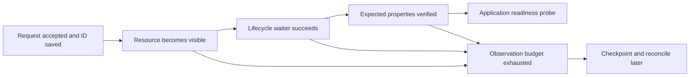

# Handle Cloud API Delays with Waiters and Read-After-Write Checks

Author: [nawazdhandala](https://www.github.com/nawazdhandala)

Tags: AWS, Cloud Automation, Reliability

Description: Replace guessed cloud provisioning delays with bounded state polling, explicit postconditions, durable resource IDs, and recovery for uncertain API outcomes.

A create request returns an instance identifier, but the next describe request says the instance does not exist. Adding a thirty-second sleep may hide the failure on one run and still fail on a slower day. Increasing the sleep wastes time without proving that the resource is ready.

Cloud automation should distinguish request acceptance, resource visibility, lifecycle state, and application readiness. These are separate observations. A waiter checks a defined condition repeatedly; a read-after-write check confirms the specific properties your workflow requires.

The example below observes an already-created EC2 instance. It performs no provisioning and uses Boto3 1.40.76 with Python 3.11.13. Its local tests exercised the real SDK waiter against stubbed service responses, not an AWS account.

## Know what eventual consistency means for the next call

AWS documents that the [EC2 API is eventually consistent](https://docs.aws.amazon.com/ec2/latest/devguide/eventual-consistency.html): a successful write may not be immediately visible to subsequent requests. A recently returned instance ID can temporarily produce `InvalidInstanceID.NotFound` in a describe call.

That does not make every missing-resource error harmless. A wrong account, wrong region, mistyped identifier, or deleted resource can produce superficially similar symptoms. Persist the account, region, operation identity, and returned resource ID before beginning observation. Restrict retries to the operation and error conditions for which delayed visibility is plausible.

A sleep measures elapsed time. It says nothing about whether the instance exists, has entered `running`, has the expected network placement, or can serve an application request.



Exhausting an observation budget is not an instruction to create another resource.

## Use the waiter for the condition it actually checks

The [InstanceRunning waiter](https://boto3.amazonaws.com/v1/documentation/api/latest/reference/services/ec2/waiter/InstanceRunning.html) polls `DescribeInstances`. In the pinned SDK model, `running` is success, `shutting-down`, `terminated`, and `stopping` are failure conditions, and `InvalidInstanceID.NotFound` is retryable.

Those rules are more useful than “try every exception again.” Permission failures need an authorization investigation; a terminal lifecycle transition needs a workflow decision. Neither is repaired by sleeping longer.

Supply an EC2 client for the verified destination account and region. The three remaining inputs come from the durable provisioning record: the exact instance ID, expected subnet ID, and a non-secret run identifier written as an `AutomationRun` tag.

```python
class ObservationIncomplete(RuntimeError):
    pass

def observe_instance(ec2, instance_id, subnet_id, run_id,
                     delay=5, max_attempts=36):
    ec2.get_waiter('instance_running').wait(
        InstanceIds=[instance_id],
        WaiterConfig={'Delay': delay, 'MaxAttempts': max_attempts},
    )
    response = ec2.describe_instances(InstanceIds=[instance_id])
    rows = [instance for reservation in response['Reservations']
            for instance in reservation['Instances']]
    if len(rows) != 1 or rows[0]['InstanceId'] != instance_id:
        raise ObservationIncomplete('Expected instance was not uniquely observed')
    instance = rows[0]
    tags = {tag['Key']: tag.get('Value', '') for tag in instance.get('Tags', [])}
    if (instance.get('State', {}).get('Name') != 'running'
            or instance.get('SubnetId') != subnet_id
            or tags.get('AutomationRun') != run_id):
        raise ObservationIncomplete('Instance postconditions are not confirmed')
    return instance
```

The default configuration makes at most 36 waiter polling attempts with a five-second interval. It is not a strict three-minute wall-clock deadline: network calls, service retries, and timeouts add time. Configure client connection/read timeouts and the surrounding job deadline as well.

The waiter handles the lifecycle state. The following explicit describe checks one exact instance, its subnet, and its run marker. This prevents a generic “something is running” result from completing the wrong workflow. The [DescribeInstances API](https://docs.aws.amazon.com/AWSEC2/latest/APIReference/API_DescribeInstances.html) documents the returned state, subnet, and tag fields.

`ObservationIncomplete` deliberately means the postconditions are unconfirmed. Tags or other properties may still be propagating, but they might also be genuinely wrong. Record the discrepancy and reconcile within a bounded policy; do not silently change the expected subnet or tag to match whatever was observed.

## Persist observations without confusing them with outcomes

At minimum, record operation ID, immutable request parameters, target account and region, resource ID, expected properties, current phase, last successful observation, and retry budget. Capture service request identifiers for diagnostics without logging secrets or full user-data payloads.

A useful phase sequence is `requested`, `identified`, `running-observed`, `properties-verified`, and `application-ready`. Keep the expected configuration separate from the latest observed configuration. Otherwise, a retry can accidentally redefine success by overwriting the desired values with a stale response.

If the worker stops after the waiter succeeds but before it saves completion, the replacement worker can re-observe the same instance. It should not repeat the create step merely because its local process memory disappeared.

## Handle uncertain creation separately from waiting

A creation request can time out after the service accepted it. This is different from a known resource taking time to become visible. For supported operations, persist an idempotency token before sending the request and reuse it with the same immutable parameters during recovery.

EC2 documents [client-token idempotency](https://docs.aws.amazon.com/ec2/latest/devguide/ec2-api-idempotency.html), including `RunInstances` behavior and parameter-mismatch errors. Its scope can depend on region and Availability Zone, so do not assume a token globally prevents duplicates across unrelated placements.

If the first response was lost, reconcile the original operation or retry it according to that documented contract. Generating a fresh token on every retry defeats the protection. Reusing the same token while changing intended parameters is also wrong: it turns a retry into a conflicting operation.

The observation function starts only after the workflow has identified the instance. It does not solve lost creation responses or supply an idempotency ledger by itself.

## Choose bounded retry behavior for each boundary

| Observation | Appropriate response |
|---|---|
| Fresh instance ID temporarily not found | Retry the documented observation within its budget |
| Instance remains pending | Continue state polling within the budget |
| Instance enters a terminal failure state | Stop this wait and evaluate the resource outcome |
| Authorization denied | Inspect credentials and policy; avoid an endless consistency retry |
| Waiter succeeds but marker differs | Keep the workflow unverified and reconcile expected properties |
| Application probe fails | Diagnose the application and its dependencies separately |

A custom poller should use bounded exponential backoff, jitter, and an explicit deadline when the SDK lacks a suitable waiter. Jitter randomizes retry timing so many workers do not hammer the API together. Respect service throttling and SDK retry behavior; nested retries can multiply calls and extend duration unexpectedly.

For batch provisioning, track each resource separately. One slow instance should not cause already-created resources to be created again. Preserve partial progress and report which resources are still unresolved.

## Prove readiness through the operation the user needs

An EC2 `running` state does not prove that startup scripts finished, credentials loaded, or the application can reach its database. After lifecycle and property checks, run a scoped application probe with its own timeout and expected result. Keep traffic gated until that probe succeeds.

Deletion has similar traps. The EC2 consistency guide warns that a not-found response following termination does not by itself establish that termination completed. Use the documented lifecycle observations and preserve ambiguous outcomes for reconciliation instead of treating any error as success.

Local tests covered pending-to-running, temporary not-found-to-running, terminal failure, authorization denial, exhausted attempts, and four postcondition mismatches. They used zero polling delay to keep tests fast; production defaults remain bounded state polling. No instance was created, started, or terminated. Rehearse real service delays and application readiness in a scoped account before relying on the workflow operationally.
