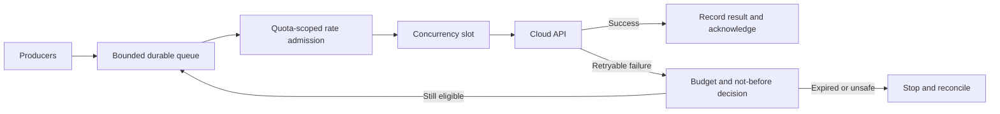

# Handle Cloud API Throttling with Queues, Retry-After, and Jitter

Author: [nawazdhandala](https://www.github.com/nawazdhandala)

Tags: Cloud Automation, Rate Limiting, Troubleshooting

Description: Coordinate queued cloud work, request rates, concurrency, server retry hints, and bounded jitter without turning throttling into a retry storm.

A worker receives HTTP 429, sleeps for a second, and retries. That looks reasonable until hundreds of workers do the same thing at the same time. The next burst arrives together, the API throttles again, and the queue grows while useful throughput falls.

Fixing this requires more than a delay loop. Control how much work enters the system, how many requests run simultaneously, and how retries consume the same capacity as original requests. Then honor the provider's retry guidance within a bounded operation budget.

## Find the limit you are actually hitting

Capture the provider request ID, operation, account or project, Region, status, service error code, and retry headers. Avoid recording credentials or complete request payloads. Distinguish throttling from authorization failures, invalid inputs, and an ambiguous network timeout after a write.

Do not classify every failure by HTTP status alone. SDKs can use service error codes such as `ThrottlingException` when deciding whether an error is retryable. Follow the SDK and service contract rather than treating every 4xx response as permanent or every failure as transient. [AWS retry behavior](https://docs.aws.amazon.com/sdkref/latest/guide/feature-retry-behavior.html).

Find the quota scope before partitioning work. Azure Resource Manager, for example, documents regional token buckets and subscription, principal, tenant, and global limits. Another resource provider can impose additional limits. A limiter attached to one worker does not coordinate the rest of the fleet. [Azure request limits](https://learn.microsoft.com/en-us/azure/azure-resource-manager/management/request-limits-and-throttling).

## Separate rate, concurrency, and queue capacity

A rate limit controls starts per unit time. A concurrency limit controls requests currently in flight. Queue capacity controls how much unfinished work can accumulate. You usually need all three.

For example, a maximum of ten simultaneous requests can still produce a very high request rate if each finishes quickly. Conversely, a modest rate can leave many requests in flight when the API slows down. Neither setting limits an unbounded producer queue.



Partition admission by the documented quota scope and workload priority. Reserve capacity for essential recovery or status checks. Do not let a large inventory sweep starve the operations needed to finish an incident. Count retries against the same request budget; otherwise they become an unmetered second workload.

Release a concurrency slot while a job waits for its next eligible time. Use a delayed queue or durable `not_before` record for long waits rather than keeping many worker threads asleep. Persist attempt count, operation identity, deadline, and reason for deferral so a restart does not reset the retry budget.

## Respect Retry-After without synchronizing every worker

HTTP `Retry-After` can contain a nonnegative number of seconds or an HTTP date. It describes how long the client should wait before a follow-up request. An implementation that accepts only integers misses valid date-based responses. [RFC 9110, Retry-After](https://www.rfc-editor.org/rfc/rfc9110.html#name-retry-after).

For Azure Resource Manager throttling, the documented response includes a wait in seconds. Retrying earlier produces another throttle response rather than useful work. Treat that delay as a minimum and consult the service's contract for any additional headers. [Azure throttling responses](https://learn.microsoft.com/en-us/azure/azure-resource-manager/management/request-limits-and-throttling#error-code).

Without a server delay, full jitter chooses a random wait between zero and an exponentially increasing cap. This spreads retries that would otherwise synchronize. With a server delay, the example below adds that jitter after the required wait. It caps only its own backoff component, not the server's delay. AWS explains why randomized backoff reduces synchronized contention in [Exponential Backoff and Jitter](https://aws.amazon.com/blogs/architecture/exponential-backoff-and-jitter/).

## Calculate a bounded next attempt

This Python 3.11 helper calculates a delay; it does not call an API or implement a queue. It assumes the caller has already decided that retrying the operation is safe. `retry_number=1` means the first retry after the initial request.

Supply an aware wall-clock time to interpret HTTP dates, a remaining attempt budget derived from a monotonic deadline, and a random sample from zero to one. Keep host clocks synchronized for date-based headers. Save the code as `delay.py`.

```python
from datetime import timezone
from email.utils import parsedate_to_datetime
import math
import re


def retry_delay(retry_number, retry_after, now, remaining,
                random_unit, request_budget=5.0):
    """Return seconds to wait, or None when this attempt cannot fit."""
    if type(retry_number) is not int or not 1 <= retry_number <= 30:
        raise ValueError('Invalid retry number')
    if now.tzinfo is None:
        raise ValueError('Timezone-aware wall clock required')
    if not all(math.isfinite(x) for x in (remaining, random_unit, request_budget)):
        raise ValueError('Finite budgets required')
    if remaining < 0 or request_budget <= 0 or not 0 <= random_unit <= 1:
        raise ValueError('Invalid budget or random sample')
    floor = 0.0
    if retry_after is not None:
        value = retry_after.strip()
        if re.fullmatch(r'[0-9]+', value):
            floor = float(int(value))
        else:
            date = parsedate_to_datetime(value)
            if date.tzinfo is None:
                date = date.replace(tzinfo=timezone.utc)
            floor = max(0.0, (date - now).total_seconds())
    window = min(30.0, 0.5 * (2 ** (retry_number - 1)))
    delay = floor + random_unit * window
    if not math.isfinite(delay) or delay + request_budget > remaining:
        return None
    return delay
```

Here, `request_budget` reserves time for the next request. The caller must enforce that timeout, cap total attempts, and recheck the remaining deadline after queue delays. The helper's 30-second cap, half-second base, and retry-number bound are example policy choices, not claimed SDK defaults.

Malformed headers raise an error rather than silently becoming an immediate retry. Handle that as an explicit diagnostic or a documented provider-specific fallback. An excessively long server delay should stop this attempt or defer it only if the operation's overall business deadline still permits it.

The HTTP-date parser comes from Python's [email utilities](https://docs.python.org/3.11/library/email.utils.html). For the legacy date form without timezone information, the helper interprets it as UTC. It is a scheduling example, not a complete HTTP client.

Try a deterministic local example:

```python
from datetime import datetime, timezone
from delay import retry_delay

now = datetime(2026, 11, 20, 12, tzinfo=timezone.utc)
print(retry_delay(2, '120', now, remaining=200, random_unit=0.5))
print(retry_delay(2, '120', now, remaining=60, random_unit=0.5))
```

The first call returns `120.5`; the second returns `None`. Neither sleeps. In production, pass a fresh random sample for each scheduling decision. Eighteen local tests covered numeric and date headers, past dates, capped jitter, deadline edges, malformed input, and invalid budgets. No live throttling was induced.

## Give retries one owner

Check whether your SDK already retries before adding an outer loop. If an SDK makes three attempts and an outer worker retries the call three times, one logical operation can create nine requests. Across several layers, this multiplication becomes hard to see.

Choose which layer owns immediate transport retries and which owns durable job rescheduling. Record both counts and impose a total operation deadline. Do not assume the configured attempt count means the same thing across SDKs or includes the initial request in the same way.

Pin and inspect your SDK version and configuration. The current AWS retry reference explicitly distinguishes new behavior behind `AWS_NEW_RETRIES_2026` from earlier behavior. Do not apply its new timing assumptions to an older installed client without checking support and configuration. [AWS SDK retry configuration](https://docs.aws.amazon.com/sdkref/latest/guide/feature-retry-behavior.html).

For mutating requests, a timeout can mean the server completed the operation but the response was lost. Preserve the same business operation ID and use documented idempotency tokens or authoritative reconciliation. More retries cannot repair an unsafe duplicate operation. AWS discusses this distinction in its [timeouts and retries guidance](https://aws.amazon.com/builders-library/timeouts-retries-and-backoff-with-jitter/).

## Tune for useful throughput

Watch completed operations per minute, queue age, in-flight requests, total attempts, server-directed wait time, and deadline failures. Track the affected quota scope so one overloaded tenant or resource is visible.

When throttling rises, reduce admitted work and inspect competing clients. Increasing worker count usually makes the problem worse. After recovery, raise the rate gradually while observing useful completions and latency. A low 429 count achieved by leaving important work stuck indefinitely is not success.

Finally, test restart and deadline behavior. A deferred job should retain its identity and retry count, and an expired operation should not reappear as fresh work. The goal is controlled progress: finite attempts, respected server delays, bounded outstanding work, and a clear outcome when the operation cannot finish safely.
