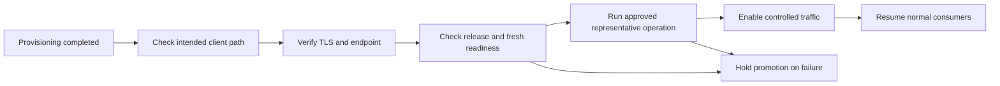

# Verify Data-Plane Readiness After Cloud Provisioning Succeeds

Author: [nawazdhandala](https://www.github.com/nawazdhandala)

Tags: Cloud Automation, Reliability, Monitoring

Description: Verify the intended release through its real access path after provisioning succeeds, using fresh readiness responses, TLS checks, and bounded promotion gates.

The cloud deployment reports success, but the application still cannot serve requests. Its process may be starting, its database connection may be failing, or the load balancer may still route to an older release.

A successful administrative operation is useful evidence. It is not a complete readiness test. Before promoting traffic or starting dependent work, verify the behavior that the next consumer actually needs.

## Distinguish configuration from use

The control plane creates and configures resources. The data plane performs the service's primary work. For example, creating a storage resource is an administrative operation; reading and writing its data exercises its function. AWS explains the distinction in [control planes and data planes](https://docs.aws.amazon.com/whitepapers/latest/aws-fault-isolation-boundaries/control-planes-and-data-planes.html).

Build a staged gate rather than one boolean copied from a deployment API:

| Gate | Evidence | Common false conclusion |
| --- | --- | --- |
| Provisioning | Expected resource and configuration exist | The application must be ready |
| Connectivity | Intended client can reach the endpoint securely | An open port proves useful service |
| Application readiness | Correct release and dependencies respond | Any HTTP 200 is enough |
| Representative operation | Required application behavior succeeds | A static health page proves data access |
| Controlled traffic | Expected behavior under a small real workload | One probe proves capacity for everyone |

The probe location matters. A check from the deployment runner may use a different route, DNS resolver, identity, or trust store from the real client. Run checks from the relevant client networks and identities, with access limited to the intended test operation.

## Define what the readiness endpoint promises

For a web service, define a narrow response contract. For example, your application's `/ready` endpoint could return the deployment identifier, a fresh probe identifier, a boolean readiness result, and the result of a bounded database check.

This is an application contract to implement, not a standard endpoint built into every cloud product. The server must actually perform the checks it reports. A database check might execute a harmless query using the application's connection configuration. It does not prove that every business transaction or migration is correct.

The server should echo the supplied probe identifier and prevent caching of readiness responses. This helps reject a stale response, but echoing a value alone is not proof that a dependency was queried. Keep detailed diagnostics in protected logs rather than exposing sensitive internals in a public endpoint.

Kubernetes also distinguishes startup, liveness, and readiness probes. A readiness failure controls eligibility to receive service traffic; it is not equivalent to a liveness failure that can trigger a restart. Design those checks for their separate purposes, following the [probe documentation](https://kubernetes.io/docs/concepts/workloads/pods/probes/).



## Probe a specific release with TLS verification

The following Python 3.11 helper expects the custom contract described above. It checks an HTTPS endpoint, rejects redirects, bounds the response size, and requires the exact deployment identifier. It makes one attempt; the deployment orchestrator controls repeated attempts and the overall deadline.

The optional `ca_file` points to your trusted internal certificate authority bundle. Omitting it uses the default trust configuration. Certificate and hostname verification remain enabled. See Python's [TLS context documentation](https://docs.python.org/3.11/library/ssl.html) and [HTTP request interfaces](https://docs.python.org/3.11/library/urllib.request.html).

Save this as `probe.py`:

```python
import json
import ssl
import uuid
from urllib.parse import urlsplit, urlunsplit, parse_qsl, urlencode
from urllib.request import Request, build_opener, HTTPSHandler, HTTPRedirectHandler


class NoRedirect(HTTPRedirectHandler):
    def redirect_request(self, req, fp, code, msg, headers, newurl):
        return None


def probe(url, expected_deployment, ca_file=None):
    parts = urlsplit(url)
    if parts.scheme != 'https' or not parts.hostname or parts.username:
        raise ValueError('Expected an HTTPS service endpoint without credentials')
    probe_id = str(uuid.uuid4())
    query = [(key, value) for key, value in parse_qsl(parts.query)
             if key != 'probe_id']
    query.append(('probe_id', probe_id))
    request_url = urlunsplit((parts.scheme, parts.netloc, parts.path,
                             urlencode(query), ''))
    context = ssl.create_default_context(cafile=ca_file)
    opener = build_opener(HTTPSHandler(context=context), NoRedirect())
    request = Request(request_url, headers={'Cache-Control': 'no-store',
                                           'Accept': 'application/json'})
    with opener.open(request, timeout=5) as response:
        if response.status != 200:
            raise ValueError('Expected HTTP 200')
        body = response.read(65537)
    if len(body) > 65536:
        raise ValueError('Readiness response too large')
    result = json.loads(body)
    if (result.get('deployment') != expected_deployment or
            result.get('probe_id') != probe_id or
            result.get('ready') is not True or
            result.get('checks', {}).get('database') is not True):
        raise ValueError('Readiness contract not satisfied')
    return {'deployment': expected_deployment, 'probe_id': probe_id,
            'ready': True}
```

Call `probe` with the real readiness URL, the deployment ID recorded by your release pipeline, and the trusted CA path if needed. A successful return includes `ready: True` and the probe ID to join with server-side evidence. A redirect, TLS failure, oversized body, malformed JSON, wrong release, stale probe ID, or failed required check prevents a successful return.

Redirect rejection matters because a login page or fallback route might otherwise return HTTP 200. If your application requires authentication for the probe, add its supported client authentication flow and test it explicitly; the example does not implement login or bypass access controls.

The five-second timeout applies to blocking network operations. It is not a strict end-to-end deadline for the entire rollout, and a bounded response length does not prevent a peer from sending bytes slowly. Enforce a total attempt and rollout budget in the supervising workflow as well.

## Test the operation the next step needs

A read-only readiness query may be enough before enabling reads, but not before resuming writers. For a write-dependent workflow, use an approved synthetic transaction in an isolated test namespace, with a unique marker and a documented cleanup policy.

Verify the marker through the same application path the consumer uses. For a queue, that can mean sending and observing a designated test message. For storage, it can mean writing and reading back a test object. These operations are real mutations, so choose their scope deliberately and keep them separate from ordinary customer data.

Check the result's identity as well as its status. An older deployment might be perfectly healthy while the new deployment never became reachable. The same principle applies to resource generations, database schemas, and tenant routing.

After these checks pass, enable controlled test traffic before resuming normal producers or writers. Observe errors, latency, and dependency behavior during that interval. A single successful probe is not a load test or a guarantee of sustained availability.

## Make failures actionable and bounded

Classify failures by layer. DNS resolution problems, certificate trust failures, authorization denials, dependency failures, and release mismatches need different responses. Do not solve them all by extending a sleep.

Retry only within a documented deadline and preserve the last failure plus the expected release and endpoint. Require a defined period or number of consecutive successful checks if the service can briefly appear ready during startup. Apply that policy consistently rather than resetting the deadline every time a worker restarts.

A failed readiness gate should hold promotion and preserve diagnostic access. It should not automatically destroy stateful resources or reverse a database migration. Decide whether to repair forward, restore routing to a known-good release, or follow a data-specific recovery procedure.

## Verify the probe itself

This helper was tested against a local HTTPS fixture with a temporary localhost certificate. Twelve cases covered a valid response, redirect, old deployment, stale probe ID, false readiness, failed database flag, string-valued readiness, malformed JSON, oversized response, untrusted certificate, hostname mismatch, and an HTTP URL.

Those are real local HTTP/TLS checks, not tests of a cloud deployment or database. The fixture's database flag was simulated. In staging, verify that the application's endpoint genuinely tests its dependencies and that the probe follows the intended client path. Then retain the provisioning evidence, readiness evidence, and controlled-traffic result together before allowing the next workflow step to proceed.
