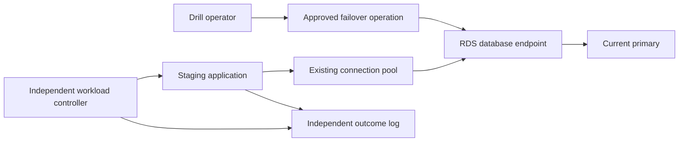

# Run a Database Failover Drill That Measures Application Recovery

Author: [nawazdhandala](https://www.github.com/nawazdhandala)

Tags: AWS, PostgreSQL, Reliability

Description: Build a staged RDS failover drill that checks application recovery, operation correctness, connection behavior, and sustained service under load.

A failover drill can look successful while proving very little. The database changes hosts, its status returns to available, and the operator closes the exercise. Meanwhile, an application worker may still hold unusable connections or a retry loop may submit the same operation twice.

Design the exercise around a business operation. For an order service, the question is whether a uniquely identified test order can be created, read back correctly, and reconciled after recovery. The database event is one observation within that test.

This example uses a disposable staging application and an Amazon RDS PostgreSQL **Multi-AZ DB instance**. It does not apply the same command to Aurora or Multi-AZ DB clusters. The application workload and acceptance thresholds are your own test contract, not provider guarantees.

## Define success before introducing the fault

Write a short hypothesis: “After an instance failover, the existing application processes recover without operator restarts, resume correct operations within our recovery target, and remain healthy at the agreed load.”

Replace the recovery target with a number your service owner accepts. Define an observation window and normal load as well. For example, a team might require five consecutive minutes within its existing latency and error objectives after recovery. That is a local acceptance rule, not a universal five-minute requirement.

| Check | Evidence to retain | Failure condition |
|---|---|---|
| Application recovery | Request outcomes and timing from the workload driver | Target exceeded or manual intervention required unexpectedly |
| Correctness | Operation IDs reconciled against authoritative stored results | Missing acknowledged operation or duplicate business effect |
| Connection recovery | Pool waiters, failed connections, new connections | Persistent exhaustion or uncontrolled connection creation |
| Workload stability | Completed operations, backlog, latency, database load | Errors improve only because offered load collapsed |
| Operational response | Alert receipt, acknowledgment, operator timeline | Failure remained invisible or recovery actions were unclear |

AWS recommends testing workload behavior as a whole under realistic conditions. Keep the experiment reproducible and retain its limits rather than treating one successful run as proof against every failure. [AWS reliability guidance](https://docs.aws.amazon.com/wellarchitected/latest/reliability-pillar/rel_testing_resiliency_failure_injection_resiliency.html).

## Build a representative but contained environment

Match production's driver version, pool settings, DNS configuration, TLS trust, authentication method, and network routing. A tiny staging database can test reconnection behavior, but it cannot establish production recovery capacity. Record those differences explicitly.

Use synthetic data and accounts that cannot call real payment, email, or fulfillment systems. Keep the workload controller and its evidence storage outside the database being failed over. Otherwise, the same fault can remove both the system and its witness.



Set a maximum request rate, maximum concurrent requests, and a way to stop the generator without restarting the application. Assign an operator who can halt the exercise if it reaches the wrong environment or exceeds the agreed resource limits.

## Verify the target before any disruptive command

The following examples use AWS CLI 2.38.1 syntax. Replace the profile, region, and identifier with values for the approved staging instance. First inspect the caller identity:

```bash
aws sts get-caller-identity \
  --profile staging-drill --region us-east-1 --no-cli-pager
```

Check the returned account and role against the exercise record. The profile's name alone is not evidence that it points to staging. [GetCallerIdentity reference](https://docs.aws.amazon.com/cli/latest/reference/sts/get-caller-identity.html).

Then inspect the exact instance:

```bash
aws rds describe-db-instances \
  --profile staging-drill --region us-east-1 \
  --db-instance-identifier staging-recovery-drill \
  --query 'DBInstances[].{Id:DBInstanceIdentifier,Arn:DBInstanceArn,Engine:Engine,Status:DBInstanceStatus,MultiAZ:MultiAZ,Cluster:DBClusterIdentifier,Endpoint:Endpoint.Address,Pending:PendingModifiedValues}' \
  --output json --no-cli-pager
```

Confirm the ARN identifies the approved account and region, the engine is PostgreSQL, `MultiAZ` is true, and the status is `available`. A populated cluster identifier means you must revisit the deployment scope instead of assuming this instance procedure is appropriate. Review pending modifications so the reboot does not unexpectedly combine a configuration change with the drill. [DescribeDBInstances reference](https://docs.aws.amazon.com/cli/latest/reference/rds/describe-db-instances.html).

## Establish the baseline and preserve application state

Run the synthetic operation through the application API, not just through a direct SQL client. Use one stable operation ID per intended action and distinct attempt IDs for retries. Log start time, completion time, outcome, and the returned business identifier without recording credentials or sensitive payloads.

The test should distinguish a request that failed before submission from one whose response was lost after submission. For the latter, query the operation's authoritative result using its stable identity before deciding whether to retry. An HTTP timeout alone cannot classify the stored outcome.

Let the existing application instances build their ordinary connection pools. Record a baseline at the intended test load. Do not restart them immediately before the failover: doing so discards the long-lived state the drill is supposed to exercise.

## Perform one controlled transition

AWS documents that rebooting with failover interrupts sessions abruptly and recommends stopping transactions beforehand to avoid possible data loss. For this first exercise, pause synthetic writers, let active work finish, and retain the application processes and pools. This tests reconnection and recovery after a quiesced transition; it deliberately does not prove handling of interrupted commits. [RDS reboot behavior and prerequisites](https://docs.aws.amazon.com/AmazonRDS/latest/UserGuide/USER_RebootInstance.html).

Only after the approved staging target and pause are confirmed, the disruptive operation is:

```bash
aws rds reboot-db-instance \
  --profile staging-drill --region us-east-1 \
  --db-instance-identifier staging-recovery-drill \
  --force-failover --no-cli-pager
```

This command causes an outage. Its response is not evidence of application recovery. The `--force-failover` option requires a Multi-AZ instance. Do not issue a second reboot simply because application requests remain unhealthy. [RebootDBInstance reference](https://docs.aws.amazon.com/cli/latest/reference/rds/reboot-db-instance.html).

Continue independent observation. Once service readiness checks allow it, resume a small amount of controlled test traffic through the unchanged application, then increase toward the agreed load. Track the first correct business operation and the beginning of the sustained healthy window.

The CLI's `db-instance-available` waiter checks database status. It does not submit application requests or reconcile outcomes, so it cannot be the exercise's completion condition. [Waiter reference](https://docs.aws.amazon.com/cli/latest/reference/rds/wait/db-instance-available.html).

## Reconcile outcomes before calling the drill successful

Compare the controller's intended operation IDs with authoritative application records. Every acknowledged success should have the expected effect. Investigate unknown outcomes individually; do not silently count them as failures or successes. Verify retry attempts did not create extra effects.

Review whether recovery required an operator to restart instances, clear queues, or change pool limits. Those interventions may restore service, but they disprove a hypothesis of automatic recovery. Preserve the original outcome and plan a new run after the fix.

For a later exercise, test interruption with operations in flight using explicitly disposable data and an approved risk boundary. That is a separate scenario with additional reconciliation requirements. Likewise, a planned instance reboot does not simulate a regional outage, credential failure, or every possible network partition.

Stop load generation if the abort criteria fire, preserve logs, and follow the agreed recovery procedure. “Abort” means stop adding experimental work; it does not magically undo an already requested failover.

The useful deliverable is a timeline tied to correct application outcomes, observed load, and documented interventions. Keep the drill as a repeatable check for driver, pool, and infrastructure changes, with each result stating exactly which recovery behavior was demonstrated.
