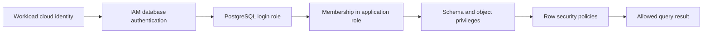

# Fix SQL Permission Errors After Cloud Database IAM Login

Author: [nawazdhandala](https://www.github.com/nawazdhandala)

Tags: PostgreSQL, Cloud, Troubleshooting

Description: Diagnose successful IAM login followed by denied PostgreSQL queries, then map workload identities to narrowly scoped database roles.

Your application opens a database connection using its cloud identity. The connection succeeds, but its first query returns “permission denied for schema” or “permission denied for table.” Adding another cloud administrator role is unlikely to fix the right problem.

Authentication proves who connected. Authorization decides what that identity may do. Cloud Identity and Access Management, or IAM, can handle the first step while PostgreSQL roles and object privileges govern the second. This tutorial uses **Cloud SQL for PostgreSQL with PostgreSQL 17 SQL syntax**. The diagnostic approach transfers to other managed databases, but identity names and cloud permissions do not necessarily transfer.

## Locate the failing boundary

First, distinguish a proxy listener opening from a successful database login. A proxy reporting that it is listening does not prove PostgreSQL accepted the user. Start with the application error and a fresh connection using the application's actual identity.

| Observation | Investigate first |
| --- | --- |
| Cannot reach the endpoint | Routing, DNS, listener, firewall, TLS |
| IAM login rejected | Token identity, login permission, registered database user |
| Login succeeds; schema access denied | Schema `USAGE` and effective role membership |
| Schema access succeeds; table read denied | Table or column privileges |
| Read succeeds; expected rows missing | Query filters and row security policies |
| Existing tables work; new tables fail | Object creator and default privileges |

Cloud SQL's [IAM login instructions](https://docs.cloud.google.com/sql/docs/postgres/iam-logins) describe the login prerequisites. Keep that investigation separate from granting access inside the database. A fresh session also avoids confusing the identity you intended to deploy with an older connection still held by the application pool.



The final result depends on every relevant layer, not simply the first successful check.

## Confirm the database identity

Run this read-only query through the same connection path and credentials as the application:

```sql
SELECT session_user,
       current_user,
       current_database(),
       current_schema();
```

`session_user` identifies the session's original user. `current_user` is the effective identity used for permission checks; it can differ after `SET ROLE` or inside a security-definer function. `current_database()` confirms that you are diagnosing the intended database. These are documented [PostgreSQL information functions](https://www.postgresql.org/docs/17/functions-info.html).

Record the returned identity exactly. Cloud SQL PostgreSQL service-account database usernames omit the `.gserviceaccount.com` suffix. For example, the cloud service account `report-worker@example-project.iam.gserviceaccount.com` maps to `report-worker@example-project.iam`. This is a provider-specific rule, not a general transformation for all database users. See [Cloud SQL IAM user management](https://docs.cloud.google.com/sql/docs/postgres/add-manage-iam-users).

Do not create an ordinary password-based role with a similar name to hide a missing IAM registration. Register the intended identity through the supported Cloud SQL workflow, then grant database permissions to that existing login role.

## Give the identity an application role

Separate the login identity from a reusable permission role. If the workload identity changes, its replacement can receive the same reviewed role without rebuilding every object grant.

Here is a deliberately narrow staging example. Prerequisites are an existing database named `appdb`, schema `reporting`, table `reporting.daily_totals`, and the registered service-account login shown below. Replace those names with approved objects. Connect to `appdb` as an administrator with authority to create the role, grant its membership, and grant privileges on these objects.

```sql
BEGIN;
CREATE ROLE reporting_reader NOLOGIN;
GRANT CONNECT ON DATABASE appdb TO reporting_reader;
GRANT USAGE ON SCHEMA reporting TO reporting_reader;
GRANT SELECT ON TABLE reporting.daily_totals TO reporting_reader;
GRANT reporting_reader TO "report-worker@example-project.iam"
  WITH INHERIT TRUE;
COMMIT;
```

This changes permissions; review it before applying. `NOLOGIN` makes `reporting_reader` a permission container rather than a new sign-in account. Schema `USAGE` permits access to objects by name, while the table grant authorizes reading this particular table. It does not authorize every table in the schema. Double quotes preserve the service-account role's punctuation.

The explicit membership inheritance setting means the login can use the permission role without issuing `SET ROLE` for ordinary reads. PostgreSQL 17 documents the [grant syntax](https://www.postgresql.org/docs/17/sql-grant.html) and [role membership behavior](https://www.postgresql.org/docs/17/role-membership.html). If the permission role already exists, inspect its grants instead of rerunning `CREATE ROLE` or assuming its name guarantees the intended access.

## Check effective privileges, then the real operation

Reconnect as the workload identity and inspect the effective permissions:

```sql
SELECT has_database_privilege(current_user, current_database(), 'CONNECT')
         AS can_connect,
       has_schema_privilege(current_user, 'reporting', 'USAGE')
         AS can_use_schema,
       has_table_privilege(current_user, 'reporting.daily_totals', 'SELECT')
         AS can_read,
       has_table_privilege(current_user, 'reporting.daily_totals', 'UPDATE')
         AS can_update;
```

For the intended reader, expect the first three results to be true and `can_update` to be false. An unexpected true result deserves investigation: another membership, a direct grant, or a grant to `PUBLIC` may supply additional access. These checks report effective privileges rather than only the grants added by this tutorial.

Then execute a bounded, approved application read against known staging data. A privilege function cannot prove that the application's query uses the expected object, returns the correct tenant's data, or satisfies every dependency of a view or function. Keep the test representative while avoiding sensitive output in shared incident logs.

## Explain missing rows and future-table failures

Table privileges do not override row-level security. Row-level security applies policies to individual rows; an enabled table without an applicable policy uses default-deny behavior. An owner or privileged test account may see different results from the application. Test with the real application identity rather than disabling policies to make a query return rows. See [PostgreSQL row security](https://www.postgresql.org/docs/17/ddl-rowsecurity.html).

For future tables, first decide whether the reader should automatically receive access. A dedicated reporting schema may justify that policy; a mixed schema containing confidential tables may not.

If every future table created by `reporting_owner` in `reporting` is intended for this reader, that owner, or an appropriately authorized administrator, can configure:

```sql
ALTER DEFAULT PRIVILEGES FOR ROLE reporting_owner IN SCHEMA reporting
  GRANT SELECT ON TABLES TO reporting_reader;
```

This affects future objects created by the named role. It does not repair existing tables, and another migration role's creations do not automatically follow these defaults. Confirm which effective role creates objects during migrations. PostgreSQL's [default privileges documentation](https://www.postgresql.org/docs/17/sql-alterdefaultprivileges.html) explains these boundaries.

Finally, record the identity-to-role mapping alongside migrations, and test both allowed reads and denied writes in staging. Keep cloud login permissions, SQL grants, and row policies reviewable as separate decisions. That makes the next permission error a traceable configuration issue instead of a reason to give the application administrator access.

The SQL examples were syntax-checked with a PostgreSQL 17 parser and reviewed against official documentation. No live IAM login or database permission changes were performed.
