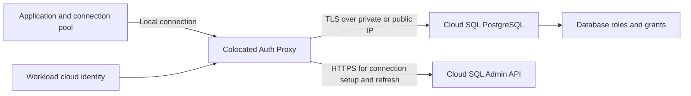

# Choose Between Private IP, an Auth Proxy, and Public Database TLS

Author: [nawazdhandala](https://www.github.com/nawazdhandala)

Tags: PostgreSQL, Cloud, Architecture

Description: Choose a Cloud SQL connection path by separating network reachability, TLS verification, cloud identity, and database permissions.

A database connection review often starts with three proposed solutions: use a private address, deploy an authentication proxy, or enable TLS on a public endpoint. These are not interchangeable answers. A private address determines where traffic can travel. TLS encrypts traffic and, when properly verified, confirms the server's identity. An authentication proxy can manage certificates and cloud authorization while using either a private or public address.

Start with those separate decisions, then choose a combination your team can operate. This article uses **Cloud SQL for PostgreSQL** and **Cloud SQL Auth Proxy 2.28.0** as a concrete example. Other products called “database proxies” can provide different features, especially connection pooling. Google's [connection options guide](https://docs.cloud.google.com/sql/docs/postgres/connection-options) describes the available Cloud SQL paths.

## Decide what must be private

Ask which machines need access: application servers, migration workers, incident responders, and disaster recovery environments. For each one, identify its network and how it reaches the database.

A private endpoint is useful when those workloads already have an approved private route. Installing a proxy on a laptop does not create that route. The tagged [proxy documentation](https://github.com/GoogleCloudPlatform/cloud-sql-proxy/blob/v2.28.0/README.md) explicitly leaves network configuration to the operator.

| Connection path | Appropriate starting point | Responsibility that remains |
| --- | --- | --- |
| Direct private connection with verified TLS | Workloads have private reachability and mature certificate management | Client trust, server-name verification, database authentication |
| Auth Proxy over private IP | Private reachability exists; managed connection certificates are desirable | Proxy identity, API access, process lifecycle, SQL permissions |
| Auth Proxy over public IP | Approved workloads lack a private route and policy permits this path | Public connectivity, identity restrictions, local listener protection |
| Direct public connection with verified TLS | A client cannot use the connector and its source network is controlled | Authorized networks, certificate lifecycle, database credentials |

Treat this table as a review aid, not a ranking. An incident response laptop and a production worker may legitimately use different paths, provided each has explicit ownership and restrictions.

For a direct public Cloud SQL connection, configure the required authorized networks for the actual source addresses. A changing outbound address can break access even when the database is healthy. Avoid broadening the allowlist merely to make the test pass. See Google's [authorized networks documentation](https://docs.cloud.google.com/sql/docs/postgres/authorize-networks).

## Understand the proxy's two connections

With a colocated proxy, the application connects locally while the proxy establishes the protected database connection. The proxy also needs access to Google's APIs.



The database-side connection and API access are separate firewall requirements. Cloud SQL documents TCP 443 for API access and TCP 3307 for the proxy's instance connection. Allowing only PostgreSQL's usual port 5432 does not cover this path.

The application-to-proxy hop is not encrypted by the proxy. Keep it within the intended local security boundary; do not expose a listener to other hosts as a shortcut. Also, the proxy does not pool connections: retain an appropriately bounded application pool. These behaviors are documented in [About the Cloud SQL Auth Proxy](https://docs.cloud.google.com/sql/docs/postgres/sql-proxy).

In containers, “local” needs a deliberate design. Containers sharing a network namespace can reach the same loopback listener; unrelated containers generally cannot. Document where the listener exists and which processes can access it before changing its bind address.

## A pinned private-IP proxy example

The following example assumes you have installed the official **2.28.0** binary as `./cloud-sql-proxy`. The host already has private reachability to the instance, the Cloud SQL Admin API is enabled, and Application Default Credentials resolve to an approved workload identity. Grant the required connection permission, commonly through the Cloud SQL Client role, at the appropriate scope.

Run this in a staging environment after replacing the instance connection name:

```bash
./cloud-sql-proxy --version

./cloud-sql-proxy \
  --address 127.0.0.1 \
  --port 15432 \
  --private-ip \
  'PROJECT_ID:REGION:INSTANCE_ID'
```

The first command should report version 2.28.0. The second starts a foreground listener on loopback port 15432 and selects the instance's private address. That port is an intentional local choice; it does not change the database's server port. Keep the process running while the staging application connects locally.

A listener starting successfully is only the first checkpoint. The application must still complete database login and an authorized query. Configure its database name and user through your existing protected configuration mechanism; do not put passwords into shell history. The [official connection walkthrough](https://docs.cloud.google.com/sql/docs/postgres/connect-auth-proxy) covers credential prerequisites and listener configuration.

This example does not enable automatic IAM database authentication. IAM means Identity and Access Management. Permission for the proxy to connect to an instance is distinct from permission to log into PostgreSQL and read tables. Automatic IAM login is an additional configuration choice, requiring the corresponding database identity and access setup. See [Cloud SQL IAM authentication](https://docs.cloud.google.com/sql/docs/postgres/iam-authentication).

## Direct TLS requires the right name, not just encryption

If you choose a direct connection, prepare a trusted certificate authority bundle and a hostname that matches the server certificate. A certificate authority, or CA, is the issuer the client trusts. A convenient internal alias is not automatically a valid certificate name.

Cloud SQL's CA mode matters. Its documentation describes DNS-name verification for shared and customer-managed CA modes; per-instance CA has different restrictions, including the Private Service Connect case. Confirm your instance's mode and its supported DNS name before adopting a generic connection string. Follow the [server identity verification procedure](https://docs.cloud.google.com/sql/docs/postgres/configure-ssl-instance#enable-server-identity-verification).

For PostgreSQL 17 clients, `sslmode=verify-full` verifies both the certificate chain and the hostname. Supply the intended CA through `sslrootcert`. Encryption alone is not equivalent to these checks. PostgreSQL's [TLS documentation](https://www.postgresql.org/docs/17/libpq-ssl.html) explains the distinction.

If the instance requires client certificates, provision those as well. Do not weaken verification to work around a hostname mismatch; correct the endpoint, certificate configuration, or connection method.

## Test the path you intend to operate

Use a staging application with the same identity mechanism, DNS configuration, and deployment layout as production. Record evidence at each boundary:

1. **Reachability:** the selected private or public path works from the actual workload location.
2. **Identity:** the intended workload credentials are in use, rather than an engineer's cached login.
3. **Database access:** a fresh connection can perform an approved read and is denied an operation outside its role.
4. **Lifecycle:** restarting the proxy and rebuilding application connections produces bounded recovery, without exhausting database capacity.
5. **Rotation:** certificate or identity renewal succeeds during a controlled rehearsal.

For a proxy deployment, include API availability in the test plan. Its ephemeral certificates require refresh; an initially working connection does not establish that future connections will work indefinitely when API access is blocked. For direct TLS, test the next trust bundle before retiring the previous one.

Finally, write down who owns each failure: network route, certificate trust, workload identity, SQL grants, and connection pool. This makes the architecture actionable. When login fails, the team can inspect the relevant boundary instead of replacing the entire connection path.

The commands here were checked against the pinned proxy binary's local help and official documentation. They were not connected to a live Cloud SQL instance.
