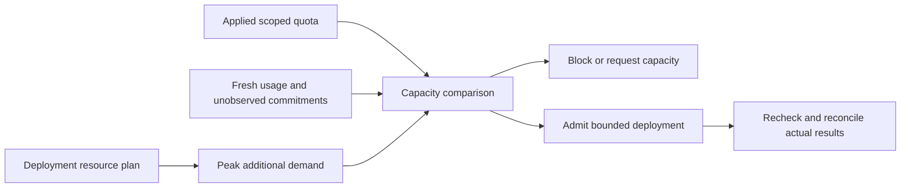

# Check Cloud Quotas Before Provisioning a Half-Built Environment

Author: [nawazdhandala](https://www.github.com/nawazdhandala)

Tags: AWS, Cloud Automation, Capacity Planning

Description: Check applied quotas, current usage, concurrent commitments, and rollout peaks before provisioning, while keeping recovery ready for unavoidable races.

A deployment creates its network, allocates storage, and then fails because the account cannot launch the required compute capacity. The environment is incomplete, but some resources are already running or billable.

Quota preflight checks move predictable failures earlier. They cannot guarantee provisioning success, but they can stop a deployment whose known demand already exceeds its allowed capacity. The useful result is an evidence-backed decision about a specific plan, account, Region, and point in time.

## Build a capacity bill for the deployment

Translate the desired environment into the units each service limits. An instance count is not always the quota unit. EC2 On-Demand quotas, for example, are expressed in virtual CPUs and grouped by instance families, per account and Region. Capacity Reservations also affect those quotas. See [EC2 On-Demand quota definitions](https://docs.aws.amazon.com/AWSEC2/latest/UserGuide/ec2-on-demand-instances.html#ec2-on-demand-instances-limits).

Include temporary deployment peaks. A replacement strategy that creates new instances before removing old ones needs capacity for the overlap. Count existing resources in current usage and additional resources in the rollout increment; do not count the old environment twice.

| Capacity category | What the preflight must identify |
| --- | --- |
| Compute | Correct family/purchase-model quota and peak additional units |
| Storage | Volume types, total provisioned capacity, and relevant request limits |
| Networking | Addresses, interfaces, gateways, and service-specific scope |
| Identity and platform services | Account-level resource counts and dependent services |
| Provisioning rate | API rate limits separately from resource capacity |

Do not treat this as a universal quota list. Derive it from the actual deployment graph and the services it provisions. A plan that passes its compute check can still fail on a required network or storage limit.

## Read the applied quota in the right scope

Use the account's applied quota, not a default copied from a documentation table. AWS Service Quotas distinguishes default values from applied overrides, and quota increases can take time or be denied. See [Service Quotas concepts](https://docs.aws.amazon.com/servicequotas/latest/userguide/intro.html).

`GetServiceQuota` returns the applied value where available. Some quotas do not expose an applied value through that operation. Missing data is an unresolved check, not unlimited capacity. Discover the correct service and quota identifiers through the service's quota listing and verify their names and scope. See [GetServiceQuota](https://docs.aws.amazon.com/servicequotas/2019-06-24/apireference/API_GetServiceQuota.html).

Record account identity, Region, service code, quota code, unit, observed limit, usage source, and observation time. An account-global quota must not be compared with usage from only one Region. Resource-level quotas may require a specific resource context. The example below intentionally handles a reviewed regional EC2 quota only.

## Include competing deployments without double counting

Use this planning equation:

```text
projected demand = observed usage
                 + committed demand not yet reflected in usage
                 + this plan's peak additional demand
                 + policy headroom
```

“Committed demand” means other admitted work expected to consume capacity. If that work has already appeared in observed usage, remove it from the additional commitment amount. Otherwise the same demand is counted twice.

Headroom is an explicit policy allowance for uncertainty and operational needs. It is not a magic percentage that makes stale data safe. Choose it per service and workload, and document why it is sufficient for the rollout.



## A local decision function and a read-only quota adapter

The following Python helpers use Boto3 **1.40.76**, matching local tests with Python 3.11. They do not launch resources. The quota adapter reads one regional EC2 quota through an authorized Service Quotas client; the decision function evaluates supplied observations.

Use the quota code and name discovered in your account. All numeric inputs must use that quota's unit. Supply timezone-aware observation times and a freshness limit appropriate to the source. This example's five-minute default is an illustrative policy, not an AWS data freshness guarantee.

```python
from decimal import Decimal


def amount(value):
    if value is None or isinstance(value, bool):
        raise ValueError('Missing or invalid capacity value')
    number = Decimal(str(value))
    if not number.is_finite() or number < 0:
        raise ValueError('Capacity must be finite and nonnegative')
    return number


def capacity_decision(quota, used, committed, additional_peak, margin,
                      observed_at, now, max_age_seconds=300):
    if observed_at.tzinfo is None or now.tzinfo is None:
        raise ValueError('Timezone-aware timestamps required')
    age = (now - observed_at).total_seconds()
    if age < 0 or age > max_age_seconds:
        raise ValueError('Usage observation is stale or in the future')
    limit, used, committed, peak, margin = map(
        amount, (quota, used, committed, additional_peak, margin))
    projected = used + committed + peak + margin
    return {'fits': projected <= limit,
            'projected': str(projected),
            'limit': str(limit),
            'remaining_after_plan': str(limit - projected)}


def regional_quota(client, quota_code, expected_name):
    quota = client.get_service_quota(
        ServiceCode='ec2', QuotaCode=quota_code)['Quota']
    if (quota.get('ServiceCode') != 'ec2' or
            quota.get('QuotaCode') != quota_code or
            quota.get('QuotaName') != expected_name or
            quota.get('GlobalQuota') is not False or
            quota.get('ErrorReason')):
        raise ValueError('Quota scope or identity is unconfirmed')
    return amount(quota.get('Value'))
```

For example, a limit of 64 units, observed usage of 32, other unobserved commitments of 8, a rollout increment of 16, and headroom of 8 exactly fit. Raising the increment to 17 fails the comparison. These numbers are examples, not your account's quota.

The helper rejects missing, negative, and non-finite capacity inputs, stale observations, and mismatched quota identity or scope. A permissions error propagates instead of becoming a successful check. It does not discover current usage or validate your mapping from instance types to quota groups.

A production usage adapter must follow the service's accounting rules, include all relevant pages, and state whether its source is delayed. Do not infer zero usage from an empty metric response. For capacity with incomplete telemetry, require a reliable inventory or treat the check as unresolved.

## Admit work carefully, then recheck

A successful comparison is not a reservation with the cloud provider. Another deployment or manual action can consume capacity immediately afterward. If several pipelines share a quota, coordinate their admission records using conditional updates or a transaction in your own scheduler.

That internal reservation reduces collisions among cooperating pipelines. It cannot constrain outside actors. Re-read important capacity observations close to the provisioning step, record each created resource, and retain recovery logic for partial failures.

Quotas are also different from physical availability. An EC2 request can fail because the requested capacity is unavailable even when the account's quota is sufficient. Handle these as distinct failure categories; AWS documents launch issues in [instance launch troubleshooting](https://docs.aws.amazon.com/AWSEC2/latest/UserGuide/troubleshooting-launch.html).

If a quota increase is needed, wait for the applied value to change and rerun the check. Submitting an increase request is not proof that capacity was approved. Plan increases ahead of deployment, following [EC2 service quota guidance](https://docs.aws.amazon.com/AWSEC2/latest/UserGuide/ec2-resource-limits.html).

## Report the reason, not just a red light

A blocked report should identify the quota, scope, observed usage, planned increment, headroom, shortfall, and observation time. That lets an operator choose between reducing the rollout, delaying competing work, or requesting an increase.

Also report unresolved checks separately from confirmed shortfalls. “Cannot read applied quota” is operationally different from “needs 72 units with a 64-unit limit.” Neither should be silently converted to approval.

Local validation exercised fifteen arithmetic, freshness, quota-response, and permission-error cases with stubbed SDK responses. No cloud usage was measured or resources provisioned. In staging, add concurrent admissions, delayed usage, partial creation, and failed cleanup. The goal is to eliminate known capacity failures before mutation while remaining honest about races and service conditions that only execution can reveal.
