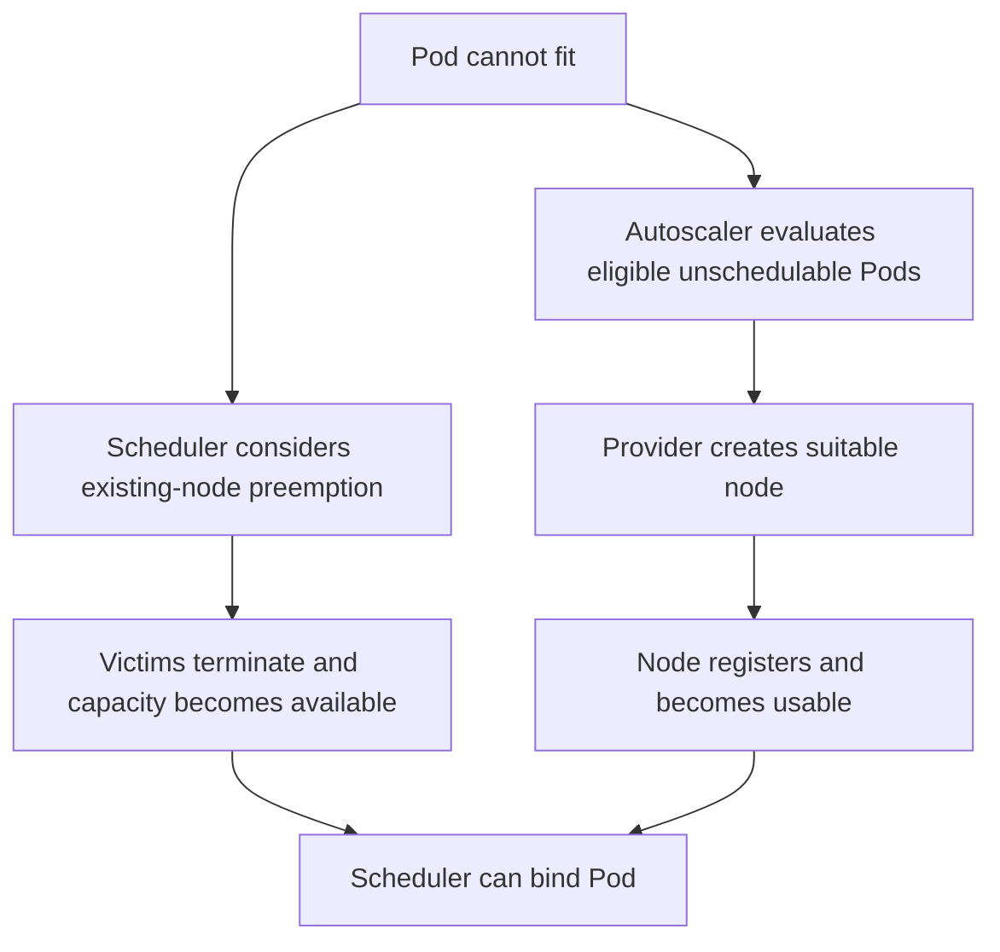

# Should Cluster Autoscaler Add Capacity Before Pod Preemption?

Author: [nawazdhandala](https://www.github.com/nawazdhandala)

Tags: Kubernetes, Cluster Autoscaler, Scheduling

Description: Understand why scheduler preemption can precede node scale-up, inspect autoscaler eligibility, and choose between waiting for capacity and maintaining headroom.

An important Pod arrives, lower-priority Pods are removed, and Cluster Autoscaler does not add a node first. That sequence is not necessarily an autoscaler failure. The scheduler and autoscaler solve related problems through separate control loops, and ordinary preemption does not wait for a cloud instance to become ready.

Decide which behavior the workload needs. It can wait for capacity without initiating preemption, or it can take available capacity from expendable work. If it needs both fast startup and low disruption, maintain suitable spare capacity rather than assuming two controllers will always choose your preferred order.

This guide reviews **Cluster Autoscaler 1.34.0** and **Kubernetes 1.34** behavior. Managed services can expose different settings or use another node provisioning system; inspect the actual component before applying these conclusions.

## Trace the two paths

When the scheduler cannot place a Pod, its preemption logic may identify lower-priority victims on an existing node. Cluster Autoscaler separately considers eligible unschedulable Pods and whether adding a node from a supported node group would help.



The diagram shows possible paths, not a synchronization contract. Provider provisioning, node bootstrap, networking, storage, and image availability can all take time after a scale-up decision.

The [pinned autoscaler FAQ](https://github.com/kubernetes/autoscaler/blob/cluster-autoscaler-1.34.0/cluster-autoscaler/FAQ.md#how-does-cluster-autoscaler-work-with-pod-priority-and-preemption) notes that Pods already waiting for lower-priority preemption do not trigger scale-up through the ordinary path. A nominated Pod can therefore wait while its victims shut down without causing a new node request for that Pod.

## Inspect the actual eligibility filter

In the [1.34.0 filter](https://github.com/kubernetes/autoscaler/blob/cluster-autoscaler-1.34.0/cluster-autoscaler/core/utils/expendable.go), Pods below the expendable-priority cutoff are excluded from scale-up consideration. A non-expendable Pod with a nominated node that still exists is separated as waiting for preemption. If the nominated node is gone, it stays in the other candidate set.

These distinctions prevent a misleading diagnosis based only on `Pending`. Capture the Pod and relevant autoscaler configuration:

```bash
kubectl --context staging -n workloads get pod REPLACE_WITH_POD -o yaml
kubectl --context staging -n workloads describe pod REPLACE_WITH_POD
kubectl --context staging -n kube-system get deployment REPLACE_WITH_AUTOSCALER -o yaml
```

Use the real namespace and controller name for your installation. Some managed services do not expose an editable Deployment; use their supported configuration interface instead.

Record numeric priority, `preemptionPolicy`, `status.nominatedNodeName`, recent scheduling events, and autoscaler logs around the same timestamps. Check the node group's maximum size, provider capacity or quotas, and whether its nodes would satisfy the Pod's constraints. A scale-up decision cannot manufacture an incompatible node type into a feasible placement.

## Do not reverse the meaning of delay settings

The following flags are source-verified for this autoscaler release:

| Setting | What it controls | What it does not do |
|---|---|---|
| `--new-pod-scale-up-delay` | Minimum Pod age before scale-up consideration | Delay scheduler preemption |
| `--scan-interval` | How often autoscaler reevaluates the cluster | Guarantee node readiness by that interval |
| `--expendable-pods-priority-cutoff` | Which low-priority Pods are excluded from scale-up demand | Set scheduler victim priority rules |

The [flag definitions](https://github.com/kubernetes/autoscaler/blob/cluster-autoscaler-1.34.0/cluster-autoscaler/config/flags/flags.go) set the new-Pod delay default to zero and the expendable cutoff to `-10`. The comparison is strictly below the cutoff: priority `-11` is expendable with that default, while `-10` is not excluded by this particular test.

Increasing the new-Pod delay gives the scheduler more time before autoscaler consideration. It does not mean “wait this long before preempting.” Making the scan interval shorter also cannot eliminate provider startup latency or override the nominated-Pod filter.

Change these settings only after identifying which interval actually dominates the observed startup time.

## Choose waiting when existing work must continue

A non-preempting PriorityClass lets an incoming Pod retain a queue priority while forbidding it from initiating lower-priority preemption:

```yaml
apiVersion: scheduling.k8s.io/v1
kind: PriorityClass
metadata:
  name: important-wait-for-capacity
value: 1000
globalDefault: false
preemptionPolicy: Never
description: "Important work waits for capacity instead of displacing running Pods."
```

This administrator-reviewed example uses an arbitrary local priority. Apply the intended class through the workload's Pod template; existing Pods do not change priority in place.

A Pod in this class can remain unschedulable and be considered for scale-up when it passes the autoscaler's other eligibility checks. That is not a promise that a node will be added: node-group limits, fit simulation, provider errors, and policy can still prevent it. It can also be preempted by a higher-priority Pod. The [Kubernetes non-preempting class documentation](https://kubernetes.io/docs/concepts/scheduling-eviction/pod-priority-preemption/#non-preempting-priorityclass) explains the direction of this setting.

This choice trades interruption of existing work for the incoming workload's potential wait. Make that tradeoff explicit in its startup objective.

## Keep headroom when waiting is unacceptable

If startup must be faster than provisioning, keep resources available on nodes that satisfy the workload's real placement constraints. Spare CPU on the wrong architecture or in the wrong volume zone is not useful headroom.

One documented approach uses low-priority placeholder Pods that request capacity and yield to important work. Their replacements create demand to replenish the reserve. The [autoscaler overprovisioning guide](https://github.com/kubernetes/autoscaler/blob/cluster-autoscaler-1.34.0/cluster-autoscaler/FAQ.md#how-can-i-configure-overprovisioning-with-cluster-autoscaler) describes this pattern. Keep placeholder priority compatible with the configured cutoff if those replacements are intended to trigger scale-up.

Headroom costs money and does not solve every topology constraint. Size it from measured burst demand and replenishment time, and ensure that placeholders do not compete with workloads they were meant to support.

## Measure the policy you selected

In staging, record Pod admission, scheduling failure, victim termination if applicable, autoscaler decision, node readiness, Pod assignment, and application readiness as separate timestamps. For a non-preempting workload, confirm that existing Pods retain their UIDs while the incoming Pod waits. For a headroom design, confirm that reserve capacity is replenished after a burst.

Local tests executed the tagged autoscaler filter against below-cutoff, cutoff-equal, existing-nomination, missing-node, and absent-priority cases. The PriorityClass example passed schema checks. No cloud scale-up or live scheduler timing was tested. Use the measured critical path to choose policy; do not expect an autoscaler timing flag to impose a global “scale first, preempt later” sequence.
