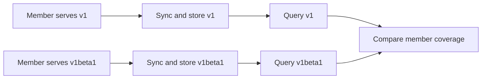

# Prevent Custom Resource Version Gaps in Clusterpedia Queries

Author: [nawazdhandala](https://www.github.com/nawazdhandala)

Tags: Kubernetes, Multi-Cluster, Troubleshooting

Description: Diagnose missing custom resources in Clusterpedia by checking served, synchronized, and queried API versions before changing collection policies.

A fleet-wide query returns objects from twelve clusters, but you imported thirteen. The request succeeded, the missing cluster is healthy, and its operator is running. Before investigating the database, check whether that cluster exposes a different version of the custom resource.

A custom resource is a Kubernetes API object added by a CustomResourceDefinition, or CRD. Its versions belong to that extension, independently of the Kubernetes server release. Upgrading Kubernetes does not automatically give every cluster the same CRD versions.

This guide targets **Clusterpedia v0.9.0** and the CRDs packaged with chart **2.7.0**. It uses a hypothetical namespaced resource, `widgets.inventory.example.com`, to make the version boundary visible. Replace that group, resource, namespace, and cluster names with your own. The local checks cover JSON filters and configuration schemas, not a running Clusterpedia installation.

## Separate three different version decisions

Start with this deliberately uneven fleet:

| Member | Member API serves | Clusterpedia synchronizes | A v1 search can cover |
| --- | --- | --- | --- |
| member-a | v1 | v1 | member-a objects |
| member-b | v1beta1 and v1 | v1beta1 only | No member-b objects from that synchronized version |
| member-c | v1beta1 | v1beta1 | No member-c objects from that synchronized version |

For custom resources, Clusterpedia does not automatically convert stored results from one version into another query version. Its [synchronization documentation](https://clusterpedia.io/docs/usage/sync-resources/) explicitly warns that a v1 query can omit resources synchronized as v1beta1.



There is also a separate storage-version setting in the member CRD. Kubernetes uses that setting when persisting custom objects in the member's own storage. It does not instruct Clusterpedia to convert its search results. Kubernetes may use a conversion webhook when serving different versions; review the [CRD versioning documentation](https://kubernetes.io/docs/tasks/extend-kubernetes/custom-resources/custom-resource-definition-versioning/) before changing that configuration.

## Inventory the actual served versions

Use a member context with permission to read the CRD. This command exposes version and scope information without dumping custom object contents:

```bash
kubectl --context MEMBER_CONTEXT get crd widgets.inventory.example.com -o json \
  | jq '{group: .spec.group, resource: .spec.names.plural,
      scope: .spec.scope,
      versions: [.spec.versions[] | {name, served, storage}],
      storedVersions: .status.storedVersions}'
```

`served: true` means the member offers that version through its API. `storage: true` identifies the current write format. `status.storedVersions` can retain historical storage versions and is not a list of searchable HTTP endpoints.

Confirm discovery, too:

```bash
kubectl --context MEMBER_CONTEXT get --raw='/apis/inventory.example.com'
kubectl --context MEMBER_CONTEXT get --raw='/apis/inventory.example.com/v1'
```

An absent version can return an error even though another version works. In the second response, find `widgets` and inspect its supported verbs. Use the same identity as the import process when diagnosing authorization; an administrator's successful request does not prove the import account can list and watch Widgets.

Record this evidence for every member expected in the report. A table with member name, served versions, selected versions, synchronization status, and a known object UID is more useful than one fleet-wide object count. A UID is Kubernetes' identifier for a particular object instance.

## Inspect what Clusterpedia actually selected

Read the PediaCluster from the hosting cluster:

```bash
kubectl --context HOST_CONTEXT get pediacluster member-b -o json \
  | jq '{requested: .spec.syncResources,
      sharedPolicy: .spec.syncResourcesRefName,
      observed: [.status.syncResources[]?
        | select(.group == "inventory.example.com")
        | .resources[]? | select(.name == "widgets")
        | .syncConditions[]?]}'
```

Inspect the referenced shared policy if one exists. Its list is combined with the local selection. In observed conditions, check the version, storage version, status, reason, and message. Missing status is evidence to investigate, not proof that an empty resource list was synchronized successfully.

The [v0.9.0 version negotiator](https://github.com/clusterpedia-io/clusterpedia/blob/v0.9.0/pkg/synchromanager/clustersynchro/resource_negotiator.go) intersects explicitly requested custom-resource versions with discovered supported versions. With no requested versions, it takes up to the first three supported versions. A requested list with no supported match is skipped with a logged reason. Therefore, accepting a PediaCluster manifest does not establish version coverage.

## Make the selection deliberate

For a member that serves both versions, this is a selection fragment:

```yaml
syncResources:
  - group: inventory.example.com
    resources: [widgets]
    versions: [v1beta1, v1]
```

Place it under `spec` in your reviewed PediaCluster configuration, preserving its credentials and all other intended resource selections. It is not a standalone Kubernetes object. If you manage selection through a shared policy, review its consumers before editing it.

Synchronizing both versions is useful during a transition, but it can increase collection and storage work. Choose it because clients need both representations. Do not assume the same setting enables v1 on member-c when its API only serves v1beta1.

For a single-version reporting contract, first establish that every participating member serves the chosen version and that conversion works where required. Then update collection, verify observations and results, and finally switch consumers. If some members must remain on the older extension release, report them separately or query both versions with explicit reconciliation.

## Query an exact version and compare identities

Use the hosting context for these raw paths. The Clusterpedia prefix routes the request through its aggregated API. The `clusters` parameter limits the comparison to one imported member, as documented in [multi-cluster search](https://clusterpedia.io/docs/usage/search/multi-cluster/).

For a small, quiet test namespace containing a known Widget, save both responses:

```bash
set -euo pipefail
umask 077
mkdir version-check
kubectl --context MEMBER_CONTEXT get \
  --raw='/apis/inventory.example.com/v1/namespaces/test/widgets' \
  > version-check/member.json
kubectl --context HOST_CONTEXT get \
  --raw='/apis/clusterpedia.io/v1beta1/resources/apis/inventory.example.com/v1/namespaces/test/widgets?clusters=member-b' \
  > version-check/search.json
```

The namespace must already exist and contain the expected test object. These are read-only requests; the protected output directory is new so an earlier evidence set is not overwritten. Responses may contain application data. Repeat with v1beta1 where that is the supported and synchronized version.

The following comparison requires complete, nonempty lists. It refuses continuation tokens rather than silently comparing only the first page:

```bash
jq -n --slurpfile member version-check/member.json \
  --slurpfile search version-check/search.json '
  def ids:
    if (.items | type) != "array" or (.metadata.continue // "") != ""
    then error("Expected a complete resource list")
    elif any(.items[]; (.metadata.uid | type) != "string"
        or .metadata.uid == "")
    then error("Missing object UID")
    else [.items[].metadata.uid] | unique end;
  ($member[0] | ids) as $wanted |
  ($search[0] | ids) as $found |
  if ($wanted | length) == 0 then error("Expected a known source object")
  else {missing: ($wanted - $found), unexpected: ($found - $wanted)} end'
```

Both arrays should be empty after synchronization catches up. This checks identity coverage for one member, namespace, resource, and version; it does not prove field equality or freshness. Inspect a known updated field separately. Because the reads are not a transactional snapshot, investigate concurrent creation or deletion before attributing every difference to Clusterpedia.

## Gate upgrades on coverage, not HTTP success

Keep a representative object in the acceptance test for each required member/version combination. Record missing rows as failures, including failures to fetch a response. Do not translate an API error into an empty JSON list.

During a CRD rollout, verify the member endpoint, import permissions, observed synchronization, and exact-version search in that order. Retire an old query version only after its consumers have moved and the new coverage checks pass. Never remove historical CRD storage-version entries merely to make the report look consistent; that is a separate Kubernetes data-migration procedure. Version-aware checks turn an apparently successful but incomplete fleet query into a diagnosable result.
